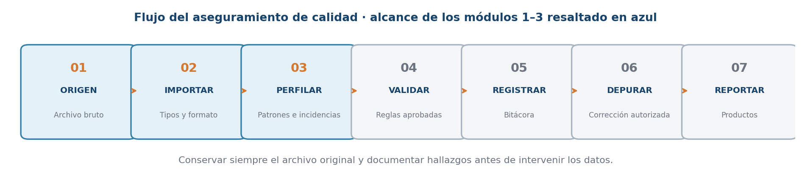
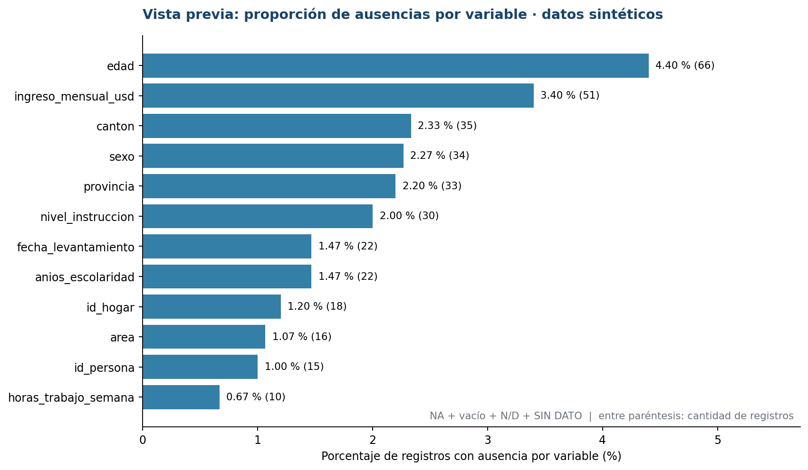
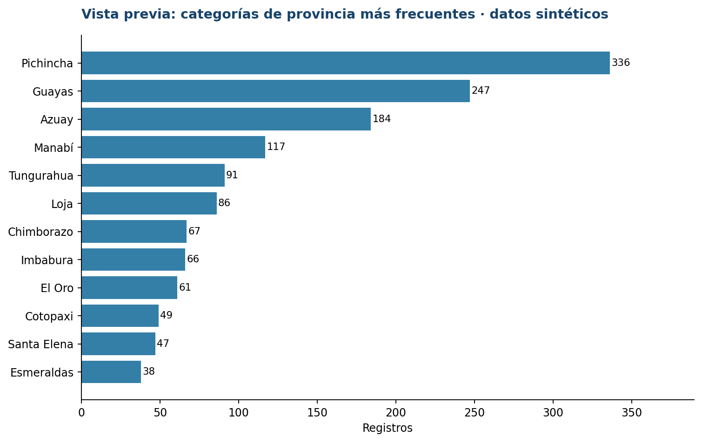
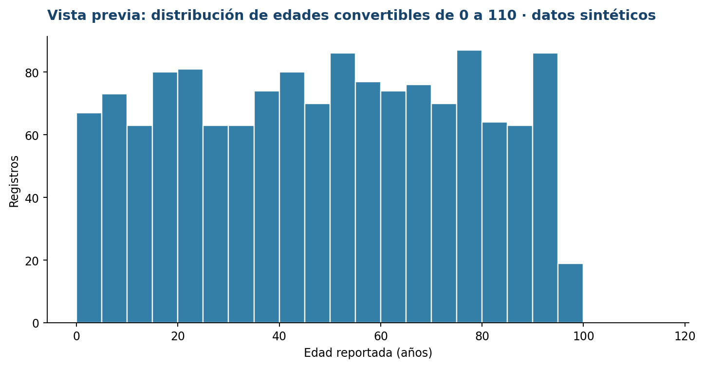

# Guía de estudio y laboratorio guiado
## Evaluación de archivos de datos y automatización de reportes de calidad en R

**Institución destinataria:** Instituto Nacional de Estadística y Censos (INEC)  
**Instructor:** Ing. Ángel Geovanny Cudco Pomagualli, PhD(c)  
**Alcance:** módulos 1, 2 y 3 del programa (6 horas, modalidad en línea)  
**Herramientas:** R, RStudio, `readr`, `dplyr`, `ggplot2` y `here`  
**Modalidad de trabajo:** construcción progresiva de un proyecto desde un archivo CSV sintético  
**Fecha de preparación:** noviembre de 2026

> **Principio del taller.** El propósito NO es ejecutar una solución acabada. El participante construye cada sección de un archivo `.R` mientras aprende qué pregunta responde, por qué se escribe y cómo interpretar la salida. Se conserva intacto el archivo fuente. Los scripts incluidos son material de consulta, no una ejecución previa.

> **Importante.** Los registros, las categorías, los umbrales ilustrativos y el diccionario del ejercicio son **sintéticos y didácticos**. No representan información oficial, reglas aprobadas ni metodología institucional del INEC. En un proceso real prevalece el diccionario y la normativa vigente de la operación estadística correspondiente.

---

## 1. Relación con las diapositivas del curso

Esta guía desarrolla el bloque **«Explorar» (módulos 01–03)** de la presentación *Servicio de capacitación en evaluación de archivos de datos y automatización de reportes de calidad en R*.

| Módulo | Diapositivas del PDF de referencia | Tema | Producto que construimos |
|---|---|---|---|
| 1 | pp. 3–5 (ruta general en p. 2) | Seis criterios de calidad, flujo de aseguramiento, proyecto RStudio | Carpeta de proyecto, `.Rproj`, script inicial y lectura del CSV |
| 2 | pp. 6–7 | Importación CSV/Excel/SPSS, tipos, codificaciones, diccionario y auditoría | Diagnóstico estructural y comparación contra diccionario |
| 3 | pp. 8–9 | Ausencias, blancos, duplicados, categorías atípicas y diagnóstico inicial | Perfil de variables, tabla de hallazgos y tres gráficos |

**Continuidad:** los módulos 4–6 usarán estos hallazgos para definir reglas, integridad y depuración controlada; los módulos 7–9 generarán indicadores, reportes Quarto y automatización. No adelantaremos correcciones ni informes finales en esta primera etapa.



### Objetivos de aprendizaje

Al completar las 6 horas, cada participante debe poder:

1. Explicar las seis dimensiones operativas de calidad de la presentación y distinguir *hallazgo* de *error confirmado*.
2. Crear un proyecto RStudio con carpetas y rutas relativas, sin depender de rutas absolutas de un equipo.
3. Importar un CSV sin perder identificadores, categorías ni marcadores especiales.
4. Contrastar nombres y tipos interpretativos de columnas con un diccionario de variables.
5. Contar ausencias, vacíos, repeticiones, categorías y valores no convertibles.
6. Elaborar tablas y gráficos descriptivos, documentando qué cuenta cada indicador.

---

## 2. El caso transversal: una base sintética de personas y hogares

Trabajaremos con `data_raw/personas_encuesta_sintetica_2026_10.csv`.

| Atributo | Descripción |
|---|---|
| Unidad de observación prevista | Registro de persona dentro de un ejemplo de levantamiento de hogares |
| Registros | **1.500** |
| Variables | **27** |
| Formato | CSV delimitado por coma, codificación UTF-8 |
| Periodo de referencia | Octubre de 2026, con algunas alteraciones intencionales |
| Cobertura ficticia | Ejemplos de varias provincias de Ecuador |
| Identificadores | `id_persona` (`P00001`, etc.) e `id_hogar` (`H00001`, etc.); no son cédulas reales |
| Datos problemáticos intencionales | `NA`, cadenas vacías, `N/D`, `SIN DATO`, claves duplicadas, categorías mal escritas, fechas y edades atípicas |

**Variables por bloques:** identificación (`id_persona`, `id_hogar`, `codigo_muestra`); ubicación (`provincia`, `canton`, `area`, `sector_censal`); levantamiento (`periodo_referencia`, `fecha_levantamiento`, `encuestador`); sociodemografía (`sexo`, `edad`, `estado_civil`, `nivel_instruccion`, `asiste_clases`, `anios_escolaridad`); actividad e ingresos (`condicion_actividad`, `actividad_principal`, `horas_trabajo_semana`, `ingreso_mensual_usd`); vivienda (`personas_hogar`, `habitaciones_hogar`, `tipo_vivienda`, `acceso_agua`, `acceso_internet`); y metadatos auxiliares (`peso_muestral`, `observaciones`).

El archivo `diccionario/diccionario_variables.csv` describe las 27 variables. Una parte del trabajo consistirá en **comparar el contenido real del CSV con esas descripciones**, sin suponer que los datos son correctos.

### 2.1. Pregunta inicial para los participantes

> Si una variable se llama `edad`, ¿podemos afirmar que todos sus valores son números solo porque el nombre sugiera una variable numérica?

No. Un CSV guarda representaciones textuales. Una misma columna puede mezclar `25`, `NA`, `N/D`, `treinta` o `145`. Primero se inspecciona la evidencia, luego se decide si la conversión es válida y qué hacer con cada valor.

### 2.2. Ejemplos de observaciones problemáticas

| Campo | Ejemplo | Pregunta de calidad |
|---|---|---|
| `id_persona` | `P00501` aparece dos veces | ¿Se repitió la clave o existe otra unidad de observación? |
| `edad` | `NA`, vacío, `N/D`, `treinta` | ¿Qué significa ausencia? ¿Qué valores no son convertibles? |
| `provincia` | `Pichincha`, `PICHINCHA`, `Pichincha ` | ¿Son equivalentes? ¿Qué transformación sería autorizable? |
| `ingreso_mensual_usd` | `450.00`, `-80.00`, `1.250,50` | ¿Qué convención decimal se empleó? ¿Qué valores son atípicos? |
| `fecha_levantamiento` | `2026-10-15`, `2026-13-01` | ¿El formato y el calendario son correctos? |
| `observaciones` | Celda vacía | ¿Es realmente un problema si el campo es opcional? |

Estos son **candidatos de revisión**, no decisiones automáticas de eliminación o imputación.

---

# MÓDULO 1 · Fundamentos de calidad de datos y entorno R

**Duración:** 2 horas. **Producto:** proyecto creado y primer script de lectura.

## 3. Conceptos fundamentales

### 3.1. Calidad de datos: ¿qué se comprueba?

Las diapositivas presentan seis criterios operativos:

| Criterio | Pregunta orientadora | Ejemplo en nuestro CSV |
|---|---|---|
| **Estructura** | ¿Existen las columnas, nombres, tipos y codificaciones esperados? | Comprobar que `edad` y `provincia` están presentes |
| **Completitud** | ¿Están informados los datos exigibles? | Revisar cuántas edades no están registradas |
| **Unicidad** | ¿La clave identifica una sola unidad cuando así debe ser? | Examinar `id_persona` repetidos |
| **Consistencia** | ¿Guardan coherencia las variables relacionadas? | Más adelante, contrastar actividad e ingreso |
| **Validez** | ¿El contenido cumple los dominios, rangos y formatos acordados? | Revisar si existen categorías fuera del catálogo |
| **Trazabilidad** | ¿Podemos reconstruir el origen y las decisiones adoptadas? | Conservar CSV original, script y bitácora |

**Precisión importante:** un valor no frecuente no es necesariamente erróneo; una edad ausente no necesariamente es un error; un identificador repetido puede requerir verificar el nivel de observación. La evidencia se registra antes de decidir.

### 3.2. Flujo de aseguramiento de calidad

De acuerdo con la presentación, el proceso es:

**Origen → Importar → Perfilar → Validar → Registrar → Depurar → Reportar.**

- **Origen:** identificar la fuente, el periodo, versión y responsable del archivo.
- **Importar:** leer datos conservando estructura y semántica.
- **Perfilar:** describir patrones y detectar posibles incidencias.
- **Validar:** aplicar reglas previamente definidas y aprobadas.
- **Registrar:** dejar evidencia de hallazgos, decisiones y versiones.
- **Depurar:** corregir de forma controlada y autorizada.
- **Reportar:** comunicar resultados, denominadores y limitaciones.

En este taller nos detenemos en **importar y perfilar**, apoyados por la organización del proyecto. Las validaciones formales y la depuración llegarán en los módulos siguientes.

### 3.3. ¿Qué es R y qué es RStudio?

- **R:** lenguaje y entorno para almacenar objetos, transformar datos, calcular estadísticas y producir gráficos. Un script `.R` contiene instrucciones reproducibles.
- **RStudio:** entorno de desarrollo que facilita escribir, ejecutar por bloques, inspeccionar datos, mostrar gráficos y organizar proyectos. RStudio utiliza una instalación de R.
- **`.R`:** archivo de código fuente; puede editarse, guardarse y revisarse.
- **`.Rproj`:** archivo de configuración que abre el proyecto en su carpeta y facilita trabajar con rutas relativas.
- **CSV:** archivo de texto tabular; no conserva por sí mismo todos los tipos estadísticos ni un diccionario de variables.
- **Paquete:** conjunto de funciones, como `readr` (importación), `dplyr` (tablas) o `ggplot2` (gráficos).

### 3.4. Fundamentos mínimos de R antes de importar

| Elemento | Código | Explicación |
|---|---|---|
| Asignación | `n <- 1500` | Guarda un número en el objeto `n` |
| Texto | `periodo <- "2026-10"` | Guarda una cadena en el objeto `periodo` |
| Lógico | `aprobado <- FALSE` | Guarda un valor verdadero o falso |
| Vector | `edades <- c(20, 21, 30)` | Agrupa varios elementos del mismo tipo básico |
| Acceso por posición | `edades[1]` | Obtiene el primer elemento (R comienza en 1) |
| Acceso por columna | `datos$provincia` | Extrae una columna de una tabla |
| Función | `length(edades)` | Calcula la cantidad de elementos del vector |
| Comentario | `# Esta línea explica el proceso` | El texto tras `#` no se ejecuta |
| Ausencia en R | `NA` | Representa un dato faltante reconocido por R |

Ejercicio rápido para escribir en la consola:

```r
# 1. Creamos variables de distintos tipos.
numero_registros <- 1500
nombre_curso <- "Calidad de datos en R"
es_sintetico <- TRUE

# 2. Creamos un vector y lo describimos.
edades_ejemplo <- c(18, 20, NA, 22)
length(edades_ejemplo)           # Hay cuatro posiciones.
mean(edades_ejemplo, na.rm = TRUE) # Excluye NA solo para este cálculo.
is.na(edades_ejemplo)           # Identifica qué posiciones son NA.

# 3. Identificamos clases de datos.
class(numero_registros)         # numeric
class(nombre_curso)            # character
class(es_sintetico)            # logical
```

**Para explicar al grupo:** `na.rm = TRUE` **no arregla** los datos. Solamente evita que los `NA` impidan el cálculo de esa estadística. La exclusión debe indicarse cuando se comunican resultados.

## 4. Taller guiado del módulo 1

### Paso 1. Crear la carpeta del proyecto

Puede utilizar la estructura que se entrega o construirla desde cero en RStudio. La carpeta final debe verse así:

```text
calidad_inec/
├── calidad_inec.Rproj
├── GUIA_ESTUDIO_MODULOS_1_3.md
├── data_raw/
│   └── personas_encuesta_sintetica_2026_10.csv
├── diccionario/
│   └── diccionario_variables.csv
├── R/
│   ├── 01_entorno_y_primera_lectura.R
│   ├── 02_importacion_y_estructura.R
│   ├── 03_perfilado_y_graficos.R
│   └── plantilla_para_construir_en_clase.R
├── figuras/
├── resultados/
└── reportes/
```

**Explicación de carpetas:** `data_raw/` contiene los datos originales y no se modifica; `diccionario/` guarda metadatos; `R/` contiene código; `figuras/` ofrece vistas previas para la clase; `resultados/` recibirá productos futuros; `reportes/` queda reservado para Quarto.

### Paso 2. Crear o abrir el `.Rproj`

**Si trabaja con el paquete descargado:** descomprima la carpeta y haga doble clic en `calidad_inec.Rproj` (o vaya a **File → Open Project** en RStudio).

**Si construye desde cero:** en RStudio seleccione **File → New Project → New Directory → New Project**, nombre `calidad_inec`, indique una carpeta de ubicación y confirme. RStudio creará el archivo `.Rproj`. Después agregue las carpetas anteriores y copie el CSV y el diccionario en las rutas correspondientes.

**Verificación visual:** el nombre del proyecto debe aparecer en RStudio; en el panel *Files* debe verse `data_raw/`. Evite copiar rutas de Windows del tipo `C:\Users\...` dentro del script.

### Paso 3. Crear un archivo `.R` para el laboratorio

En RStudio seleccione **File → New File → R Script** y guarde el archivo con **File → Save As** en `R/plantilla_para_construir_en_clase.R` (puede utilizar la plantilla incluida). Escribiremos las instrucciones **por secciones**, comentándolas. Para ejecutar solo la línea actual, use **Ctrl + Enter**; no es necesario ejecutar todo el archivo.

### Paso 4. Instalar y cargar paquetes

La instalación se efectúa **una sola vez**, cuando sea necesaria, desde la *Console*:

```r
# Solo en la consola y cuando los paquetes no están instalados:
install.packages(c("here", "readr", "dplyr", "ggplot2"))
```

En el script del proyecto se escriben las instrucciones de carga:

```r
# Herramientas que utilizará nuestro proyecto.
library(here)    # Construir rutas relativas.
library(readr)   # Leer CSV.
library(dplyr)   # Explorar y resumir datos.
```

**¿Cuál es la diferencia?** `install.packages()` descarga e instala un paquete en R; `library()` lo hace disponible durante la sesión. No se reinstalan paquetes en cada ejecución.

### Paso 5. Localizar el archivo, sin usar rutas absolutas

```r
# Ruta al CSV dentro del proyecto abierto.
archivo_csv <- here::here(
  "data_raw", "personas_encuesta_sintetica_2026_10.csv"
)

# Revisamos si existe antes de intentar importarlo.
file.exists(archivo_csv)

# Identificamos el directorio raíz que reconoce here.
here::here()
getwd()
```

**¿Qué aprender?** `here::here()` construye una ruta basada en el proyecto: funciona aunque otra persona tenga el proyecto en una carpeta distinta. `file.exists()` ayuda a reconocer errores de ubicación; idealmente devuelve `TRUE`.

### Paso 6. Importar el CSV por primera vez

```r
# Todas las columnas ingresan primero como texto.
# Esto evita perder identificadores o forzar tipos prematuramente.
# na = "NA" reconoce ese marcador; NO convierte "" en NA.
datos <- readr::read_csv(
  file = archivo_csv,
  col_types = readr::cols(.default = readr::col_character()),
  na = "NA",
  trim_ws = FALSE,       # Preserva espacios para auditoría.
  locale = readr::locale(encoding = "UTF-8"),
  show_col_types = FALSE
)
```

**Desglose del código:**

1. `datos <-` crea el objeto de trabajo sin sobrescribir el CSV.
2. `read_csv()` lee un archivo separado por comas.
3. `col_types = cols(.default = col_character())` preserva provisionalmente las columnas como texto para su auditoría; no afirma que todas *deban* ser texto.
4. `na = "NA"` reconoce únicamente el marcador literal `NA` como ausencia. Gracias a esto, podemos distinguirlo de celdas vacías y códigos `N/D`.
5. `trim_ws = FALSE` conserva espacios al inicio o al final para identificarlos en el perfilado.
6. `locale(encoding = "UTF-8")` indica la codificación esperada.
7. `show_col_types = FALSE` oculta el mensaje repetitivo de clases, pero no deshabilita controles.

### Paso 7. Hacer una primera lectura exploratoria

```r
# Responden preguntas distintas sobre el mismo objeto.
dim(datos)           # Dimensión: filas y columnas.
nrow(datos)          # Cantidad de registros.
ncol(datos)          # Cantidad de variables.
names(datos)         # Nombres de variables.
head(datos, 6)       # Seis primeras observaciones.
tail(datos, 3)       # Tres últimas observaciones.
str(datos)           # Clases y estructura interna.
dplyr::glimpse(datos) # Vista compacta de una tabla ancha.

# Selección de variables y frecuencias sencillas.
head(datos$provincia, 10)
table(datos$area, useNA = "ifany")
```

**Puntos de control del CSV entregado:** 1.500 filas, 27 columnas. Si aparece otra dimensión, compruebe que no seleccionó un CSV distinto, que el separador es correcto y que no omitió filas.

**Actividad 1 (10 minutos).** Identifique las variables que podrían ser identificadores, numéricas, categóricas y de fecha. Explique por qué las clases observadas son inicialmente `character`, aunque el diccionario declare clases interpretativas diferentes.

---

# MÓDULO 2 · Importación y evaluación estructural de archivos

**Duración:** 2 horas. **Producto:** revisión de estructura y diccionario de variables.

## 5. Conceptos de importación

### 5.1. ¿Por qué importa el formato del archivo?

| Formato | Paquete y función | Atención especial |
|---|---|---|
| CSV con coma | `readr::read_csv()` | Separador, codificación, decimales, cadenas vacías |
| CSV con punto y coma | `readr::read_csv2()` | Habitualmente usa `;` como separador y coma decimal |
| Excel (`.xlsx`) | `readxl::read_excel()` | Hoja, encabezados, celdas con tipos mixtos |
| SPSS (`.sav`) | `haven::read_sav()` | Etiquetas de variables/valores, códigos de ausencia |

**Importante:** solo se adjunta el archivo CSV para este taller. Los otros formatos se mencionan para explicar el alcance del módulo y se practicarán cuando se disponga de archivos apropiados.

El CSV suministrado usa **coma como separador y punto como decimal**. Por tanto, corresponde `read_csv()`, no `read_csv2()`.

### 5.2. Tipos de datos y su significado

En R son habituales `character` (texto), `integer` y `numeric` (números), `logical` (verdadero/falso) y `Date` (fecha). Sin embargo, **tipo de almacenamiento** y **tipo esperado por el diccionario** no son lo mismo. Para un primer diagnóstico conservamos texto y revisamos la posibilidad de convertir cada campo.

Ejemplo: `P00001` nunca debe convertirse a número para «facilitar cálculos»; es una clave. `edad`, por el contrario, debería ser representable como entero cuando hay un valor numérico interpretable.

### 5.3. Tres fuentes de defectos estructurales

1. **Esquema:** faltan columnas, aparecen columnas adicionales, hay nombres distintos o duplicados.
2. **Representación:** espacios sobrantes, distintos separadores, codificación incorrecta o formatos incompatibles.
3. **Semántica:** los códigos y categorías no significan lo que se esperaba; requieren diccionario y metodología.

La presentación propone comprobar `dim()`, `names()`, `str()`, `glimpse()` y `problems()`.

## 6. Taller guiado del módulo 2

### Paso 8. Comparar importación automática con importación controlada

```r
# Segunda lectura temporal para OBSERVAR la inferencia de tipos.
datos_auto <- readr::read_csv(
  archivo_csv,
  show_col_types = FALSE
)

# Estructura inferida automáticamente.
dplyr::glimpse(datos_auto)

# Problemas de análisis detectados por readr, si los hubo.
readr::problems(datos_auto)
```

**¿Qué ocurre?** `readr` intenta adivinar tipos. Como el CSV contiene valores heterogéneos, algunas variables que conceptualmente son numéricas podrían importarse como texto. `problems()` recoge ciertos problemas de lectura, pero **un resultado vacío no demuestra calidad perfecta**. Por eso mantenemos `datos` (lectura conservadora) como fuente de análisis.

### Paso 9. Consultar las primeras líneas textuales del CSV

```r
# Inspeccionamos cabecera y dos líneas de contenido tal como
# fueron almacenadas. No se convierte ninguna variable.
readLines(archivo_csv, n = 3, encoding = "UTF-8")
```

**Para conversar:** ¿cuántos separadores se esperan por registro? ¿Qué sucede si un campo trae una coma dentro del valor? El CSV debe emplear comillas correctas para no dividir ese valor en columnas adicionales.

### Paso 10. Cargar el diccionario de variables

```r
# El diccionario tiene una fila por variable esperada.
diccionario <- readr::read_csv(
  here::here("diccionario", "diccionario_variables.csv"),
  col_types = readr::cols(.default = readr::col_character()),
  na = "NA",
  show_col_types = FALSE
)

head(diccionario, 8)
names(diccionario)
```

**Columnas del diccionario:** `variable`, `descripcion`, `tipo_esperado`, `formato_esperado`, `dominio_referencia`, `obligatoria` y `control_exploratorio`.

**Diferencia crucial:** el campo `obligatoria` es una propuesta del ejercicio, no una determinación oficial. En datos reales la obligatoriedad puede variar según población, saltos de encuesta, periodo o diseño de formulario.

### Paso 11. Comparar las columnas contra el diccionario

```r
# Guardamos vectores de nombres.
columnas_observadas <- names(datos)
columnas_esperadas <- diccionario$variable

# Columnas definidas en el diccionario pero no en el CSV.
faltan_columnas <- setdiff(columnas_esperadas, columnas_observadas)

# Columnas del CSV que no constan en el diccionario.
columnas_extras <- setdiff(columnas_observadas, columnas_esperadas)

# Compara tanto nombres como orden.
orden_coincide <- identical(columnas_observadas, columnas_esperadas)

faltan_columnas
columnas_extras
orden_coincide
```

**Interpretación:** `character(0)` significa que no se detectaron elementos en esa diferencia. `identical()` verifica además el orden. Que todas las columnas estén presentes **no implica** que su contenido sea correcto.

### Paso 12. Construir una tabla estructural

```r
# vapply recorre las columnas y recupera la clase importada.
# Luego unimos los resultados con las declaraciones del diccionario.
tabla_estructura <- tibble::tibble(
  variable = names(datos),
  clase_importada = vapply(
    datos,
    function(x) class(x)[1],
    character(1)
  )
) %>%
  dplyr::left_join(
    diccionario %>%
      dplyr::select(variable, tipo_esperado, obligatoria, control_exploratorio),
    by = "variable"
  )

print(tabla_estructura, n = nrow(tabla_estructura))
```

**Explicación de operadores:** `%>%` envía el resultado de una operación a la siguiente; `left_join(..., by = "variable")` integra información del diccionario mediante el nombre de variable. **No estamos detectando un defecto porque una edad se almacene provisionalmente como texto:** esa fue una decisión de importación para evitar pérdida de información.

### Paso 13. Ensayar una conversión numérica sin alterar el original

```r
# Transformación solo en un vector auxiliar; el CSV queda intacto.
edad_num <- suppressWarnings(as.integer(datos$edad))

# Comparar textos de entrada con resultado convertido.
comparacion_edad <- datos %>%
  dplyr::transmute(
    id_persona,
    edad_original = edad,
    edad_convertida = suppressWarnings(as.integer(edad))
  )

head(comparacion_edad, 12)
```

`as.integer()` intenta convertir cadenas a números enteros. Si encuentra valores como `treinta` o `18,5`, la conversión puede producir `NA`. `suppressWarnings()` evita llenar la consola de avisos durante este ejercicio exploratorio, **pero nunca debe utilizarse para ocultar errores en un proceso de producción**. Se debe registrar cuáles valores no pudieron convertirse.

### Paso 14. Localizar las conversiones problemáticas

```r
# Identificamos registros cuyo valor está informado, no se ha
# declarado marcador especial y aun así no se convierte.
problemas_edad <- datos %>%
  dplyr::mutate(
    fila_csv = dplyr::row_number() + 1L,
    edad_num = suppressWarnings(as.integer(edad)),
    marcador = !is.na(edad) &
      toupper(trimws(edad)) %in% c("N/D", "SIN DATO")
  ) %>%
  dplyr::filter(
    !is.na(edad),
    trimws(edad) != "",
    !marcador,
    is.na(edad_num)
  ) %>%
  dplyr::select(fila_csv, id_persona, edad, edad_num)

print(problemas_edad, n = 20)
```

- `mutate()` crea columnas auxiliares.
- `row_number() + 1L` permite referirse aproximadamente a la línea física del CSV, considerando su encabezado.
- `trimws()` quita espacios al inicio y al final para la comparación; no modifica el original.
- `%in%` comprueba si un valor pertenece a un conjunto.
- `filter()` conserva solo las filas de interés.
- `select()` muestra las columnas que ayudan a investigar.

**Actividad 2 (15 minutos).** Explique la diferencia entre una fecha mal representada (`2026/10/11`), una fecha imposible (`2026-13-01`) y una fecha ausente. ¿Se resolverían todas con una misma regla?

---

# MÓDULO 3 · Perfilado y diagnóstico de calidad

**Duración:** 2 horas. **Producto:** tablas de ausencias, duplicación, categorías y gráficos descriptivos.

## 7. ¿Qué significa perfilar?

**Perfilar** consiste en caracterizar el contenido de un archivo antes de imponer correcciones. Según las diapositivas, debe distinguirse:

- **Ausencia de R:** `is.na(x)` identifica el valor `NA` que reconoce R.
- **Cadena vacía o solo espacios:** `trimws(x) == ""` indica que hay texto vacío o blanco, que no siempre equivale al valor `NA`.
- **Marcadores especiales:** `N/D`, `SIN DATO` u otros códigos; solo se consideran ausencias si el diccionario lo establece.
- **Duplicación:** `duplicated(id)` depende de la clave y de la unidad de observación elegida.
- **Categoría atípica:** una etiqueta poco frecuente o no homogénea necesita investigación; no se debe declarar automáticamente error.

### 7.1. ¿Qué vamos a medir?

| Medida | Definición para esta práctica | Denominador |
|---|---|---|
| `n_na` | Valores `NA` reconocidos por R | Conteo absoluto |
| `n_vacios` | Cadena vacía o solo espacios | Conteo absoluto |
| `n_marcadores` | `N/D` o `SIN DATO` | Conteo absoluto |
| `n_ausencias` | Suma de los tres grupos anteriores (mutuamente excluyentes) | Conteo absoluto |
| `% ausencias` | `100 × n_ausencias / número de registros` | 1.500 filas por variable |
| IDs repetidos adicionales | Suma de `n - 1` para cada clave repetida | Conteo absoluto, no porcentaje |
| Frecuencia por categoría | Número de registros con cada etiqueta observada | Conteo absoluto |

**Advertencia:** el porcentaje de ausencias sobre *todas* las filas es solo una primera descripción. Para medir **completitud de campos obligatorios** debe determinarse antes qué registros son aplicables según la metodología; ese control se abordará posteriormente.

## 8. Taller guiado del módulo 3

### Paso 15. Crear funciones simples para ausencias

```r
# Una función permite reutilizar una misma definición.
es_vacio <- function(x) {
  !is.na(x) & trimws(x) == ""
}

es_marcador <- function(x) {
  !is.na(x) & toupper(trimws(x)) %in% c("N/D", "SIN DATO")
}

# Prueba conceptual: distinguir los cuatro casos.
ejemplo <- c("25", NA, "", "N/D", "  ", "SIN DATO")
is.na(ejemplo)
es_vacio(ejemplo)
es_marcador(ejemplo)
```

**Explicación:** `function(x)` define un procedimiento reusable. `toupper()` transforma temporalmente a mayúsculas para comparar etiquetas. `&` exige que ambas condiciones sean verdaderas. Los grupos se definen sin solapamiento para no contar dos veces una misma celda.

### Paso 16. Calcular ausencias por variable

```r
# vapply aplica una operación a cada columna de 'datos'.
perfil <- tibble::tibble(
  variable = names(datos),
  registros = nrow(datos),
  n_na = vapply(datos, function(x) sum(is.na(x)), integer(1)),
  n_vacios = vapply(datos, function(x) sum(es_vacio(x)), integer(1)),
  n_marcadores = vapply(datos, function(x) sum(es_marcador(x)), integer(1))
) %>%
  dplyr::mutate(
    n_ausencias = n_na + n_vacios + n_marcadores,
    porcentaje = round(100 * n_ausencias / registros, 2)
  ) %>%
  dplyr::arrange(desc(porcentaje))

print(perfil, n = nrow(perfil))
```

**Interpretar cada línea:** `n_na` cuenta ausencias reconocidas; `n_vacios` detecta celdas sin contenido visible; `n_marcadores` busca códigos definidos para este ejercicio. `round(..., 2)` expresa los porcentajes con dos decimales. `arrange(desc(...))` ordena de mayor a menor y facilita priorizar inspecciones.

**Pregunta clave:** `observaciones` se diseñó como campo opcional y casi todas sus celdas pueden estar vacías. Un porcentaje de vacíos alto **no es, por sí solo, incumplimiento de calidad**. El dictamen depende de la obligatoriedad y aplicabilidad.

### Paso 17. Examinar duplicados por identificador

```r
# Excluir claves ausentes al contar repeticiones de valores válidos.
ids_repetidos <- datos %>%
  dplyr::filter(!is.na(id_persona), trimws(id_persona) != "") %>%
  dplyr::count(id_persona, name = "veces") %>%
  dplyr::filter(veces > 1) %>%
  dplyr::arrange(desc(veces), id_persona)

# Cuántos registros 'extra' hay respecto a una clave por persona.
n_repeticiones_adicionales <- sum(ids_repetidos$veces - 1L)

ids_repetidos
n_repeticiones_adicionales

# Diferencia: duplicados de la fila completa, en todas sus columnas.
sum(duplicated(datos))
```

**Interpretación:** un ID que aparece 3 veces genera **2 repeticiones adicionales**, aunque el conjunto de filas repetidas contenga 3 registros. `duplicated(datos)` exige igualdad de **todas** las columnas, por lo que mide otro fenómeno. **No se borran filas con `distinct()` en esta etapa.**

### Paso 18. Inspeccionar las filas asociadas a claves repetidas

```r
# Ver TODOS los registros implicados, no solo los segundos duplicados.
filas_ids_repetidos <- datos %>%
  dplyr::mutate(fila_csv = dplyr::row_number() + 1L) %>%
  dplyr::semi_join(ids_repetidos, by = "id_persona") %>%
  dplyr::arrange(id_persona, fila_csv) %>%
  dplyr::select(fila_csv, id_persona, id_hogar, provincia, edad)

print(filas_ids_repetidos, n = 30)
```

`semi_join()` permite mantener todas las filas del archivo original cuyo identificador aparece en la tabla de claves repetidas. El número de fila ayuda a localizar la observación en el CSV.

### Paso 19. Calcular frecuencias categóricas

```r
# count(..., sort = TRUE) resume categorías por frecuencia.
frecuencia_provincias <- datos %>%
  dplyr::count(provincia, sort = TRUE, name = "registros")

frecuencia_sexo <- datos %>%
  dplyr::count(sexo, sort = TRUE, name = "registros")

frecuencia_area <- datos %>%
  dplyr::count(area, sort = TRUE, name = "registros")

print(frecuencia_provincias, n = nrow(frecuencia_provincias))
print(frecuencia_sexo, n = nrow(frecuencia_sexo))
print(frecuencia_area, n = nrow(frecuencia_area))
```

**¿Qué buscar?** `Pichincha` frente a `PICHINCHA`, `Guayas` frente a `Guayas `, así como `F` o `99` en una variable donde el diccionario propone otras categorías. **No normalice aún**: primero documente la frecuencia y el contexto.

### Paso 20. Resumir numéricamente la edad con cuidado

```r
# La conversión se hace en una tabla AUXILIAR.
edades <- datos %>%
  dplyr::transmute(
    id_persona,
    edad_original = edad,
    edad_num = suppressWarnings(as.integer(edad)),
    no_convertible = !is.na(edad_original) &
      trimws(edad_original) != "" &
      !(toupper(trimws(edad_original)) %in% c("N/D", "SIN DATO")) &
      is.na(edad_num),
    extremo_ilustrativo = !is.na(edad_num) &
      (edad_num < 0 | edad_num > 110)
  )

# Contar candidatos a revisión sin calificarlos definitivamente.
edades %>%
  dplyr::summarise(
    no_convertibles = sum(no_convertible),
    extremos_para_revisar = sum(extremo_ilustrativo)
  )

# Para DESCRIBIR una distribución, usamos solo enteros en un rango
# ilustrativo. Esto NO equivale a limpiar ni a autorizar descartes.
resumen_edades <- edades %>%
  dplyr::filter(!is.na(edad_num), dplyr::between(edad_num, 0L, 110L)) %>%
  dplyr::summarise(
    n = dplyr::n(),
    media = round(mean(edad_num), 2),
    mediana = median(edad_num),
    minimo = min(edad_num),
    maximo = max(edad_num),
    desviacion_estandar = round(sd(edad_num), 2)
  )

resumen_edades
```

**Conceptos:** la media se afecta más por valores extremos; la mediana es otra medida de tendencia central. La desviación estándar describe dispersión. El filtro **0–110 es exclusivamente demostrativo** y debe justificarse en una aplicación real.

## 9. Gráficos descriptivos: del código a la interpretación

Las siguientes imágenes son **vistas previas elaboradas a partir del CSV sintético**; no son capturas de una ejecución del proyecto R. Su finalidad es mostrar qué gráficos construirán paso a paso los participantes.

### Gráfico 1. Variables con mayor frecuencia de ausencias



**Pregunta que responde:** ¿en qué variables aparecen más `NA`, vacíos y marcadores de ausencia? Para facilitar la lectura excluimos `observaciones`, cuyo campo es opcional y predominantemente vacío.

```r
# Seleccionamos las doce variables de mayor porcentaje de ausencia.
perfil_grafico <- perfil %>%
  dplyr::filter(variable != "observaciones") %>%
  dplyr::slice_max(order_by = porcentaje, n = 12, with_ties = FALSE)

# ggplot describe qué se grafica; geom_col dibuja los conteos
# o porcentajes YA calculados; coord_flip mejora etiquetas largas.
grafico_ausencias <- ggplot2::ggplot(
  perfil_grafico,
  ggplot2::aes(x = reorder(variable, porcentaje), y = porcentaje)
) +
  ggplot2::geom_col(fill = "#347FA7", width = 0.72) +
  ggplot2::coord_flip() +
  ggplot2::labs(
    title = "Ausencias por variable (datos sintéticos)",
    subtitle = "Incluye NA, vacíos y marcadores N/D y SIN DATO",
    x = "Variable", y = "Porcentaje (%)"
  ) +
  ggplot2::theme_minimal(base_size = 12)

# Mostrar el gráfico en el panel Plots de RStudio.
print(grafico_ausencias)
```

**Lectura del gráfico:** una barra grande indica más valores ausentes **según la definición utilizada**. No debe interpretarse automáticamente como un error grave sin revisar si la variable era aplicable y obligatoria.

### Gráfico 2. Categorías de provincia más frecuentes



**Pregunta que responde:** ¿qué categorías aparecen con más frecuencia y qué etiquetas merecen una revisión del catálogo?

```r
# Se conservan literalmente las etiquetas detectadas.
provincias_top <- frecuencia_provincias %>%
  dplyr::slice_head(n = 12) %>%
  dplyr::mutate(
    provincia = dplyr::if_else(
      is.na(provincia) | provincia == "", "(vacía/NA)", provincia
    )
  )

grafico_provincias <- ggplot2::ggplot(
  provincias_top,
  ggplot2::aes(x = reorder(provincia, registros), y = registros)
) +
  ggplot2::geom_col(fill = "#347FA7") +
  ggplot2::coord_flip() +
  ggplot2::labs(
    title = "Categorías de provincia (datos sintéticos)",
    x = "Categoría observada", y = "Registros"
  ) +
  ggplot2::theme_minimal(base_size = 12)

print(grafico_provincias)
```

**Precisión:** `geom_col()` toma las frecuencias ya calculadas con `count()`. No debe confundirse con `geom_bar()`, que por defecto cuenta registros a partir de observaciones individuales.

### Gráfico 3. Distribución de edad



**Pregunta que responde:** ¿cómo se distribuyen las edades numéricas utilizables para este ejercicio ilustrativo?

```r
# Los intervalos del histograma agrupan edades de cinco en cinco.
grafico_edades <- edades %>%
  dplyr::filter(!is.na(edad_num), dplyr::between(edad_num, 0L, 110L)) %>%
  ggplot2::ggplot(ggplot2::aes(x = edad_num)) +
  ggplot2::geom_histogram(
    binwidth = 5, boundary = 0,
    fill = "#347FA7", color = "white"
  ) +
  ggplot2::labs(
    title = "Distribución descriptiva de edades",
    subtitle = "Rango 0–110 utilizado solo con fines didácticos",
    x = "Edad (años)", y = "Registros"
  ) +
  ggplot2::theme_minimal(base_size = 12)

print(grafico_edades)
```

**Cómo interpretarlo:** las barras permiten identificar concentraciones y posibles extremos. Los registros que no pudieron convertirse a entero o no quedaron en el rango ilustrativo **no desaparecen de la fuente**; solo quedan fuera de esta visualización particular.

### Paso 21. Construir una primera tabla de hallazgos

```r
# Los conteos no son categorías mutuamente excluyentes:
# una misma fila podría presentar varios problemas simultáneamente.
incidencias_iniciales <- tibble::tibble(
  hallazgo = c(
    "Ausencias en edad",
    "Repeticiones adicionales de id_persona",
    "Edades no convertibles",
    "Edades fuera de 0–110 (ilustrativo)"
  ),
  total = c(
    perfil$n_ausencias[perfil$variable == "edad"],
    n_repeticiones_adicionales,
    sum(edades$no_convertible),
    sum(edades$extremo_ilustrativo)
  )
)

incidencias_iniciales
```

**Interpretación:** un *hallazgo* es un evento que merece estudio. Más adelante, una regla aprobada determinará cuándo es error, advertencia o excepción justificada. Los conteos no deben sumarse como «registros distintos afectados», pues las incidencias pueden coexistir en una fila.

---

## 10. Comprobaciones de aprendizaje con el CSV entregado

Los siguientes valores describen **exclusivamente** el conjunto sintético preparado para el taller. No son cifras del INEC, ni resultados de una ejecución R de la guía:

| Comprobación | Valor de referencia | Instrucción R relacionada |
|---|---:|---|
| Número de filas | **1.500** | `nrow(datos)` |
| Número de variables | **27** | `ncol(datos)` |
| Ausencias de `edad` (NA + vacío + marcadores) | **66** | `perfil` |
| Ausencias de `ingreso_mensual_usd` | **51** | `perfil` |
| Identificadores `id_persona` repetidos adicionales | **20** | `n_repeticiones_adicionales` |

Si no obtiene estos valores, compruebe si leyó el archivo indicado, si conservó las columnas como texto, si `na = "NA"` se escribió como se mostró y si está usando la misma definición de marcador de ausencia. Una diferencia es una oportunidad de revisar el procedimiento, no una razón para modificar el archivo original.

---

## 11. Dinámica recomendada para las 6 horas

| Bloque | Duración | Actividad del instructor | Evidencia del participante |
|---|---:|---|---|
| M1. Conceptos | 35 min | Seis dimensiones, ejemplos de incidencias y flujo | Respuestas a casos de interpretación |
| M1. Entorno | 25 min | Crear `.Rproj`, carpetas y script | Proyecto y primera importación |
| M1. Práctica | 60 min | Acompañar lectura, funciones básicas y preguntas | Dimensiones y exploración del CSV |
| M2. Conceptos | 35 min | CSV, tipos, encoding y diccionario | Diferenciación de esquemas y valores |
| M2. Práctica | 85 min | Comparación de importaciones y auditoría | Tabla estructural y conversiones problemáticas |
| M3. Conceptos | 30 min | Ausencias, duplicados y categorías | Definiciones de indicadores |
| M3. Práctica | 90 min | Construir perfil, frecuencias y gráficos | Tablas y tres visualizaciones |

**Recomendación para enseñanza en línea:** el instructor comparte pantalla y escribe instrucciones por bloques. Los participantes reproducen cada bloque antes de avanzar. Después de cada bloque, se solicita la interpretación verbal de la salida y se revisan errores comunes.

---

## 12. Actividad integradora de cierre (módulos 1–3)

**Consigna:** continuar el mismo proyecto sin editar el CSV fuente. Entregar el `.R` construido hasta el paso 21 y una breve explicación de los resultados observados en su propia sesión de RStudio.

1. Explique las diferencias entre R, RStudio, CSV, `.R` y `.Rproj`.
2. Identifique tres variables numéricas conceptuales que se importaron como texto y justifique la decisión.
3. Informe dimensiones, nombres y tipos de las variables del CSV.
4. Calcule el número de `NA`, vacíos y marcadores especiales de `edad`, `sexo` e `ingreso_mensual_usd`.
5. Identifique claves de persona repetidas y explique la diferencia entre repeticiones de clave y filas iguales.
6. Presente un cuadro de frecuencias de `provincia` e indique dos categorías que ameritan verificación.
7. Elabore un gráfico de ausencias y otro de distribución de edad; interprete sus ejes y denominadores.
8. Distinga entre: «dato ausente», «valor atípico», «formato no convertible», «incidencia» y «error confirmado».

### Lista de verificación

- [ ] El archivo `.Rproj` abre correctamente y las rutas utilizan `here::here()`.
- [ ] El CSV original está en `data_raw/` y no ha sido sobrescrito.
- [ ] El código contiene comentarios que explican cada etapa.
- [ ] Se han comprobado las 27 variables y consultado el diccionario.
- [ ] El perfil distingue `NA`, vacíos y marcadores especiales.
- [ ] Se identifican duplicados por clave, sin borrar ninguna fila.
- [ ] Se visualizan frecuencias y distribuciones con títulos y ejes claros.
- [ ] Las conclusiones se limitan a hallazgos exploratorios, sin aprobar correcciones.

---

## 13. Errores frecuentes en el laboratorio

| Situación | Causa probable | Qué revisar |
|---|---|---|
| `object 'datos' not found` | No ha importado la base en la sesión actual | Volver al paso 6 y ejecutar solo ese bloque |
| `No such file or directory` | No se abrió el `.Rproj` correcto o falta `data_raw/` | Verificar proyecto, `here::here()` y `file.exists()` |
| El archivo aparece en una sola columna | Se usó separador incorrecto | El CSV entregado está separado por **coma** |
| `edad` aparece como `character` | Importación conservadora deliberada | No es un error de importación; se evalúa después |
| `mean(datos$edad)` produce error | Edad es texto | Construir `edad_num` y declarar qué filas se consideran |
| `NA` y vacío parecen iguales | La importación automática convirtió ambos en `NA` | Usar `na = "NA"` según el taller y explicar la convención |
| Una categoría tiene pocos registros | Posible valor raro o codificación distinta | Comparar con diccionario antes de declarar error |
| `could not find function 'ggplot'` | No se cargó `ggplot2` | Ejecutar `library(ggplot2)` |
| Se pierden objetos al reiniciar RStudio | Los objetos existen en la memoria de la sesión | Recorrer los scripts de los módulos anteriores en orden |

---

## 14. Continuación prevista para el resto del curso

Al concluir estas tres sesiones, el proyecto estará listo para avanzar de **diagnóstico** a **control**: en el módulo 4 se propondrán reglas de obligatoriedad, dominio, rango y formato; en el módulo 5 se revisará coherencia entre variables e integridad referencial; en el módulo 6 se documentarán decisiones y depuración controlada. Los módulos 7–9 reutilizarán las tablas y gráficos para generar métricas, un documento Quarto y una ejecución automatizable.

**No se adelanta esa automatización aquí:** primero se debe conocer el significado de cada columna, comprobar la forma de lectura y comprender las incidencias.

## 15. Archivos incluidos y uso sugerido

| Archivo | Para qué sirve | Cuándo usarlo |
|---|---|---|
| `calidad_inec.Rproj` | Abre el proyecto en RStudio | Inicio de la primera sesión |
| `data_raw/personas_encuesta_sintetica_2026_10.csv` | Fuente con incidencias ficticias | En todas las sesiones; conservar intacta |
| `diccionario/diccionario_variables.csv` | Esquema y metadatos del ejemplo | Módulos 2–3 |
| `R/plantilla_para_construir_en_clase.R` | Guion incompleto con comentarios `TODO` | Archivo principal que completa el participante |
| `R/01_entorno_y_primera_lectura.R` | Código comentado de referencia | Consulta módulo 1 |
| `R/02_importacion_y_estructura.R` | Código comentado de referencia | Consulta módulo 2 |
| `R/03_perfilado_y_graficos.R` | Código comentado de referencia | Consulta módulo 3 |
| `figuras/*.png` | Figuras de referencia para discutir en clase | Introducción y análisis de gráficos |
| `resultados/` | Carpeta vacía para futuras salidas controladas | Talleres posteriores |
| `reportes/` | Carpeta reservada a Quarto | Módulo 8 |

### Referencias de apoyo indicadas en las diapositivas

- Instituto Nacional de Estadística y Censos. (2018). *Marco de aseguramiento de la calidad estadística*. <https://www.ecuadorencifras.gob.ec/documentos/web-inec/Sistema_Estadistico_Nacional/Aseguramiento_de_la_calidad/Marco_Aseguramiento_Calidad.pdf>
- Posit. *RStudio Projects*. <https://docs.posit.co/ide/user/ide/guide/code/projects.html>
- Tidyverse. *readr: Read rectangular text data*. <https://readr.tidyverse.org/>
- Tidyverse. *dplyr*. <https://dplyr.tidyverse.org/>
- Wickham, H., Çetinkaya-Rundel, M., & Grolemund, G. (2023). *R for Data Science (2e).* <https://r4ds.hadley.nz/>
- Wickham, H. *ggplot2*. <https://ggplot2-book.org/>

---

**Cierre pedagógico:** al finalizar los módulos 1–3 no esperamos «datos limpios». Esperamos un archivo de origen preservado, un proyecto de RStudio organizado, código documentado y evidencia descriptiva suficiente para discutir las reglas de calidad en las siguientes sesiones.

---

## 16. Cuaderno de 15 actividades y solucionario complementario

Para desarrollar la práctica como ejercicios separados se incorpora material adicional:

- [Actividades propuestas para participantes](actividades/ACTIVIDADES_PROPUESTAS_PARTICIPANTE.md): quince actividades distribuidas en los tres primeros módulos, con consignas, preguntas de análisis, evidencias y rúbrica.
- [Script de actividades incompleto](R/ACTIVIDADES_PARA_COMPLETAR.R): archivo `.R` para construir progresivamente durante la sesión.
- [Solucionario docente comentado](actividades/SOLUCIONARIO_DOCENTE_COMENTADO.md): respuestas, código completo por actividad e interpretación de los hallazgos.
- [Script integrado con las quince soluciones](R/SOLUCIONARIO_15_ACTIVIDADES.R): versión de consulta para el instructor, **no destinada a ejecución automática al inicio**.

La guía principal sigue siendo la ruta teórico-práctica; el cuaderno convierte esa ruta en evaluaciones formativas de aula. El original CSV permanece inalterado.
