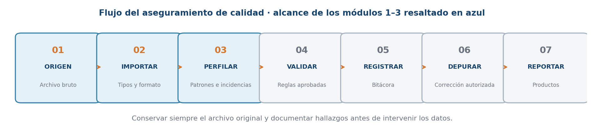
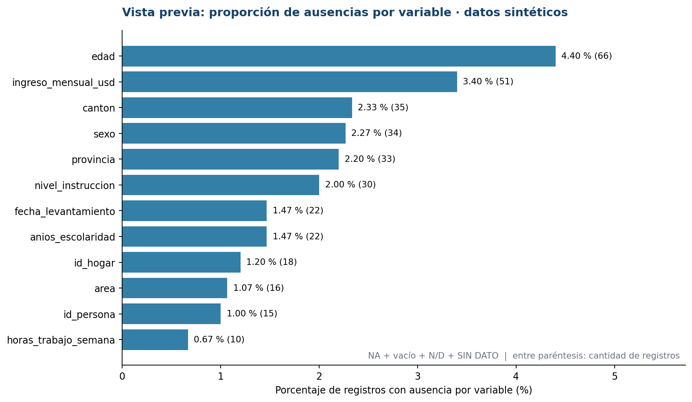
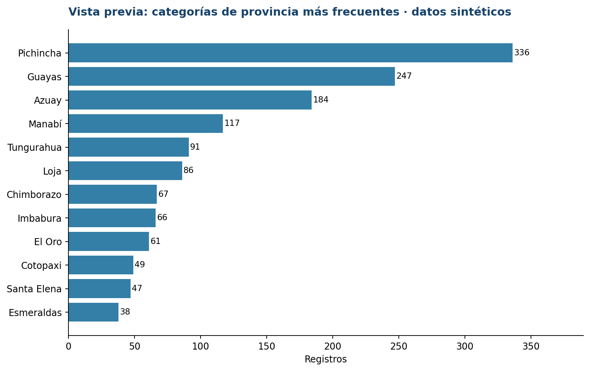
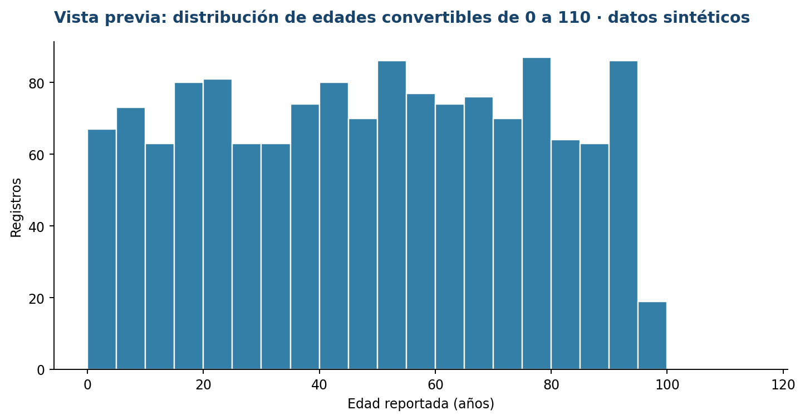

# Cuaderno de actividades prácticas — Participante
## Evaluación de archivos de datos y automatización de reportes de calidad en R

**Institución destinataria:** INEC · **Caso:** encuesta estadística **sintética** · **Módulos:** 1, 2 y 3 (6 horas)  
**Datos de trabajo:** `data_raw/personas_encuesta_sintetica_2026_10.csv`  
**Metadatos:** `diccionario/diccionario_variables.csv`

> **Propósito:** escribir, explicar y comprobar el código **paso a paso**. No ejecutar un proyecto terminado desde el comienzo. El archivo CSV original debe mantenerse intacto. Las observaciones y reglas de este ejercicio no constituyen criterios oficiales del INEC.

### Aprendizajes y productos

| Módulo | Actividades | Resultado que se construye |
|---|---|---|
| 1. Fundamentos y entorno R | 1–5 | Proyecto `.Rproj`, primer script y exploración de columnas |
| 2. Importación y estructura | 6–10 | Diagnóstico de importación, diccionario y conversiones |
| 3. Perfilado y diagnóstico | 11–15 | Indicadores, duplicados, categorías y tres gráficos |



## Instrucciones de trabajo

1. Abrir el archivo `calidad_inec.Rproj` en RStudio (o crearlo siguiendo la Actividad 3).
2. Crear el script `R/ACTIVIDADES_PARA_COMPLETAR.R` y completar una actividad por vez.
3. Antes de escribir el código, responder: **¿qué quiero averiguar?** Después de escribirlo, responder: **¿qué significa la salida?**
4. Ejecutar solamente las líneas de cada bloque con **Ctrl + Enter** cuando el instructor lo indique.
5. No utilizar `distinct()`, `drop_na()`, imputaciones, reemplazos, sobrescritura de CSV ni correcciones automáticas: primero se perfila, después se validan reglas.

---

# MÓDULO 1 · Fundamentos de calidad y RStudio (120 minutos)

## Actividad 1. Clasificar problemas de calidad (15 min)

**Objetivo:** reconocer las seis dimensiones: estructura, completitud, unicidad, consistencia, validez y trazabilidad.

**Enunciado.** Señale la dimensión más directamente relacionada con cada situación y justifique su respuesta:

| Situación | Dimensión | Justificación |
|---|---|---|
| Una columna requerida no está en el CSV | ______ | ______ |
| Una persona no registra edad y era obligatoria | ______ | ______ |
| El mismo `id_persona` aparece dos veces | ______ | ______ |
| Un registro indica una fecha de finalización anterior a su inicio | ______ | ______ |
| `sexo` contiene un código no previsto en el catálogo del ejercicio | ______ | ______ |
| No se conoce la versión del archivo que se analizó | ______ | ______ |

**Preguntas para dialogar:** ¿un valor raro siempre es incorrecto?, ¿por qué no se puede corregir una inconsistencia sin registrar la decisión?

**Evidencia:** tabla completada y explicación oral breve.

## Actividad 2. Crear objetos y usar funciones básicas (20 min)

**Objetivo:** familiarizarse con asignación `<-`, vectores, clases, `NA`, `is.na()`, `length()` y `mean()`.

**Pasos:**

1. Crear la variable `n_registros_esperados` con valor 1500.
2. Crear `nombre_curso` como texto y `es_sintetico` como lógico.
3. Crear `edades_prueba <- c(18, 20, NA, 22)`.
4. Consultar `class()` para los tres primeros objetos.
5. Calcular la longitud, detectar `NA` y calcular la media, explicando `na.rm = TRUE`.

```r
# Complete las instrucciones en su archivo .R
# n_registros_esperados <- ...
# edades_prueba <- c(...)
# class(...)
# length(...)
# is.na(...)
# mean(..., na.rm = TRUE)
```

**Evidencia:** los tipos de datos, la ubicación del `NA` y la media. **Interpretación:** ¿`na.rm = TRUE` elimina registros del CSV?

## Actividad 3. Construir el proyecto RStudio (25 min)

**Objetivo:** diferenciar `.R`, `.Rproj`, carpetas de origen y rutas relativas.

**Pasos:**

1. En RStudio: **File → New Project → New Directory → New Project**; nombre `calidad_inec`.
2. Crear las carpetas `data_raw`, `diccionario`, `R`, `figuras` y `resultados`.
3. Colocar el CSV original en `data_raw/` y el diccionario en `diccionario/`.
4. Crear y guardar `R/ACTIVIDADES_PARA_COMPLETAR.R`.
5. Cargar los paquetes `here`, `readr`, `dplyr` y `ggplot2` (instalar una sola vez desde la consola si hace falta).
6. Escribir una ruta relativa al CSV usando `here::here()` y verificarla con `file.exists()`.

**Estructura esperada:**

```text
calidad_inec/
├── calidad_inec.Rproj
├── R/
│   └── ACTIVIDADES_PARA_COMPLETAR.R
├── data_raw/
│   └── personas_encuesta_sintetica_2026_10.csv
├── diccionario/
│   └── diccionario_variables.csv
├── figuras/
└── resultados/
```

**Evidencia:** la ruta existe (`TRUE`) y se muestra correctamente el proyecto abierto en RStudio. **Pregunta:** ¿por qué evitar `C:\Users\...` en un script que compartirán varias personas?

## Actividad 4. Importar el CSV conservando evidencias (35 min)

**Objetivo:** comprender separador, codificación, inferencia de tipos y marcadores de ausencia.

**Enunciado:** importar `personas_encuesta_sintetica_2026_10.csv` con `readr::read_csv()` y guardar el resultado como `datos`.

**Condiciones:**

- Leer todas las columnas inicialmente como `character`.
- Interpretar el texto literal `NA` como ausencia de R.
- Conservar vacíos y espacios en los valores; usar `trim_ws = FALSE`.
- Declarar la codificación `UTF-8`.
- Explicar qué hace cada argumento de `read_csv()`.

```r
# Completar la lectura conservadora:
# datos <- readr::read_csv(
#   file = archivo_csv,
#   col_types = ...,
#   na = ...,
#   trim_ws = ...,
#   locale = ...
# )
```

**Evidencia:** objeto `datos` en el panel Environment. **Pregunta:** ¿por qué conviene preservar `id_persona` como texto?

## Actividad 5. Primer diagnóstico descriptivo (25 min)

**Objetivo:** diferenciar filas, columnas, tipos y frecuencias iniciales.

**Pasos:**

1. Calcular `nrow(datos)`, `ncol(datos)` y `dim(datos)`.
2. Inspeccionar `names(datos)`, `head(datos, 6)`, `str(datos)` y `dplyr::glimpse(datos)`.
3. Crear una tabla de frecuencias de `area` usando `table(..., useNA = "ifany")`.
4. Indicar cuáles variables parecen identificadores, numéricas, categóricas y fechas según su **significado**, aunque estén guardadas provisionalmente como texto.

**Evidencia:** cinco observaciones sobre el contenido. **Pregunta:** ¿por qué una variable llamada `edad` no necesariamente está lista para calcular su promedio?

---

# MÓDULO 2 · Importación y auditoría estructural (120 minutos)

## Actividad 6. Comparar dos formas de importación (25 min)

**Objetivo:** entender los riesgos de que R infiera automáticamente los tipos.

**Pasos:**

1. Importar nuevamente el mismo archivo sin forzar todas las columnas a `character` y guardar como `datos_auto`.
2. Contrastar `glimpse(datos)` y `glimpse(datos_auto)`.
3. Consultar `readr::problems(datos_auto)`.
4. Responder qué significa una salida de `problems()` con cero filas.

**Evidencia:** comparación de al menos tres variables. **Pregunta:** ¿`problems()` reemplaza una auditoría de calidad?

## Actividad 7. Examinar el texto original del CSV (15 min)

**Objetivo:** reconocer encabezado, separador y representación textual.

**Pasos:**

1. Leer solo las tres primeras líneas del CSV con `readLines()`.
2. Identificar el delimitador y los nombres de las primeras cinco columnas.
3. Explicar por qué un campo que contiene una coma debe estar entre comillas en un CSV separado por comas.
4. Identificar qué inconvenientes ocasionaría un archivo con codificación distinta de UTF-8.

**Evidencia:** explicación del formato y de un posible error de lectura.

## Actividad 8. Contrastación con el diccionario (20 min)

**Objetivo:** verificar nombres de variables y documentación.

**Pasos:**

1. Importar el diccionario como `diccionario`.
2. Identificar sus columnas `variable`, `descripcion`, `tipo_esperado`, `formato_esperado`, `dominio_referencia`, `obligatoria` y `control_exploratorio`.
3. Calcular variables declaradas pero ausentes: `setdiff(diccionario$variable, names(datos))`.
4. Calcular columnas observadas pero no declaradas: `setdiff(names(datos), diccionario$variable)`.
5. Comprobar si coinciden nombres **y orden** con `identical()`.

**Evidencia:** tres resultados y su interpretación. **Pregunta:** ¿`character(0)` es un error?

## Actividad 9. Elaborar una tabla de auditoría estructural (25 min)

**Objetivo:** relacionar clases importadas con tipos interpretativos esperados.

**Pasos:**

1. Crear una tabla con dos columnas: `variable` y `clase_importada`.
2. Utilizar `vapply()` y `class()` para obtener la clase de cada columna de `datos`.
3. Añadir información del diccionario mediante `left_join(..., by = "variable")`.
4. Examinar `edad`, `ingreso_mensual_usd`, `provincia` y `fecha_levantamiento`.

**Evidencia:** tabla de 27 filas. **Pregunta:** ¿es erróneo que `edad` tenga clase `character` durante la lectura conservadora?

## Actividad 10. Detectar valores de edad no convertibles (35 min)

**Objetivo:** reconocer un error de conversión y distinguirlo de una ausencia declarada.

**Pasos:**

1. Crear una columna auxiliar `edad_convertida` mediante `as.integer(edad)` sin modificar `datos$edad`.
2. Reconocer como ausencias declaradas los valores `NA`, cadena vacía, `N/D` y `SIN DATO`.
3. Filtrar valores **informados** que, pese a ello, se convirtieron en `NA`.
4. Presentar `fila_csv`, `id_persona` y `edad` para cada caso.
5. Explicar por qué `suppressWarnings()` no justifica descartar las observaciones.

**Evidencia:** tabla de valores problemáticos, cada uno con su ubicación. **Pregunta:** ¿qué haría con el valor `18,5` antes de aprobar alguna corrección?

---

# MÓDULO 3 · Perfilado y diagnóstico (120 minutos)

## Actividad 11. Calcular ausencias por variable (25 min)

**Objetivo:** crear un perfil reutilizable que diferencie `NA`, cadena vacía y marcadores especiales.

**Pasos:**

1. Crear una función `es_vacio(x)` usando `trimws()` e `is.na()`.
2. Crear `es_marcador(x)` para `N/D` y `SIN DATO`, sin distinguir mayúsculas.
3. Recorrer todas las columnas con `vapply()` para contar ausencias por tipo.
4. Calcular `n_ausencias` y `porcentaje` por variable con dos decimales.
5. Ordenar de mayor a menor. Analizar `edad`, `sexo` e `ingreso_mensual_usd`.

**Evidencia:** tabla con `variable`, `registros`, `n_na`, `n_vacios`, `n_marcadores`, `n_ausencias`, `porcentaje`.

**Pregunta:** si `observaciones` es opcional, ¿muchos vacíos significan necesariamente mala calidad?

## Actividad 12. Analizar duplicados por clave y por fila (30 min)

**Objetivo:** diferenciar una clave repetida de un registro totalmente duplicado.

**Pasos:**

1. Excluir `id_persona` ausentes antes de contar repeticiones de claves válidas.
2. Contar apariciones por `id_persona` con `count()`.
3. Filtrar las claves que aparezcan dos o más veces.
4. Calcular el número de **claves repetidas**, **filas implicadas** y **repeticiones adicionales**.
5. Comparar con `sum(duplicated(datos))`, que considera todas las columnas.
6. Utilizar `semi_join()` para ver las observaciones implicadas.

**Evidencia:** tabla de claves repetidas y cuatro indicadores. **Pregunta:** ¿por qué nunca se debe borrar inmediatamente una fila con ID repetido?

## Actividad 13. Descubrir categorías atípicas (20 min)

**Objetivo:** analizar frecuencias sin unificar etiquetas antes de la verificación.

**Pasos:**

1. Construir frecuencias para `provincia`, `sexo` y `area` mediante `count(..., sort = TRUE)`.
2. Localizar `Pichincha` frente a `PICHINCHA`, y `Guayas` frente a `Guayas ` (con espacio final).
3. Revisar categorías `F` y `99` en `sexo`, y `urban` en `area`.
4. Explicar la diferencia entre un valor poco frecuente y un valor fuera de catálogo.

**Evidencia:** tres tablas y al menos cuatro hallazgos escritos.

## Actividad 14. Resumir la distribución de edad (20 min)

**Objetivo:** calcular medidas descriptivas evitando interpretar marcadores como valores numéricos.

**Pasos:**

1. Crear una tabla auxiliar `edades` que incluya valor original y valor convertido a entero.
2. Contar no convertibles **sin incluir** ausencias declaradas.
3. Contar valores numéricos fuera del intervalo **0–110**, usado exclusivamente como ejemplo docente.
4. Para describir edades en ese intervalo, calcular `n`, media, mediana, mínimo, máximo y desviación estándar.
5. Explicitar cuántos registros quedaron dentro del subconjunto y por qué.

**Evidencia:** una tabla de resumen y una explicación de los criterios de inclusión. **Pregunta:** ¿es legítimo reportar el promedio sin indicar que se aplicó un filtro?

## Actividad 15. Crear tres gráficos y un cuadro de hallazgos (25 min)

**Objetivo:** comunicar visualmente patrones sin confundir diagnósticos con errores ya confirmados.

**Construir en `ggplot2`:**

1. **Barras horizontales:** 12 variables con mayor porcentaje de ausencias, excluyendo `observaciones` por ser opcional en el ejercicio.
2. **Barras horizontales:** 12 categorías de provincia más frecuentes, conservando literalmente sus etiquetas.
3. **Histograma:** edades convertibles entre 0 y 110, con intervalos de cinco años.
4. **Tabla final:** ausencias de edad, ausencias de ingreso, repeticiones adicionales de claves, valores de edad no convertibles y extremos de edad para revisión.

**Referencias visuales para discusión:**







**Evidencia:** tres gráficos con títulos, ejes y denominadores explicados, además de una tabla con cinco tipos de hallazgos. **Pregunta:** ¿pueden sumarse directamente los diferentes tipos de incidencias para obtener el número de personas afectadas? Justifique.

---

## Entrega final

- Un proyecto RStudio con las carpetas indicadas y el CSV sin modificaciones.
- Un script `.R` **construido gradualmente**, ordenado en 15 secciones y comentado.
- Tablas de auditoría, ausencias, duplicados y frecuencias.
- Tres gráficos descriptivos.
- Breve interpretación escrita de los principales hallazgos y límites de las conclusiones.

### Rúbrica sugerida (20 puntos)

| Criterio | Puntaje |
|---|---:|
| Proyecto reproducible, rutas relativas y organización | 3 |
| Importación conservadora y explicación de tipos | 4 |
| Contraste con el diccionario y detección de conversiones | 4 |
| Perfilado de ausencias, duplicados y categorías | 5 |
| Gráficos, interpretación y trazabilidad | 4 |
| **Total** | **20** |

**Recordatorio:** los resultados describen un conjunto de datos inventado para enseñar procedimientos; no deben publicarse ni interpretarse como estadísticas del INEC.
