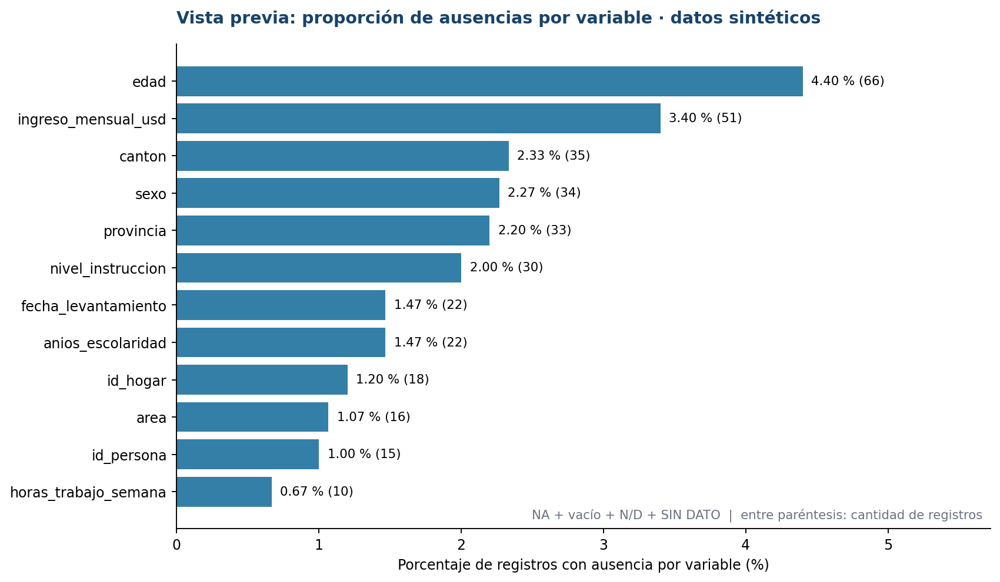
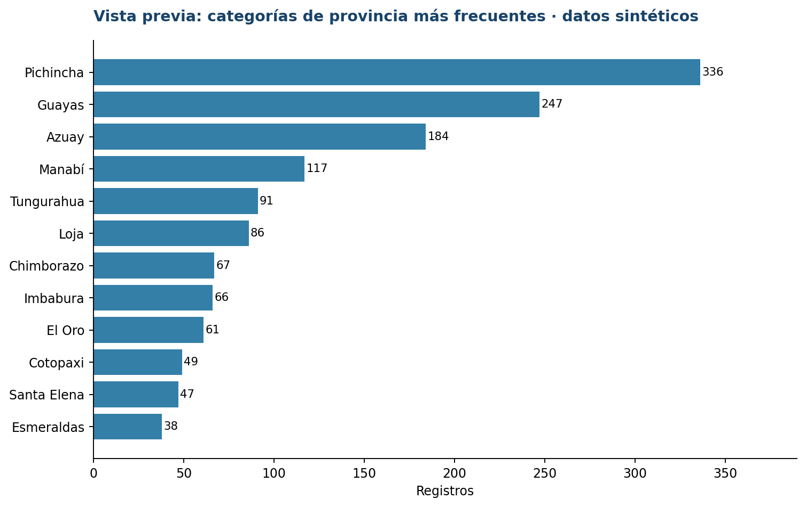
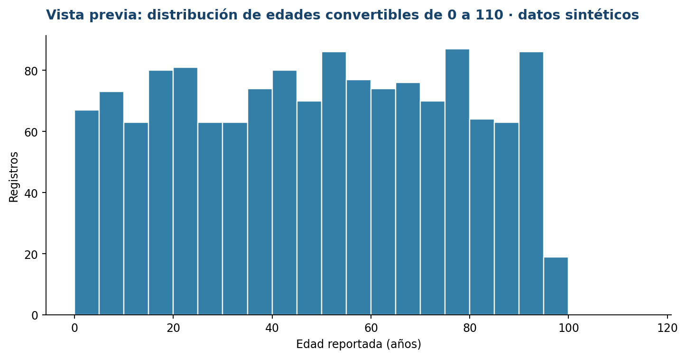

# Solucionario docente comentado — 15 actividades
## Curso INEC | Evaluación de archivos de datos y automatización de reportes de calidad en R

**Cobertura:** módulos 1, 2 y 3 · **Base:** `personas_encuesta_sintetica_2026_10.csv` (1.500 × 27).  
**Correspondencia con el cuaderno:** `ACTIVIDADES_PROPUESTAS_PARTICIPANTE.md`  
**Script completo de referencia:** `../R/SOLUCIONARIO_15_ACTIVIDADES.R`.

> **Modo de empleo:** construir el script en vivo, **una actividad a la vez**. El contenido siguiente es el material de contraste para el instructor; no es necesario entregar todas las respuestas al inicio de la sesión. La base es sintética y los rangos son meramente ilustrativos. No se ejecuta ni modifica la base al elaborar este material.

**Nota sobre los resultados:** las cifras de referencia se verificaron directamente sobre el CSV de trabajo, no mediante una ejecución del proyecto R. La equivalencia con R presupone la lectura conservadora que se especifica a continuación.

---


# MÓDULO 1: fundamentos


## Actividad 1. Distinguir los seis criterios de calidad

**Solución conceptual:**

| Caso del participante | Dimensión principal | Explicación |
|---|---|---|
| Falta una columna declarada | **Estructura** | La estructura observada no coincide con el esquema de referencia. |
| Edad no registrada donde era obligatoria | **Completitud** | Falta contenido requerido para una observación aplicable. |
| El mismo `id_persona` aparece en dos registros | **Unicidad** | La clave puede no identificar una única unidad; hay que comprobar el diseño. |
| Fecha de fin anterior al inicio | **Consistencia** | Dos variables se contradicen en una relación lógica. |
| `sexo` contiene un código no previsto | **Validez** | Se debe contrastar con el catálogo y vigencia aplicables. |
| No se conoce la versión del archivo | **Trazabilidad** | No es posible reconstruir plenamente la procedencia del análisis. |

**Interpretación:** una clave repetida no obliga a borrar filas: primero se revisa el nivel de observación. Un valor raro no es automáticamente un error. La diapositiva de los seis criterios corresponde al **módulo 1** de la presentación adjunta.


## Actividad 2. Reconocer tipos de objetos y NA

**Solución en R:**

```r
# ACTIVIDAD 2 | Objetos, vectores, funciones y NA en R
n_registros_esperados <- 1500
nombre_curso <- "Evaluacion de archivos de datos en R"
es_sintetico <- TRUE
edades_prueba <- c(18, 20, NA, 22)

class(n_registros_esperados)     # numeric
class(nombre_curso)            # character
class(es_sintetico)            # logical
length(edades_prueba)          # 4 elementos
is.na(edades_prueba)           # Solo el tercer elemento es TRUE
mean(edades_prueba, na.rm = TRUE) # 20 (no elimina ni corrige el NA)
```

**¿Por qué funciona?** `<-` asigna un valor a un objeto, `c()` construye un vector, `class()` pregunta su tipo, `length()` cuenta posiciones e `is.na()` señala el valor ausente. `na.rm = TRUE` evita incluir `NA` solo en el cálculo actual; no modifica los datos.

**Esperado:** clases `numeric`, `character` y `logical`; cuatro posiciones; el tercer elemento marcado como `NA`; media = **20**.


## Actividad 3. Crear un proyecto reproducible

**Solución en R:**

```r
# ACTIVIDAD 3 | Proyecto RStudio y rutas relativas
# Crear con File > New Project > New Directory > New Project
# y comprobar que el archivo calidad_inec.Rproj aparece en la carpeta raiz.
library(here)
library(readr)
library(dplyr)
library(ggplot2)

here::here()                   # Carpeta raiz reconocida por el proyecto
getwd()                       # Directorio de trabajo
archivo_csv <- here::here(
  "data_raw", "personas_encuesta_sintetica_2026_10.csv"
)
file.exists(archivo_csv)       # Esperado: TRUE
```

**¿Por qué funciona?** El archivo `.Rproj` sitúa la carpeta del proyecto como contexto de trabajo. `here::here()` construye rutas desde ese contexto, en lugar de guardar rutas absolutas específicas del equipo. `file.exists()` comprueba si el CSV está en la ubicación correcta.

**Esperado:** `file.exists(archivo_csv)` devuelve `TRUE` cuando el proyecto se abrió y el archivo está colocado correctamente. La carpeta del proyecto puede ubicarse en cualquier unidad o usuario.


## Actividad 4. Importar el CSV como texto y preservar la evidencia

**Solución en R:**

```r
# ACTIVIDAD 4 | Lectura conservadora del CSV
# "NA" se reconoce como NA; los espacios y cadenas vacias se conservan.
# Todas las columnas se reciben como texto para no perder evidencia.
datos <- readr::read_csv(
  file = archivo_csv,
  col_types = readr::cols(.default = readr::col_character()),
  na = "NA",
  trim_ws = FALSE,
  locale = readr::locale(encoding = "UTF-8"),
  show_col_types = FALSE
)
```

**¿Por qué funciona?** `col_character()` conserva los identificadores y representaciones originales; `na = "NA"` reconoce el marcador literal sin convertir las celdas vacías en el mismo estado; `trim_ws = FALSE` permite descubrir espacios adicionales; `UTF-8` conserva caracteres acentuados.

**Esperado:** un objeto `datos` con **1.500 filas y 27 columnas**; todas las columnas importadas inicialmente como `character`. No se altera el archivo de entrada.


## Actividad 5. Explorar la estructura y una tabla categórica

**Solución en R:**

```r
# ACTIVIDAD 5 | Exploracion inicial
nrow(datos)                     # 1500
ncol(datos)                     # 27
dim(datos)                      # c(1500, 27)
names(datos)                    # nombres de las 27 variables
head(datos, 6)                 # primeras seis filas
str(datos)                     # estructura, inicialmente character
dplyr::glimpse(datos)          # exploracion compacta
# area: Urbana 751, Rural 719, urban 14, vacio 9 y NA 7
# (las categorias se conservan literalmente en esta etapa).
table(datos$area, useNA = "ifany")
```

**¿Por qué funciona?** `dim()` proporciona filas y columnas; `names()` devuelve los nombres; `str()` y `glimpse()` muestran las clases; `table(..., useNA="ifany")` cuenta cada etiqueta visible y los valores `NA`. No agrupar `urban` con `Urbana` todavía.

**Esperado:** 1.500 filas, 27 columnas. Para `area`: `Urbana` = **751**, `Rural` = **719**, `urban` = **14**, vacío = **9**, `NA` = **7**.


# MÓDULO 2: importación y estructura


## Actividad 6. Comparar inferencia automática con lectura conservadora

**Solución en R:**

```r
# ACTIVIDAD 6 | Diferencia entre inferencia automatica y lectura controlada
# Esta segunda lectura NO sustituye el objeto conservador "datos".
datos_auto <- readr::read_csv(archivo_csv, show_col_types = FALSE)
dplyr::glimpse(datos_auto)
readr::problems(datos_auto)
# Una tabla vacia de problems() no significa ausencia de errores de calidad.
```

**¿Por qué funciona?** La lectura automática intenta adivinar tipos con base en el contenido. Puede interpretar unos campos como texto y otros como numéricos. `problems()` muestra ciertos problemas de lectura, **no** todas las inconsistencias semánticas. Un tibble `0 × 5` indica que no se registraron problemas de *parseo*, no que el archivo sea perfecto.

**Esperado:** identificar diferencias de clases o supuestos de lectura sin cambiar el objeto conservador `datos`. No se requiere que `problems()` tenga un número prefijado de filas.


## Actividad 7. Leer el encabezado y reconocer el separador

**Solución en R:**

```r
# ACTIVIDAD 7 | Examinar el formato del archivo CSV
readLines(archivo_csv, n = 3, encoding = "UTF-8")
# El archivo tiene separador coma y encabezado de 27 variables.
# La coma decimal en "18,5", dentro de comillas CSV, permanece en un campo.
```

**¿Por qué funciona?** `readLines(..., n = 3)` obtiene el encabezado y dos filas directamente del texto original. Esto facilita comprobar coma como separador, encabezados y convenciones. Los campos que incluyan comas dentro del valor deben representarse correctamente entre comillas.

**Esperado:** encabezado que inicia `id_persona,id_hogar,codigo_muestra,periodo_referencia,provincia` y contiene las 27 variables.


## Actividad 8. Contrastar las variables con el diccionario

**Solución en R:**

```r
# ACTIVIDAD 8 | Leer diccionario y cotejar los nombres
diccionario <- readr::read_csv(
  here::here("diccionario", "diccionario_variables.csv"),
  col_types = readr::cols(.default = readr::col_character()),
  na = "NA",
  show_col_types = FALSE
)

faltan_columnas <- setdiff(diccionario$variable, names(datos))
columnas_extras <- setdiff(names(datos), diccionario$variable)
orden_coincide <- identical(names(datos), diccionario$variable)

faltan_columnas                 # character(0)
columnas_extras                 # character(0)
orden_coincide                  # TRUE
```

**¿Por qué funciona?** `setdiff(A, B)` devuelve elementos de `A` que no figuran en `B`. Un `character(0)` significa que no hay nombres en esa diferencia; no es un error. `identical()` exige coincidencia en nombres y orden.

**Esperado:** `faltan_columnas = character(0)`, `columnas_extras = character(0)`, `orden_coincide = TRUE`. Estas comprobaciones solo garantizan coincidencia de esquema nominal.


## Actividad 9. Construir la tabla estructural con metadatos

**Solución en R:**

```r
# ACTIVIDAD 9 | Auditoria de estructura y metadatos
tabla_estructura <- tibble::tibble(
  variable = names(datos),
  clase_importada = vapply(datos, function(x) class(x)[1], character(1))
) %>%
  dplyr::left_join(
    diccionario %>%
      dplyr::select(variable, tipo_esperado, obligatoria, control_exploratorio),
    by = "variable"
  )
print(tabla_estructura, n = nrow(tabla_estructura))
# Un tipo 'character' no implica error: fue una decision de importacion.
```

**¿Por qué funciona?** `vapply()` recorre columnas y obtiene su clase. `left_join()` agrega las declaraciones del diccionario sin reemplazar valores del CSV. Que `edad` aparezca como `character` es esperado porque el importador fue configurado así; el tipo conceptual se examina después.

**Esperado:** una tabla de **27 filas**, con clase importada `character` y tipos esperados diferenciados en el diccionario.


## Actividad 10. Localizar conversiones no válidas de edad

**Solución en R:**

```r
# ACTIVIDAD 10 | Conversion de edad y localizacion de 6 formatos problematicos
comparacion_edad <- datos %>%
  dplyr::mutate(
    fila_csv = dplyr::row_number() + 1L,
    edad_convertida = suppressWarnings(as.integer(edad)),
    marcador_ausencia = !is.na(edad) &
      toupper(trimws(edad)) %in% c("N/D", "SIN DATO")
  )

edad_no_convertible <- comparacion_edad %>%
  dplyr::filter(
    !is.na(edad), trimws(edad) != "",
    !marcador_ausencia,
    is.na(edad_convertida)
  ) %>%
  dplyr::select(fila_csv, id_persona, edad)

print(edad_no_convertible, n = nrow(edad_no_convertible))
nrow(edad_no_convertible)        # 6
# Cadenas: treinta, 35 anios (con enie), ?, 18,5, sin edad, XX.
# Los marcadores N/D y SIN DATO NO se cuentan aqui como errores de conversion.
```

**¿Por qué funciona?** `as.integer()` convierte valores válidos a enteros; valores como `treinta` producen `NA`. `suppressWarnings()` solo evita avisos repetitivos en este diagnóstico; no convierte datos defectuosos en válidos. El filtro excluye de esta cuenta los marcadores conocidos de ausencia y las celdas vacías.

**Esperado:** **6 valores informados no convertibles**: `treinta`, `35 años`, `?`, `18,5`, `sin edad` y `XX`. Se deben conservar sus posiciones y valores originales para revisión.


# MÓDULO 3: perfilado y diagnóstico


## Actividad 11. Perfilar ausencias sin perder categorías

**Solución en R:**

```r
# ACTIVIDAD 11 | Perfilado: distinguir NA, vacios y marcadores
# Funciones reutilizables de diagnostico. Ninguna cambia "datos".
es_vacio <- function(x) {
  !is.na(x) & trimws(x) == ""
}
es_marcador <- function(x) {
  !is.na(x) & toupper(trimws(x)) %in% c("N/D", "SIN DATO")
}

perfil <- tibble::tibble(
  variable = names(datos),
  registros = nrow(datos),
  n_na = vapply(datos, function(x) sum(is.na(x)), integer(1)),
  n_vacios = vapply(datos, function(x) sum(es_vacio(x)), integer(1)),
  n_marcadores = vapply(datos, function(x) sum(es_marcador(x)), integer(1))
) %>%
  dplyr::mutate(
    n_ausencias = n_na + n_vacios + n_marcadores,
    porcentaje = round(100 * n_ausencias / registros, 2)
  ) %>%
  dplyr::arrange(dplyr::desc(porcentaje))

print(perfil, n = nrow(perfil))
perfil %>% dplyr::filter(variable %in% c("edad", "sexo", "ingreso_mensual_usd"))
# Referencias:
# edad:     NA=23, vacios=19, marcadores=24, total=66 (4,40 %)
# sexo:     NA=12, vacios=22, marcadores=0, total=34 (2,27 %)
# ingresos: NA=20, vacios=17, marcadores=14, total=51 (3,40 %)
```

**¿Por qué funciona?** Las funciones `es_vacio()` y `es_marcador()` distinguen tres estados: `NA` reconocido por R, texto vacío o espacios, y marcadores como `N/D` o `SIN DATO`. `vapply()` aplica el conteo a todas las variables y `round(..., 2)` presenta porcentajes con dos decimales.

**Esperado sobre 1.500 registros:** `edad` = **23 NA + 19 vacíos + 24 marcadores = 66 (4,40 %)**; `sexo` = **12 + 22 + 0 = 34 (2,27 %)**; `ingreso_mensual_usd` = **20 + 17 + 14 = 51 (3,40 %)**. Una variable opcional puede tener ausencias legítimas.


## Actividad 12. Diferenciar claves duplicadas de filas iguales

**Solución en R:**

```r
# ACTIVIDAD 12 | Identificar claves de persona duplicadas
# Se excluyen claves ausentes al contar repeticiones validas.
ids_repetidos <- datos %>%
  dplyr::filter(!is.na(id_persona), trimws(id_persona) != "") %>%
  dplyr::count(id_persona, name = "veces") %>%
  dplyr::filter(veces > 1) %>%
  dplyr::arrange(id_persona)

n_claves_repetidas <- nrow(ids_repetidos)
n_repeticiones_adicionales <- sum(ids_repetidos$veces - 1L)
n_filas_claves_repetidas <- sum(ids_repetidos$veces)

n_claves_repetidas              # 20 claves diferentes repetidas
n_repeticiones_adicionales     # 20 filas extra respecto a una por clave
n_filas_claves_repetidas       # 40 filas implicadas
sum(duplicated(datos))         # 4 filas completas duplicadas

# Registros correspondientes a las claves repetidas.
filas_repetidas <- datos %>%
  dplyr::mutate(fila_csv = dplyr::row_number() + 1L) %>%
  dplyr::semi_join(ids_repetidos, by = "id_persona") %>%
  dplyr::select(fila_csv, id_persona, id_hogar, provincia, edad) %>%
  dplyr::arrange(id_persona, fila_csv)
print(filas_repetidas, n = 40)
```

**¿Por qué funciona?** Se retiran **solo del conteo** las claves ausentes, sin borrar filas de `datos`. `count()` identifica repeticiones de la clave. Un ID que aparece dos veces genera una repetición adicional, pero dos filas implicadas. `duplicated(datos)` exige igualdad de **todas** las columnas.

**Esperado:** **20 claves** válidas diferentes aparecen duplicadas; **40 filas** están implicadas; **20 repeticiones adicionales**; **4 filas totalmente idénticas adicionales**. Estas cantidades representan fenómenos distintos.


## Actividad 13. Contar categorías que merecen revisión

**Solución en R:**

```r
# ACTIVIDAD 13 | Categorias y frecuencias sin normalizar automaticamente
frecuencia_provincias <- datos %>%
  dplyr::count(provincia, sort = TRUE, name = "registros")
frecuencia_sexo <- datos %>%
  dplyr::count(sexo, sort = TRUE, name = "registros")
frecuencia_area <- datos %>%
  dplyr::count(area, sort = TRUE, name = "registros")

print(frecuencia_provincias, n = nrow(frecuencia_provincias))
print(frecuencia_sexo, n = nrow(frecuencia_sexo))
print(frecuencia_area, n = nrow(frecuencia_area))
# Pichincha=336; PICHINCHA=15; Guayas=247; "Guayas "=7.
# 'F' y '99' en sexo necesitan revisar catalogo, no cambiar directamente.
```

**¿Por qué funciona?** `count()` resume literalmente las etiquetas existentes; `sort = TRUE` ordena por frecuencia. No conviene normalizar antes de corroborar el catálogo. Por ejemplo, una diferencia entre mayúsculas o espacios puede requerir transformación documentada, pero no se aprueba aún.

**Esperado:** `Pichincha` **336**, `PICHINCHA` **15**, `Guayas` **247**, `Guayas ` **7**; en `sexo`, `F` **14** y `99` **10**; en `area`, `urban` **14**.


## Actividad 14. Calcular estadísticas con un subconjunto explícito

**Solución en R:**

```r
# ACTIVIDAD 14 | Medidas descriptivas de edad con criterios explicitos
edades <- datos %>%
  dplyr::transmute(
    id_persona,
    edad_original = edad,
    edad_num = suppressWarnings(as.integer(edad)),
    no_convertible = !is.na(edad_original) &
      trimws(edad_original) != "" &
      !(toupper(trimws(edad_original)) %in% c("N/D", "SIN DATO")) &
      is.na(edad_num),
    extremo_ilustrativo = !is.na(edad_num) &
      (edad_num < 0L | edad_num > 110L)
  )

edades %>% dplyr::summarise(
  no_convertibles = sum(no_convertible),
  extremos_para_revisar = sum(extremo_ilustrativo)
)
# 6 no convertibles; 12 fuera de 0-110 (rango exclusivamente didactico).

resumen_edades <- edades %>%
  dplyr::filter(!is.na(edad_num), dplyr::between(edad_num, 0L, 110L)) %>%
  dplyr::summarise(
    n = dplyr::n(),
    media = round(mean(edad_num), 2),
    mediana = median(edad_num),
    minimo = min(edad_num),
    maximo = max(edad_num),
    desviacion_estandar = round(sd(edad_num), 2)
  )
print(resumen_edades)
# n=1416, media=48.30, mediana=49, min=0, max=95, sd=27.62.
# Reportar siempre el filtro usado al comunicar estadisticas.
```

**¿Por qué funciona?** La conversión numérica se realiza en una tabla auxiliar. Para describir edades se emplea el filtro didáctico de enteros entre 0 y 110, manteniendo todos los datos originales. La media, la mediana y la desviación estándar se interpretan respecto del subconjunto seleccionado.

**Esperado:** **6** no convertibles, **12** edades numéricas fuera del intervalo demostrativo. Entre 0 y 110 hay **1.416** casos, media **48,30**, mediana **49**, mínimo **0**, máximo **95** y desviación estándar **27,62**. No son límites institucionales.


## Actividad 15. Comunicar hallazgos mediante tres gráficos y una tabla

**Solución en R:**

```r
# ACTIVIDAD 15 | Graficos descriptivos y primera sintesis
# 15.A Porcentaje de ausencias: excluir 'observaciones' por ser opcional.
perfil_grafico <- perfil %>%
  dplyr::filter(variable != "observaciones") %>%
  dplyr::slice_max(order_by = porcentaje, n = 12, with_ties = FALSE)

g_ausencias <- ggplot2::ggplot(
  perfil_grafico,
  ggplot2::aes(x = reorder(variable, porcentaje), y = porcentaje)
) +
  ggplot2::geom_col() +
  ggplot2::coord_flip() +
  ggplot2::labs(
    title = "Ausencias por variable (base sintetica)",
    x = "Variable", y = "Porcentaje de registros (%)"
  ) +
  ggplot2::theme_minimal()
print(g_ausencias)

# 15.B Frecuencia de categorias de provincia.
provincias_top <- frecuencia_provincias %>%
  dplyr::slice_head(n = 12) %>%
  dplyr::mutate(
    provincia = dplyr::if_else(
      is.na(provincia) | provincia == "", "(vacia/NA)", provincia
    )
  )
g_provincias <- ggplot2::ggplot(
  provincias_top,
  ggplot2::aes(x = reorder(provincia, registros), y = registros)
) +
  ggplot2::geom_col() +
  ggplot2::coord_flip() +
  ggplot2::labs(
    title = "Frecuencias de provincia (base sintetica)",
    x = "Categoria literal", y = "Registros"
  ) +
  ggplot2::theme_minimal()
print(g_provincias)

# 15.C Histograma de edad bajo un filtro didactico explicitado.
g_edades <- edades %>%
  dplyr::filter(!is.na(edad_num), dplyr::between(edad_num, 0L, 110L)) %>%
  ggplot2::ggplot(ggplot2::aes(x = edad_num)) +
  ggplot2::geom_histogram(binwidth = 5, boundary = 0) +
  ggplot2::labs(
    title = "Distribucion de edades (base sintetica)",
    subtitle = "Solo valores enteros 0-110; umbral demostrativo",
    x = "Edad (anios)", y = "Registros"
  ) +
  ggplot2::theme_minimal()
print(g_edades)

# TABLA FINAL DE HALLAZGOS - No sumar como personas distintas afectadas.
incidencias_iniciales <- tibble::tibble(
  hallazgo = c(
    "Ausencias de edad (NA, vacio, marcador)",
    "Ausencias de ingreso mensual",
    "Claves de persona repetidas adicionales",
    "Edad no convertible (sin marcadores)",
    "Edad fuera del rango ilustrativo 0-110"
  ),
  total = c(
    perfil$n_ausencias[perfil$variable == "edad"],
    perfil$n_ausencias[perfil$variable == "ingreso_mensual_usd"],
    n_repeticiones_adicionales,
    sum(edades$no_convertible),
    sum(edades$extremo_ilustrativo)
  )
)
print(incidencias_iniciales)
```

**¿Por qué funciona?** `ggplot()` fija variables y ejes; `geom_col()` dibuja las frecuencias o porcentajes que ya se calcularon; `coord_flip()` facilita leer etiquetas largas; `geom_histogram(binwidth = 5)` agrupa edades en intervalos de cinco años. Cada figura debe expresar qué datos incluye.

**Esperado:** gráfico de ausencias, gráfico de frecuencias de provincia e histograma de edad; tabla de incidencias con totales **66**, **51**, **20**, **6** y **12**, respectivamente. **No sumar** esos totales como personas únicas afectadas: las incidencias pueden coexistir en un registro.


**Gráficos de referencia:**








---

## Clave de respuestas numéricas para el instructor

| Indicador del CSV sintético | Resultado | Interpretación |
|---|---:|---|
| Filas / columnas | 1.500 / 27 | Estructura de origen |
| Edad: `NA` / vacíos / marcadores | 23 / 19 / 24 | Tres formas diferenciadas de ausencia |
| Total de ausencias de edad | 66 | 4,40 % sobre todas las filas |
| Total de ausencias de sexo | 34 | 2,27 % sobre todas las filas |
| Total de ausencias de ingreso | 51 | 3,40 % sobre todas las filas |
| Claves válidas `id_persona` repetidas | 20 | Cada una aparece dos veces |
| Filas implicadas en esas claves | 40 | Incluye original y repetición |
| Repeticiones adicionales de clave válida | 20 | Excluye claves ausentes |
| Filas idénticas adicionales | 4 | Compara las 27 variables |
| Edades informadas no convertibles | 6 | No cuenta marcadores de ausencia |
| Edades convertibles fuera de 0–110 | 12 | Umbral únicamente didáctico |
| Edades descriptibles tras filtro | 1.416 | Subconjunto, no archivo depurado |
| Media / mediana | 48,30 / 49 | Solo edades del subconjunto |

### Preguntas de cierre y respuestas orientadoras

**¿Que significa `problems(datos_auto)` cuando devuelve una tabla `0 × 5`?** Que el lector no registró problemas de *parseo* bajo sus tipos y parámetros; no equivale a una certificación de calidad, ausencia de duplicados ni cumplimiento de dominios.

**¿La edad `999` debe eliminarse?** No inmediatamente. Se documenta como candidata a revisión, se contrasta con el diseño estadístico y se aplica una regla aprobada en los módulos siguientes.

**¿Se pueden sumar 66 ausencias de edad y 20 repeticiones adicionales para afirmar 86 personas afectadas?** No. Puede haber solapamiento de incidencias y las unidades de conteo no tienen por qué coincidir.

**¿Se puede reemplazar `PICHINCHA` por `Pichincha` sin consultar a nadie?** No como procedimiento institucional: primero se documenta el catálogo esperado, regla de normalización, responsable y vigencia.

**¿Por qué no reportar completitud institucional usando solamente `100 - porcentaje`?** Porque el denominador debe considerar campos requeridos y registros aplicables según la metodología de la operación estadística.

**Continuación pedagógica:** módulo 4 = reglas explícitas; módulo 5 = consistencia e integridad; módulo 6 = depuración controlada y bitácora; módulos 7–9 = gráficos, Quarto y automatización.
