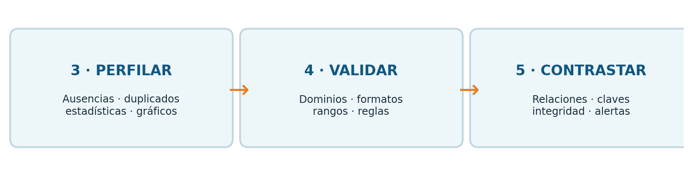
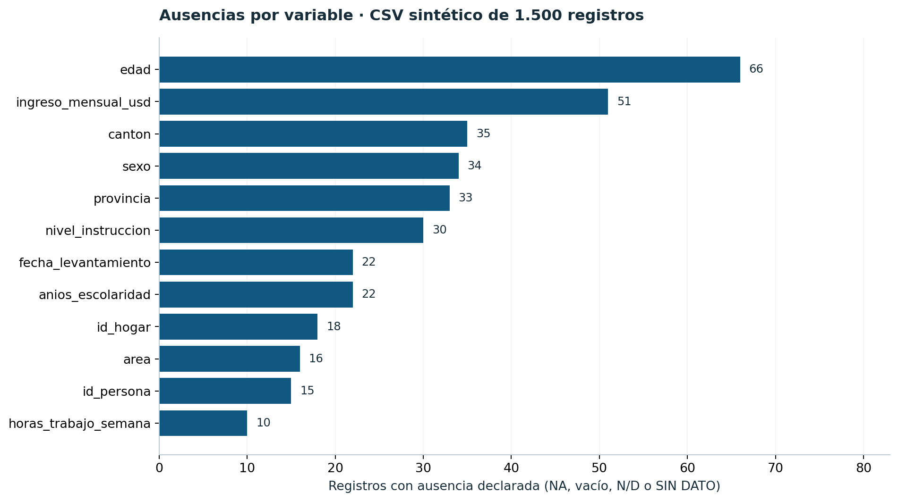
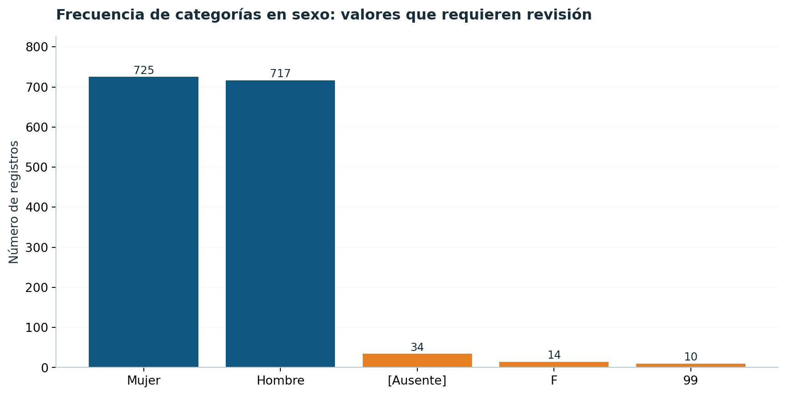
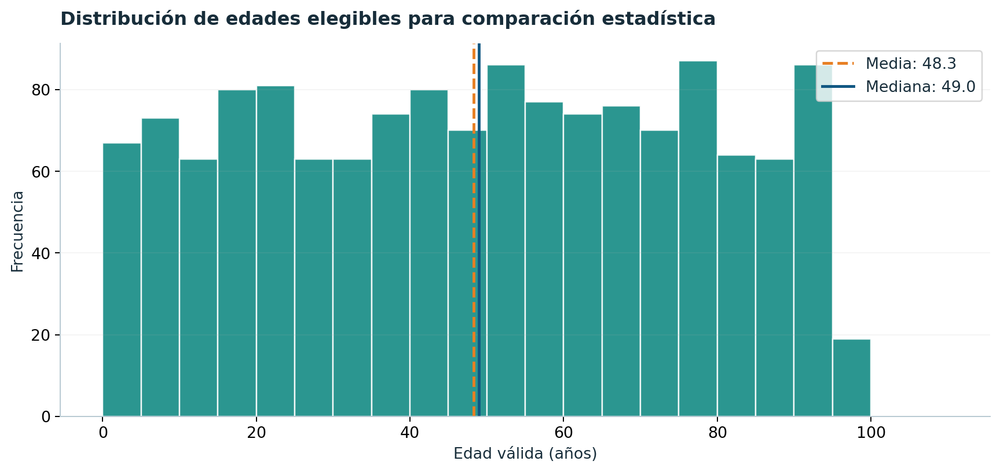
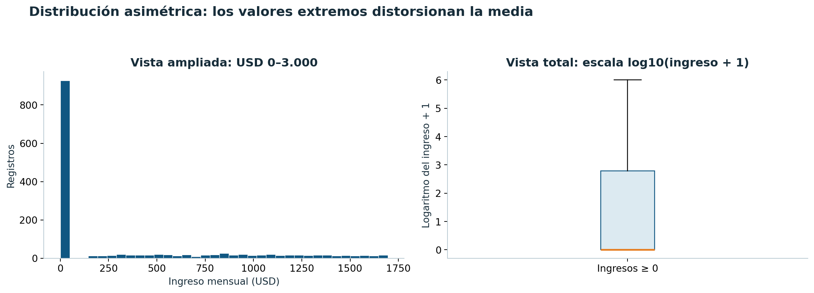
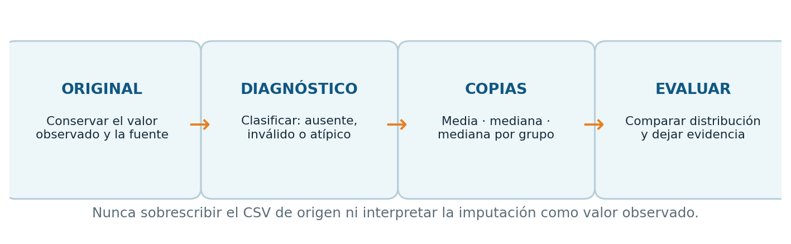
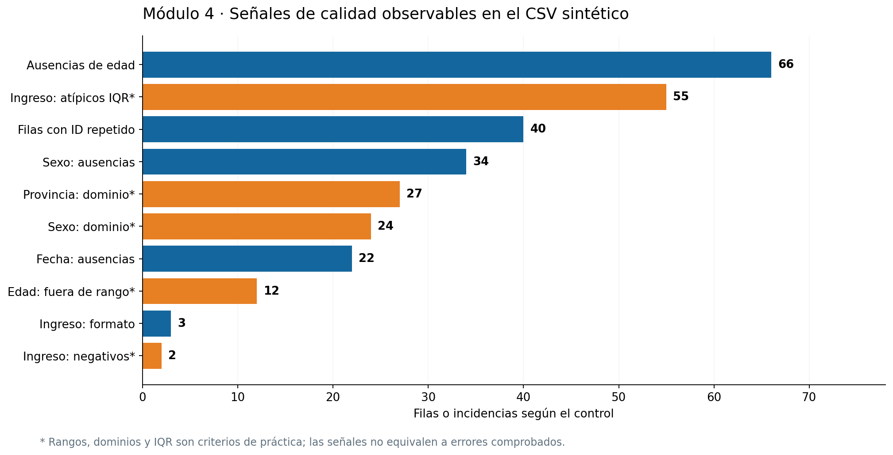
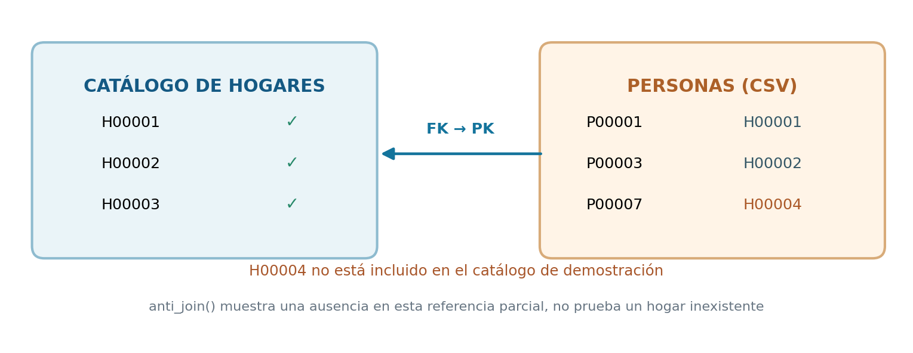

# Guía de estudio y laboratorio en R: módulos 3, 4 y 5

**Curso:** Evaluación de archivos de datos y automatización de reportes de calidad en R  
**Contexto:** Instituto Nacional de Estadística y Censos (INEC) · Capacitación 2026  
**Duración:** 6 horas (tres módulos de 2 horas)  
**Caso transversal:** `personas_encuesta_sintetica_2026_10.csv`  
**Modalidad de trabajo:** construir el proyecto manualmente en RStudio, bloque a bloque.  
**Instructor:** Ing. Ángel Geovanny Cudco Pomagualli, PhD(c).

> **Alcance y advertencia:** los datos son sintéticos y deliberadamente contienen incidencias. Los rangos, catálogos y cruces que se presentan son supuestos didácticos, **no reglas oficiales del INEC**. La imputación estadística es una comparación metodológica, no una autorización para reemplazar datos ausentes. El archivo de origen jamás se modifica.



## 1. Objetivos y correspondencia con las diapositivas

Esta guía desarrolla, en secuencia, las diapositivas **8–9 (módulo 3), 10–11 (módulo 4) y 12–13 (módulo 5)** de `Presentacion_INEC_Calidad_Datos_R_(2).pdf`. Recupera también la organización de proyecto de la diapositiva 5 y el principio de trazabilidad de la diapositiva 4.

| Módulo | Pregunta orientadora | Competencia | Resultado progresivo |
|---|---|---|---|
| **3. Perfilado y diagnóstico de calidad** | ¿Qué características tiene el archivo y qué aspectos merecen revisión? | Identificar ausencias, duplicados, formatos, distribuciones y valores atípicos. Comparar métodos de imputación. | Tablas y gráficos descriptivos, variables numéricas de trabajo, escenarios de imputación. |
| **4. Validación automática de variables** | ¿Qué valores incumplen una regla documentada? | Implementar obligatoriedad, longitud, formato, dominio, rango y unicidad. | Tabla de reglas versionadas, indicadores y bitácora de incidencias. |
| **5. Consistencia lógica e integridad de datos** | ¿Son coherentes entre sí los campos y las claves de varios archivos? | Evaluar relaciones entre variables, claves repetidas, dependencias e integridad referencial. | Alertas de consistencia y bitácora consolidada. |

### Organización sugerida de las 6 horas

| Módulo | Actividad | Minutos |
|---|---|---:|
| 3 | Recuperación del proyecto, ausencias y duplicados | 35 |
| 3 | Estadísticas, categorías, histogramas y boxplots | 45 |
| 3 | Media, mediana, moda e imputación comparada | 40 |
| 4 | Diccionario, reglas, dominios y expresiones regulares | 40 |
| 4 | Aplicación de reglas y trazabilidad por registro | 50 |
| 4 | Indicadores y visualización de incidencias | 30 |
| 5 | Condiciones lógicas entre variables | 40 |
| 5 | Unicidad e integridad referencial | 50 |
| 5 | Bitácora integrada, interpretación y cierre | 30 |

---

## 2. Caso estadístico: con qué archivo vamos a trabajar

El CSV contiene **1.500 filas y 27 columnas**. Corresponde a personas y hogares ficticios, con componentes geográficos, sociodemográficos, laborales, monetarios y del levantamiento. Se distribuye sin nombres ni identificadores de personas reales.

**Variables para el taller:**

| Dimensión | Variables de interés | Tipo lógico esperado |
|---|---|---|
| Identificación | `id_persona`, `id_hogar`, `codigo_muestra` | Texto, incluso cuando contienen dígitos |
| Tiempo | `periodo_referencia`, `fecha_levantamiento` | Texto con formato, fecha posteriormente |
| Territorio | `provincia`, `canton`, `area`, `sector_censal` | Texto/categorías |
| Persona | `sexo`, `edad`, `estado_civil`, `nivel_instruccion` | Categóricas y entero |
| Educación | `asiste_clases`, `anios_escolaridad` | Categoría y entero |
| Trabajo | `condicion_actividad`, `actividad_principal`, `horas_trabajo_semana` | Categorías y entero |
| Economía | `ingreso_mensual_usd` | Decimal expresado con punto |
| Hogar | `personas_hogar`, `habitaciones_hogar`, `tipo_vivienda`, `acceso_agua`, `acceso_internet` | Numéricas y categóricas |
| Muestreo y campo libre | `peso_muestral`, `encuestador`, `observaciones` | Decimal ficticio y texto |

**Resultados de referencia al inspeccionar el CSV:**

| Hallazgo | Valor | Interpretación |
|---|---:|---|
| Ausencias declaradas/vacías en `edad` | 66 | Son `NA`, blancos u otros marcadores; no incluyen errores de formato. |
| Representaciones no numéricas adicionales en `edad` | 6 | Por ejemplo `treinta` o `35 años`. |
| Valores numéricos de `edad` fuera del rango didáctico 0–110 o no enteros | 12 | Se revisan antes de cualquier imputación. |
| Ausencias declaradas/vacías en `ingreso_mensual_usd` | 51 | No equivalen a ingreso cero. |
| Representaciones no numéricas adicionales en ingreso | 3 | Por ejemplo `1.250,50`, `mil`, `120 USD`. |
| Ingresos registrados como `0.00` | 928 | Son valores numéricos, no ausencias por defecto. |
| Ingresos numéricos negativos | 2 | Requieren revisión de criterio. |
| IDs válidos repetidos, **ocurrencias adicionales** | 20 | No significa que sean únicamente 20 filas involucradas. |
| Filas completamente repetidas, adicionales | 4 | Distinguir de clave repetida con contenido diferente. |

**Ejercicio de observación:** un `id_persona` repetido con datos diferentes puede ser un problema de identificación; una fila idéntica repetida podría ser duplicación de transmisión. Sin diseño del levantamiento no debe eliminarse ninguna.

---

## 3. Preparación: recuperar el proyecto de RStudio antes del módulo 3

El módulo 3 comienza a partir de un CSV ya recibido. No necesitamos volver a enseñar todo el módulo 1, pero sí disponer de una estructura reproducible.

### Paso 0.1. Crear o abrir un proyecto `.Rproj`

1. Abra **RStudio → File → New Project → New Directory → New Project**.
2. Asigne el nombre `calidad_inec_modulos_3_5`, seleccione un directorio de trabajo y cree el proyecto. Alternativamente, abra el archivo `.Rproj` suministrado.
3. Dentro de la pestaña *Files* cree las carpetas indicadas:

```text
calidad_inec_modulos_3_5/
├── calidad_inec_modulos_3_5.Rproj
├── data_raw/
│   └── personas_encuesta_sintetica_2026_10.csv  # origen: NO modificar
├── diccionario/
│   └── diccionario_variables.csv
├── R/
│   ├── 00_preparacion.R
│   ├── 03_perfilado_diagnostico.R
│   ├── 03b_imputacion_estadistica.R
│   ├── 04_validacion_automatica.R
│   ├── 05_consistencia_integridad.R
│   └── PLANTILLA_TALLER_PARA_COMPLETAR.R
├── figuras/      # imágenes de referencia para la guía
├── resultados/   # exportaciones del participante, solo tras revisar
└── GUIA_ESTUDIO_MODULOS_3_4_5.md
```

**¿Por qué `.Rproj`?** Permite conservar un directorio de proyecto y usar rutas relativas en distintas computadoras. No utilice `setwd("C:\\Users\\...")` como estrategia general, porque una ruta absoluta deja de funcionar al cambiar de equipo.

### Paso 0.2. Crear el primer archivo de R

En RStudio seleccione **File → New File → R Script**, escriba el siguiente bloque y guárdelo como `R/00_preparacion.R`.

```r
# INSTALACIÓN: ejecutar solo la primera vez y solo si faltan paquetes.
# install.packages(c("here", "readr", "dplyr", "tidyr", "ggplot2", "tibble"))

# Carga: ejecutar cada vez que se abre una sesión nueva.
library(here)
library(readr)
library(dplyr)  # Activa el operador %>%
library(tidyr)
library(ggplot2)
library(tibble)
```

**Explicación:** `install.packages()` instala componentes en la computadora; `library()` los activa en la sesión actual. El error *«no se pudo encontrar la función %>%»* aparece cuando no está cargado el paquete que proporciona el operador o cuando se intenta usarlo antes de cargarlo.

### Paso 0.3. Definir la ruta del CSV e importarlo conservadoramente

```r
# Obtener la ruta a partir de la carpeta raíz del proyecto.
archivo_csv <- here::here(
  "data_raw", "personas_encuesta_sintetica_2026_10.csv"
)

# Verificar la existencia antes de intentar la lectura.
file.exists(archivo_csv)

# Importar las 27 columnas como texto para conservar el contenido original.
datos <- readr::read_csv(
  file = archivo_csv,
  col_types = readr::cols(.default = readr::col_character()),
  na = "NA",          # Reconoce exactamente este marcador como ausente.
  trim_ws = FALSE,    # Permite diagnosticar espacios que haya en el origen.
  locale = readr::locale(encoding = "UTF-8"),
  show_col_types = FALSE
)

# Examinar estructura y muestras de filas.
dim(datos)               # Debe indicar 1500 × 27.
names(datos)             # Encabezados originales.
head(datos, 5)           # Cinco registros iniciales.
readr::problems(datos)   # Problemas de lectura, NO todos los de calidad.
```

**Qué observar:** la importación como texto conserva los ceros a la izquierda y evita que números con texto extraño se conviertan automáticamente en datos perdidos. La ausencia de errores en `problems(datos)` no demuestra que la base esté validada.

### Paso 0.4. Escribir una función para reconocer ausencias

```r
# Una ausencia puede estar representada de varias formas.
es_ausente <- function(x) {
  texto <- toupper(trimws(as.character(x)))
  is.na(texto) | texto %in% c("", "NA", "N/D", "SIN DATO")
}

# Prueba didáctica: cero es un dato, no una ausencia.
es_ausente(c(NA, "", "NA", "N/D", "SIN DATO", "0", "0.00"))
```

**Desglose:** `trimws()` retira espacios exteriores; `toupper()` estandariza letras para comparar marcadores; `is.na()` captura los `NA` reales; `%in%` identifica cadenas especiales. El resultado es un vector lógico con `TRUE` para ausencia y `FALSE` para presencia. **Nunca incluya `"0"` entre los marcadores sin justificación metodológica.**

---

# MÓDULO 3. Perfilado y diagnóstico de calidad

## 3.1. Concepto: ¿qué es el perfilado de datos?

El perfilado es la descripción sistemática de las características observadas de un conjunto de datos **antes de intervenirlo**. Busca conocer su forma, contenido, distribución y posibles incidencias.

| Concepto | Pregunta | Funciones iniciales |
|---|---|---|
| Completitud | ¿Qué campos están ausentes? | `is.na()`, `sum()`, `mean()` |
| Unicidad | ¿Se repiten identificadores o filas? | `duplicated()`, `n_distinct()` |
| Formato | ¿El valor tiene una representación válida? | `grepl()`, `parse_double()` |
| Dominio exploratorio | ¿Qué categorías aparecen? | `count()`, `table()` |
| Distribución | ¿Cómo se comportan los valores numéricos? | `mean()`, `median()`, `sd()`, `quantile()` |
| Atipicidad | ¿Qué valores se apartan de la mayoría? | histogramas, boxplots, IQR |

**Concepto importante:** el perfilado **no sustituye** la validación. Un dato raro puede ser correcto; un dato frecuente puede estar mal codificado. Primero se describe; después se verifica contra una regla aprobada.

## 3.2. Paso 3.1: contar valores ausentes de una sola variable

```r
# Comparar tres maneras de buscar ausencias de edad.
sum(is.na(datos$edad))
sum(trimws(datos$edad) == "", na.rm = TRUE)
sum(es_ausente(datos$edad))

# Porcentaje respecto del número total de registros.
porcentaje_edad <- round(
  100 * sum(es_ausente(datos$edad)) / nrow(datos),
  2
)
print(porcentaje_edad)  # 4.40 % para esta base.
```

**Explicación:** `sum()` cuenta cuántos `TRUE` produce la condición; `nrow()` devuelve 1.500 filas; `round(..., 2)` presenta dos decimales. Las tres primeras líneas no miden lo mismo: una detecta `NA` reales, otra busca blancos y la tercera integra marcadores definidos.

**Interpretación:** 66 registros contienen edad ausente o declarada con un marcador de ausencia; otros 6 contienen cadenas no numéricas y, por tanto, requieren una categoría de diagnóstico diferente.

## 3.3. Paso 3.2: elaborar un inventario de ausencias para todas las variables

```r
# vapply recorre cada columna y devuelve su número de ausencias.
tabla_ausencias <- tibble::tibble(
  variable = names(datos),
  n_ausentes = vapply(
    datos,
    function(x) sum(es_ausente(x)),
    integer(1)
  )
) %>%
  mutate(
    porcentaje = round(100 * n_ausentes / nrow(datos), 2)
  ) %>%
  arrange(desc(n_ausentes))

print(tabla_ausencias, n = 27)
```

**Desglose:**

1. `names(datos)` recupera los 27 nombres de variable.
2. `vapply()` aplica la función de conteo a cada columna; `integer(1)` pide un entero por columna.
3. `tibble()` combina los nombres con los conteos.
4. `mutate()` agrega la tasa de ausencia, sin modificar la fuente.
5. `arrange(desc(...))` coloca primero las variables con más ausencias.

**Advertencia:** `observaciones` es opcional y está vacío por diseño. No debe interpretarse automáticamente como una variable deficiente o requerida.

## 3.4. Paso 3.3: visualizar las ausencias



El gráfico anterior es una referencia descriptiva obtenida del CSV. Los participantes construirán su equivalente en `ggplot2`:

```r
# Se omite el campo opcional observaciones, no se elimina de la base.
g_ausencias <- tabla_ausencias %>%
  filter(variable != "observaciones", n_ausentes > 0) %>%
  ggplot(aes(x = reorder(variable, n_ausentes), y = n_ausentes)) +
  geom_col(fill = "#14679E") +
  coord_flip() +
  labs(
    title = "Ausencias por variable",
    x = NULL,
    y = "Número de registros"
  ) +
  theme_minimal()

print(g_ausencias)
```

**Qué hace cada elemento:** `ggplot()` declara las variables; `geom_col()` utiliza los conteos calculados; `reorder()` organiza las barras; `coord_flip()` coloca nombres largos en el eje vertical; `labs()` etiqueta; `theme_minimal()` mejora la presentación.

**Pregunta de clase:** ¿es mejor comparar porcentajes o conteos cuando las variables tienen diferentes números de valores aplicables? **Respuesta esperada:** tasas con denominadores de casos aplicables; aquí todos tienen 1.500 registros, pero en preguntas condicionales esa equivalencia puede romperse.

## 3.5. Paso 3.4: identificar duplicados

Un **duplicado de clave** y una **fila duplicada íntegra** son situaciones distintas.

```r
# 1. No considerar marcadores ausentes como claves válidas.
ids_validos <- datos$id_persona[!es_ausente(datos$id_persona)]

# 2. Repeticiones adicionales de claves no vacías.
sum(duplicated(ids_validos))
# Esperado: 20.

# 3. Mostrar TODAS las filas relacionadas con claves repetidas.
filas_ids_repetidos <- datos %>%
  mutate(fila_csv = row_number() + 1L) %>%
  filter(
    !es_ausente(id_persona),
    duplicated(id_persona) | duplicated(id_persona, fromLast = TRUE)
  ) %>%
  arrange(id_persona, fila_csv) %>%
  select(fila_csv, id_persona, id_hogar, provincia, edad)

print(filas_ids_repetidos, n = 30)

# 4. Contar filas totalmente idénticas adicionales.
sum(duplicated(datos))
# Esperado: 4.
```

**Interpretación:** `duplicated(x)` marca las ocurrencias posteriores de un valor ya visto. Si se combina con `fromLast=TRUE`, se obtienen tanto la primera como las posteriores filas de cada clave conflictiva. `fila_csv = row_number()+1` aproxima la línea física del CSV porque la cabecera ocupa la primera línea; resulta útil para la auditoría de archivos sin saltos o líneas multilínea.

**Importante:** no aplicar `distinct(id_persona, .keep_all = TRUE)` todavía. Esa operación escogería una versión y descartaría evidencia sin que se haya decidido cuál es correcta.

## 3.6. Paso 3.5: descubrir categorías raras o mal representadas

```r
# Frecuencias de sexo conservando las etiquetas originales.
frecuencia_sexo <- datos %>%
  mutate(sexo_revisado = ifelse(es_ausente(sexo), "[Ausente]", sexo)) %>%
  count(sexo_revisado, name = "total", sort = TRUE)

print(frecuencia_sexo)

# Una segunda comparación, por provincia.
datos %>% count(provincia, sort = TRUE)
```



La base contiene `F` y `99` además de `Hombre`, `Mujer` y ausencias. **El perfilado muestra que existen; no decide automáticamente si deben convertirse.** Para un operativo real se requiere el diccionario de codificación y el criterio del equipo metodológico. En `provincia` aparecen variaciones como `Pichincha` y `PICHINCHA` y un rótulo `Desconocida`.

## 3.7. Paso 3.6: convertir a números sin destruir el texto original

Una conversión directa de todo `ingreso_mensual_usd` con `as.numeric()` puede producir `NA` en formatos incorrectos, con pérdida del detalle original si se reemplaza la columna. Por eso crearemos **nuevas variables**.

```r
# Esta función interpreta punto decimal, no elimina letras o símbolos.
numero_estricto <- function(x) {
  suppressWarnings(readr::parse_double(
    x,
    na = c("", "NA", "N/D", "SIN DATO"),
    locale = readr::locale(decimal_mark = ".")
  ))
}

# Crear variables derivadas (sufijo _num).
datos_perfilados <- datos %>%
  mutate(
    fila_csv = row_number() + 1L,
    edad_num = numero_estricto(edad),
    ingreso_num = numero_estricto(ingreso_mensual_usd),
    horas_num = numero_estricto(horas_trabajo_semana),
    escolaridad_num = numero_estricto(anios_escolaridad)
  )

# Contrastar, fila a fila, texto original y número convertido.
datos_perfilados %>%
  select(fila_csv, id_persona, ingreso_mensual_usd, ingreso_num) %>%
  head(15)
```

**Advertencia docente:** `suppressWarnings()` solo mantiene clara la salida durante esta demostración; no oculta la anomalía en los controles porque la identificamos por separado. En producción deben conservarse o registrarse las advertencias de parsing. La cadena `1.250,50` no debe reinterpretarse como `1250.50` sin una regla de formato explícita.

### Paso 3.7: señalar los formatos no numéricos

```r
# Expresión regular: signo opcional, enteros y decimales con punto.
patron_numero <- "^-?[0-9]+(\\.[0-9]+)?$"

formatos_ingreso <- datos %>%
  mutate(fila_csv = row_number() + 1L) %>%
  filter(
    !es_ausente(ingreso_mensual_usd),
    !grepl(patron_numero, trimws(ingreso_mensual_usd))
  ) %>%
  select(fila_csv, id_persona, ingreso_mensual_usd)

print(formatos_ingreso, n = Inf)
# Esperado: 3 entradas, no confundir con las 51 ausencias declaradas.
```

**Explicación:** `grepl()` comprueba coincidencia con el patrón; `!grepl()` localiza representaciones incompatibles. El control es deliberadamente estricto para enseñar la diferencia entre **contenido observado** y **valor numérico interpretado**.

## 3.8. Paso 3.8: calcular estadísticas descriptivas

| Estadístico | Significado | Observación pedagógica |
|---|---|---|
| Media | Promedio de los valores numéricos elegibles. | Sensible a extremos. |
| Mediana | Valor central ordenado (percentil 50). | Robusta ante extremos aislados. |
| Moda | Categoría o valor de mayor frecuencia. | Puede no ser única. |
| Mínimo y máximo | Extremos observados. | No demuestran por sí mismos validez. |
| Desviación estándar | Variabilidad alrededor de la media. | Puede aumentar por extremos. |
| Q1 y Q3 | Percentiles 25 y 75. | Delimitan el 50 % central. |
| IQR | Rango intercuartílico: Q3 − Q1. | Base para detectar atípicos exploratorios. |

Para datos elegibles de `edad`, se utiliza un intervalo **exclusivamente didáctico** de 0 a 110 años enteros:

```r
edades_elegibles <- datos_perfilados %>%
  filter(!is.na(edad_num), edad_num >= 0, edad_num <= 110,
         edad_num == floor(edad_num))

resumen_edad <- edades_elegibles %>%
  summarise(
    n = n(),
    media = mean(edad_num),
    mediana = median(edad_num),
    desviacion = sd(edad_num),
    q1 = as.numeric(quantile(edad_num, 0.25)),
    q3 = as.numeric(quantile(edad_num, 0.75)),
    minimo = min(edad_num),
    maximo = max(edad_num)
  )
print(resumen_edad)
```

**Valor de contraste:** la media de edades elegibles se aproxima a **48,30** años y la mediana a **49**. La media calculada sobre todos los números convertibles, sin filtrar valores fuera de rango, sería distinta. **Antes de calcular, es necesario definir qué observaciones son elegibles.**



## 3.9. Paso 3.9: describir ingresos y reconocer la asimetría

```r
# No dividir ni transformar el CSV; solo utilizar columnas derivadas.
resumen_ingreso <- datos_perfilados %>%
  summarise(
    n_numericos = sum(!is.na(ingreso_num)),
    ceros = sum(ingreso_num == 0, na.rm = TRUE),
    negativos = sum(ingreso_num < 0, na.rm = TRUE),
    media = mean(ingreso_num, na.rm = TRUE),
    mediana = median(ingreso_num, na.rm = TRUE),
    maximo = max(ingreso_num, na.rm = TRUE)
  )
print(resumen_ingreso)
```

El conjunto contiene valores numéricos válidos para interpretar como números, pero **no necesariamente válidos metodológicamente**. Un valor de `999999.99` mueve la media de ingresos hacia arriba. En el CSV original, considerando todos los importes numéricamente interpretables, la media ronda **USD 1.016,44**, mientras que la mediana es **USD 0**. Los dos valores negativos también siguen presentes en ese promedio inicial; la finalidad es demostrar la influencia de datos que aún no han sido validados.

### ¿Por qué visualizar antes de imputar?



- **Histograma:** permite observar acumulaciones de registros, especialmente en cero y en intervalos de ingreso.
- **Diagrama de caja (boxplot):** resume mediana, cuartiles y puntos fuera de los «bigotes» habituales.
- **Escala logarítmica:** permite observar simultáneamente ingresos bajos y extremos muy elevados; `log10(ingreso + 1)` admite ceros, pero requiere excluir negativos para esta representación.

```r
# Gráfico de ingresos no negativos; el zoom NO borra registros.
g_ingresos <- datos_perfilados %>%
  filter(!is.na(ingreso_num), ingreso_num >= 0, ingreso_num <= 3000) %>%
  ggplot(aes(x = ingreso_num)) +
  geom_histogram(binwidth = 100, boundary = 0, fill = "#14679E", color = "white") +
  labs(title = "Ingresos mensuales: vista ampliada",
       subtitle = "Subconjunto solo para visualizar; el CSV permanece completo",
       x = "USD", y = "Registros") +
  theme_minimal()
print(g_ingresos)

# Boxplot por condición de actividad con transformación explícita.
g_caja <- datos_perfilados %>%
  filter(!is.na(ingreso_num), ingreso_num >= 0) %>%
  ggplot(aes(x = condicion_actividad, y = log10(ingreso_num + 1))) +
  geom_boxplot(fill = "#D8E9F2", outlier.color = "#E77F23") +
  labs(title = "Dispersión del ingreso según condición de actividad",
       x = "Condición de actividad", y = "log10(ingreso + 1)") +
  theme_minimal()
print(g_caja)
```

**Limitación:** un boxplot no identifica automáticamente un error. En una distribución con muchos ceros los «atípicos» estadísticos pueden ser numerosos y válidos. Las reglas de edición, no los gráficos, decidirán qué se marca como incidencia normativa.

## 3.10. Extensión estadística: ¿qué significa completar valores faltantes?

**Imputar** es sustituir provisionalmente un valor faltante con una estimación. Su uso puede facilitar determinados análisis, pero tiene riesgos: puede ocultar un patrón de ausencias, disminuir artificialmente la variabilidad o distorsionar asociaciones entre variables.

### Métodos que se compararán

| Método | Procedimiento | Ventaja pedagógica | Riesgo |
|---|---|---|---|
| Media global | Reemplazar la ausencia por el promedio elegible | Sencillo; muestra sensibilidad a extremos | Reduce dispersión; puede sesgar distribuciones |
| Mediana global | Reemplazar la ausencia por el percentil 50 | Resistente a extremos | Genera acumulaciones artificiales |
| Mediana por grupo | Usar mediana de `provincia` o grupo | Considera heterogeneidad | Grupos pequeños, vacíos o artificiales pueden ser poco fiables |
| Moda | Usar categoría más frecuente | Ejemplo para variables categóricas | Puede exagerar la categoría modal |
| Sin imputar | Preservar ausencia y registrar su causa | Máxima trazabilidad del original | Algunos métodos analíticos necesitan políticas para manejar faltantes |



**En análisis de datos de encuestas**, no asumir que las ausencias son aleatorias. Es útil diferenciar las ideas MCAR (ausencia completamente aleatoria), MAR (ausencia explicable por variables observadas) y MNAR (ausencia relacionada con valores no observados); ninguna de ellas se demuestra solo con este taller. Tampoco corresponde hacer estimaciones oficiales con `peso_muestral`, que en este CSV es ficticio.

### Paso 3.10: preparar una copia válida para imputar `edad`

```r
# Copia de trabajo: no cambiar edad, edad_num ni datos.
datos_imputados <- datos_perfilados %>%
  mutate(
    edad_elegible = if_else(
      !is.na(edad_num) & edad_num >= 0 & edad_num <= 110 &
        edad_num == floor(edad_num),
      edad_num,
      NA_real_
    ),
    edad_fue_imputada = is.na(edad_elegible)
  )
```

**Interpretación:** el indicador `edad_fue_imputada` permite saber en qué casos se está por insertar un valor estimado. Los registros fuera del criterio didáctico quedan como `NA` en la columna **derivada** hasta decidir un tratamiento; el texto original siempre se conserva.

### Paso 3.11: imputar por media y mediana en columnas diferentes

```r
# Calcular sobre las edades elegibles observadas.
media_edad <- mean(datos_imputados$edad_elegible, na.rm = TRUE)
mediana_edad <- median(datos_imputados$edad_elegible, na.rm = TRUE)

# coalesce conserva el valor observado y completa solo cuando hay NA.
datos_imputados <- datos_imputados %>%
  mutate(
    edad_por_media = coalesce(edad_elegible, media_edad),
    edad_por_mediana = coalesce(edad_elegible, mediana_edad)
  )
```

**Desglose:** `na.rm=TRUE` indica que el cálculo del estadístico ignore los faltantes; `coalesce(columna, reemplazo)` toma el valor observado cuando existe y recurre al segundo cuando falta. El método **no crea información observada**, sino una alternativa estimada.

### Paso 3.12: imputar con mediana por provincia

```r
# Cada provincia tendrá una mediana propia si posee datos válidos.
datos_imputados <- datos_imputados %>%
  group_by(provincia) %>%
  mutate(
    mediana_grupo = if (all(is.na(edad_elegible))) mediana_edad
                    else median(edad_elegible, na.rm = TRUE),
    edad_por_grupo = coalesce(edad_elegible, mediana_grupo)
  ) %>%
  ungroup()
```

**Qué se aprende:** `group_by()` forma grupos, `mutate()` calcula en el interior de cada grupo y `ungroup()` evita que las operaciones siguientes hereden ese agrupamiento. El respaldo global de esta demostración evita que grupos sin observaciones elegibles queden indefinidos. En un operativo real habría que definir tamaños mínimos, criterios de similitud y tratamiento de provincias ausentes.

### Paso 3.13: comparar imputación en `ingreso_mensual_usd`

```r
# Los ingresos negativos quedan pendientes de revisión; los 0 se conservan.
datos_imputados <- datos_imputados %>%
  mutate(
    ingreso_elegible = if_else(
      !is.na(ingreso_num) & ingreso_num >= 0,
      ingreso_num, NA_real_
    )
  )

media_ingreso <- mean(datos_imputados$ingreso_elegible, na.rm = TRUE)
mediana_ingreso <- median(datos_imputados$ingreso_elegible, na.rm = TRUE)

# Dos escenarios, sin reemplazar el ingreso original.
datos_imputados <- datos_imputados %>%
  mutate(
    ingreso_por_media = coalesce(ingreso_elegible, media_ingreso),
    ingreso_por_mediana = coalesce(ingreso_elegible, mediana_ingreso)
  )
```

**Resultado conceptual:** debido a la masa de valores `0.00`, la mediana de ingreso es 0. Imputar toda ausencia con cero puede ser especialmente engañoso si las personas con ingreso no informado difieren de quienes declararon no tener ingresos. El valor extremo muy alto permanece en la muestra elegible y hace menos defendible utilizar la media global sin analizarlo.

### Paso 3.14: comparar escenarios con estadística y gráficos

```r
comparacion <- tibble(
  metodo = c("Observada", "Media", "Mediana", "Mediana por provincia"),
  promedio = c(
    mean(datos_imputados$edad_elegible, na.rm = TRUE),
    mean(datos_imputados$edad_por_media, na.rm = TRUE),
    mean(datos_imputados$edad_por_mediana, na.rm = TRUE),
    mean(datos_imputados$edad_por_grupo, na.rm = TRUE)
  ),
  desviacion = c(
    sd(datos_imputados$edad_elegible, na.rm = TRUE),
    sd(datos_imputados$edad_por_media, na.rm = TRUE),
    sd(datos_imputados$edad_por_mediana, na.rm = TRUE),
    sd(datos_imputados$edad_por_grupo, na.rm = TRUE)
  )
)
print(comparacion)
```

**Interpretación:** si después de imputar disminuye la desviación estándar, ello no demuestra mejora de calidad; puede reflejar la compresión artificial de valores hacia una media o mediana. El script `03b_imputacion_estadistica.R` incluye además la mediana de ingresos de personas ocupadas, un ejemplo de moda categórica y boxplots comparativos.

### Productos esperados del módulo 3

- Tabla de ausencias absolutas y relativas.
- Tabla de claves repetidas con posición de fila.
- Catálogos de frecuencias (sexo, provincia).
- Listado de formatos no interpretables como número.
- Resumen de edades e ingresos y gráficos descriptivos.
- Tres alternativas de imputación de edad e ingresos, con indicadores de valor imputado y comparación estadística. **Nada se reemplaza en el CSV.**

---

# MÓDULO 4. Validación automática de variables

## 4.1. Concepto: del diagnóstico a una regla comprobable

El módulo 3 observa los datos. El módulo 4 establece condiciones explícitas, fundamentadas y versionadas para **detectar** incumplimientos. Según las diapositivas 10–11, se priorizan: obligatoriedad, formato, dominio, rango y unicidad. La severidad y la fuente de cada regla deben registrarse.

| Regla | Ejemplo didáctico | Clasificación de salida |
|---|---|---|
| Obligatoriedad | `id_persona` no ausente | Error |
| Formato de identificador | `P` y cinco dígitos | Error si incumple |
| Fecha | `AAAA-MM-DD`, fecha interpretable | Error si falla |
| Período | `AAAA-MM` | Error si falla |
| Rango de edad | Entero 0–110 | Revisión con umbral ilustrativo |
| Dominio `area` | `Urbana`, `Rural` | Revisión de codificación |
| Ingreso | Número decimal con punto | Error de formato |
| Ingreso negativo | Menor que cero | Revisión: definir si existen excepciones |
| Ingreso atípico | Superior al umbral de Tukey | Advertencia exploratoria, nunca error automático |

**Metadatos mínimos de una regla para aplicación institucional:** código, variable, condición, fuente documental, responsable, versión, vigencia, severidad y acción prevista. Los archivos de este taller los marcan expresamente como *demo*.

## 4.2. Paso 4.1: comenzar la tabla de reglas

```r
# Se puede ampliar a todas las reglas; el script de módulo 4 trae el catálogo.
reglas_ejemplo <- tibble::tribble(
  ~regla, ~variable, ~tipo, ~severidad,
  "error_id_ausente", "id_persona", "Obligatoriedad", "Error",
  "error_edad_formato", "edad", "Formato", "Error",
  "error_edad_rango", "edad", "Rango ilustrativo", "Revisión",
  "alerta_ingreso_extremo", "ingreso_mensual_usd", "Atípico IQR", "Advertencia"
)
print(reglas_ejemplo)
```

**Por qué es relevante:** una tabla de reglas permite explicar qué se revisará **antes** de desarrollar condiciones dispersas en código. Las reglas operativas no deben deducirse de la apariencia de los datos.

## 4.3. Paso 4.2: construir validadores con expresiones regulares

```r
# ^ es inicio, $ es fin, [0-9] es un dígito, {5} implica cinco veces.
patron_id <- "^P[0-9]{5}$"
patron_periodo <- "^[0-9]{4}-[0-9]{2}$"
patron_fecha <- "^[0-9]{4}-[0-9]{2}-[0-9]{2}$"

# Comprobar ejemplos controlados antes de evaluar 1.500 filas.
grepl(patron_id, c("P00001", "P999", "00001", "P12345"))
grepl(patron_periodo, c("2026-10", "2026/10"))
```

**Explicación:** `grepl()` devuelve `TRUE` o `FALSE` según el formato. Un texto puede cumplir el patrón de fecha y, sin embargo, no representar una fecha real (`2026-02-31`); por eso también se necesita `as.Date(..., format = ...)`.

## 4.4. Paso 4.3: añadir controles sin modificar datos

```r
# Reglas seleccionadas de ejemplo; el archivo R/04_validacion_automatica.R
# completa el conjunto con dominios, duplicados y categorías.
datos_validados_ejemplo <- datos_perfilados %>%
  mutate(
    fecha_parseada = as.Date(fecha_levantamiento, format = "%Y-%m-%d"),
    error_id_ausente = es_ausente(id_persona),
    error_id_formato = !es_ausente(id_persona) &
      !grepl("^P[0-9]{5}$", id_persona),
    error_edad_ausente = es_ausente(edad),
    error_edad_rango = !is.na(edad_num) &
      (edad_num < 0 | edad_num > 110 | edad_num != floor(edad_num)),
    error_fecha_formato = !es_ausente(fecha_levantamiento) &
      (!grepl("^[0-9]{4}-[0-9]{2}-[0-9]{2}$", fecha_levantamiento) |
       is.na(fecha_parseada))
  )

# ¿Cuántas filas incumplen cada condición? Cuentan filas, no personas únicas.
datos_validados_ejemplo %>%
  summarise(
    id_ausente = sum(error_id_ausente),
    edad_ausente = sum(error_edad_ausente),
    edad_fuera_rango = sum(error_edad_rango),
    fecha_mal_formada = sum(error_fecha_formato)
  )
```

**Nota:** `error_edad_rango` solo evalúa números interpretables. Las ausencias y formatos no interpretables están en columnas diferentes. Así evitamos contabilizar un mismo problema como si hubiera pasado por todas las reglas.

## 4.5. Paso 4.4: detectores estadísticos (IQR) como advertencias

Para una variable numérica, el límite superior exploratorio habitual de Tukey es `Q3 + 1.5 × IQR`. Este método identifica observaciones inusuales, pero **no demuestra errores**.

```r
# Ejemplo sobre ingresos numéricos no negativos.
ingresos_no_negativos <- datos_perfilados$ingreso_num[
  !is.na(datos_perfilados$ingreso_num) & datos_perfilados$ingreso_num >= 0
]

q1 <- as.numeric(quantile(ingresos_no_negativos, 0.25))
q3 <- as.numeric(quantile(ingresos_no_negativos, 0.75))
iqr <- q3 - q1
limite_superior <- q3 + 1.5 * iqr

print(c(q1 = q1, q3 = q3, iqr = iqr, limite = limite_superior))
```

**Discusión:** con ingresos concentrados en cero, este procedimiento puede señalar muchas observaciones legítimas. La severidad debe mantenerse como **advertencia exploratoria** y el responsable debe justificar cualquier acción posterior.

## 4.6. Paso 4.5: convertir las señales en una bitácora de incidencias

Para convertir un conjunto de columnas lógicas de regla en una tabla de registros de incumplimiento se usa `pivot_longer()`.

```r
# Este ejemplo utiliza solo las cuatro columnas del bloque 4.4.
columnas_ejemplo <- c(
  "error_id_ausente", "error_id_formato",
  "error_edad_ausente", "error_edad_rango", "error_fecha_formato"
)

incidencias_ejemplo <- datos_validados_ejemplo %>%
  mutate(fila_csv = row_number() + 1L) %>%
  select(fila_csv, id_persona, all_of(columnas_ejemplo)) %>%
  pivot_longer(
    cols = all_of(columnas_ejemplo),
    names_to = "regla",
    values_to = "incumple"
  ) %>%
  filter(!is.na(incumple), incumple) %>%
  select(-incumple)

print(incidencias_ejemplo, n = 20)
```

**Cómo leerla:** cada fila representa una combinación `(fila del CSV, regla incumplida)`. Una persona puede acumular varias incidencias; por eso el total de incidencias no debe compararse directamente con el total de personas sin especificar el denominador. El script completo agrega variable, criterio, severidad, versión, fuente, responsable y vigencia.



*Referencia descriptiva:* las barras muestran señales de naturaleza distinta; las marcadas con criterios de ejercicio **no son errores oficiales** y pueden superponerse en la misma fila.

## 4.7. Paso 4.6: formular indicadores con denominadores correctos

**Ejemplo de tasa de validez del rango de edad:**

```r
# Denominador: solo registros cuya edad pudo interpretarse numéricamente.
indicador_edad <- datos_validados_ejemplo %>%
  summarise(
    evaluables = sum(!is.na(edad_num)),
    cumplen = sum(!is.na(edad_num) & !error_edad_rango),
    porcentaje_cumplen = 100 * cumplen / evaluables
  )
print(indicador_edad)
```

La completitud se basa en campos requeridos presentes; la validez se basa en **controles aplicables y evaluables**. Estos indicadores no son equivalentes. El código integral del módulo prepara el gráfico de incidencias por severidad y la tabla versionada de reglas.

### Productos esperados del módulo 4

- Diccionario de reglas explicadas y versionadas.
- Validadores de formato, dominio, obligatoriedad, rango y unicidad.
- Listado largo de incidencias por fila de origen.
- Tabla de frecuencias por regla y severidad.
- Indicadores con denominadores explícitos.

---

# MÓDULO 5. Consistencia lógica e integridad de datos

## 5.1. Concepto: la validez de una columna no garantiza la validez del registro

Un valor de `horas_trabajo_semana = 0` puede ser numéricamente correcto; un valor `condicion_actividad = "Ocupado"` puede corresponder a un dominio esperado. Su **combinación** puede necesitar revisión según la metodología. Esto es consistencia entre variables.

Se distinguen cuatro grupos de control:

1. **Coherencia lógica:** relación entre condición laboral y horas, escolaridad y edad u otras reglas condicionales.
2. **Coherencia temporal:** relación de fecha de levantamiento y período de referencia.
3. **Claves y dependencias:** una misma clave nominal y período no debería identificar entidades diferentes bajo el modelo asumido.
4. **Integridad referencial:** un `id_hogar` de personas debe corresponder a la tabla maestra de hogares, **si existe una referencia independiente y vigente**.

## 5.2. Paso 5.1: crear alertas de coherencia laboral y temporal

```r
# Los nombres comienzan con alerta_ porque la semántica aún requiere validación.
datos_consistencia_ejemplo <- datos_validados_ejemplo %>%
  mutate(
    horas_num = numero_estricto(horas_trabajo_semana),
    escolaridad_num = numero_estricto(anios_escolaridad),
    alerta_ocupado_cero_horas = condicion_actividad == "Ocupado" &
      !is.na(horas_num) & horas_num == 0,
    alerta_inactivo_horas = condicion_actividad == "Inactivo" &
      !is.na(horas_num) & horas_num > 0,
    alerta_fecha_periodo = !is.na(fecha_parseada) &
      format(fecha_parseada, "%Y-%m") != periodo_referencia,
    alerta_escolaridad_edad = !is.na(edad_num) &
      !is.na(escolaridad_num) & escolaridad_num > edad_num
  )

# Cuantificar solo las alertas observadas.
datos_consistencia_ejemplo %>%
  summarise(
    ocupados_cero_horas = sum(alerta_ocupado_cero_horas, na.rm = TRUE),
    inactivos_con_horas = sum(alerta_inactivo_horas, na.rm = TRUE),
    fecha_periodo_distinto = sum(alerta_fecha_periodo, na.rm = TRUE),
    escolaridad_mayor_edad = sum(alerta_escolaridad_edad, na.rm = TRUE)
  )
```

**Interpretación:** estas relaciones son **hipótesis de calidad del ejercicio**. Una persona ocupada puede registrar cero horas de la semana de referencia en determinadas circunstancias, por lo que el supuesto de error automático sería incorrecto. El responsable temático debe definir el ámbito de aplicación y las excepciones.

## 5.3. Paso 5.2: claves repetidas que parecen referirse a entidades distintas

```r
conflictos_persona_periodo <- datos %>%
  filter(!es_ausente(id_persona)) %>%
  group_by(id_persona, periodo_referencia) %>%
  summarise(
    filas = n(),
    edades_distintas = n_distinct(edad[!es_ausente(edad)]),
    ingresos_distintos = n_distinct(
      ingreso_mensual_usd[!es_ausente(ingreso_mensual_usd)]
    ),
    .groups = "drop"
  ) %>%
  filter(filas > 1)
print(conflictos_persona_periodo)
```

**Qué aporta:** se examina una clave compuesta `(id_persona, periodo_referencia)` y se cuentan variaciones de los datos asociados. Si una persona aparece más de una vez, la clave real del operativo podría incluir visita, formulario o evento; debe revisarse antes de asignar severidad.

## 5.4. Paso 5.3: dependencias del hogar

```r
# Un mismo hogar podría requerir atributos territoriales compartidos.
# Esta suposición se revisa a la luz del modelo de datos real.
conflictos_hogar <- datos %>%
  filter(!es_ausente(id_hogar)) %>%
  group_by(id_hogar) %>%
  summarise(
    personas_registradas = n(),
    provincias_distintas = n_distinct(provincia[!es_ausente(provincia)]),
    areas_distintas = n_distinct(area[!es_ausente(area)]),
    .groups = "drop"
  ) %>%
  filter(provincias_distintas > 1 | areas_distintas > 1)
print(conflictos_hogar, n = 15)
```

**Advertencia específica del dataset:** los identificadores de hogar y ciertas características se generaron sintéticamente, por lo que las contradicciones entre personas del mismo hogar podrían ser **artefactos de la simulación**, no «errores» de captura de una encuesta real. Este ejercicio enseña la técnica, no valida el diseño original del generador.

## 5.5. Paso 5.4: integridad referencial con una tabla externa de ejemplo

En datos reales normalmente existen **dos fuentes diferentes**: `personas` y `hogares`. La unión se realiza con `id_hogar`. Deducir la tabla maestra de hogares desde la propia tabla de personas y luego comprobar la integridad sería un control circular, incapaz de detectar claves huérfanas reales.

En esta clase crearemos un microcatálogo **explícito, incompleto y ficticio** para demostrar el funcionamiento de `anti_join()`. **No debe utilizarse para validar las 1.500 filas.**



```r
# Pequeña tabla de hogares creada a mano solo para la actividad.
catalogo_hogares_demo <- tibble(
  id_hogar = c("H00001", "H00002", "H00003")
)

# Subconjunto de observación: incluye H00004 deliberadamente.
personas_subconjunto <- datos %>%
  filter(id_hogar %in% c("H00001", "H00002", "H00003", "H00004"))

# Detectar personas cuya referencia no existe en la tabla de ejemplo.
personas_huerfanas_demo <- personas_subconjunto %>%
  anti_join(catalogo_hogares_demo, by = "id_hogar")

personas_huerfanas_demo %>% select(id_persona, id_hogar)
```

**Interpretación:** si aparecen las personas del hogar `H00004`, significa que su clave no está incluida en el **catálogo de demostración**. No demuestra que el hogar sea inexistente en una fuente oficial. En el laboratorio, `anti_join(x, y, by = "id_hogar")` devuelve filas de `x` sin correspondencia en `y`.

## 5.6. Paso 5.5: validación contextual de provincia y cantón

```r
# Catálogo parcial de pares para demostrar una relación contextual.
catalogo_geo_demo <- tribble(
  ~provincia, ~canton,
  "Pichincha", "Quito",
  "Pichincha", "Rumiñahui",
  "Guayas", "Guayaquil",
  "Azuay", "Cuenca"
)

# Solo cantones cubiertos por el ejemplo: los demás NO se evalúan.
territorio_evaluable <- datos %>%
  filter(canton %in% catalogo_geo_demo$canton)

# Pares que no coinciden exactamente con el catálogo parcial.
pares_no_coincidentes_demo <- territorio_evaluable %>%
  anti_join(catalogo_geo_demo, by = c("provincia", "canton"))

pares_no_coincidentes_demo %>% select(id_persona, provincia, canton)
```

**Advertencia:** la comparación es de cadenas exactas y el catálogo es parcial. Un procedimiento institucional debe usar el catálogo oficial actualizado y decidir qué ocurre cuando alguna de las dos variables falta.

## 5.7. Paso 5.6: unificar las alertas

El script `05_consistencia_integridad.R` construye `incidencias_m5` y la integra con `incidencias_m4` de forma que cada registro conserve línea, regla, criterio y severidad:

```r
# Ejecutar una vez construidas incidencias_m4 e incidencias_m5.
bitacora_consolidada <- bind_rows(incidencias_m4, incidencias_m5) %>%
  arrange(fila_csv, regla)

# Frecuencia de los distintos motivos de revisión.
resumen_severidad <- bitacora_consolidada %>%
  count(severidad, regla, name = "incidencias") %>%
  arrange(desc(incidencias))

print(resumen_severidad, n = Inf)
```

**Principio de trazabilidad:** conservar como mínimo `archivo`, `fila_csv`, `id_persona`, `variable`, `valor_original`, `regla`, `resultado`, `severidad`, `versión` y, en un flujo real, responsable, fecha de decisión y justificación. El ejemplo registra incidencias sin inventar decisiones correctivas.

### Productos esperados del módulo 5

- Tabla de alertas condicionadas entre variables.
- Listado de claves nominales repetidas y posibles contradicciones.
- Diagnóstico de dependencias del hogar bajo hipótesis didácticas.
- Microejemplo de `anti_join()` para integridad referencial.
- Comparaciones territoriales acotadas a un catálogo parcial.
- Bitácora consolidada de reglas del módulo 4 y 5.

---

## 6. Laboratorio integrador: cómo desarrollar el proyecto sin ejecutarlo de principio a fin

La intención es **escribir, comprender, probar pequeños bloques e interpretar**, no ejecutar una aplicación acabada. El docente entrega el CSV y la plantilla vacía; los archivos `.R` con soluciones sirven como referencia. **No se requiere correr todo el proyecto** para utilizar esta guía.

| Momento | Acción de construcción | Comprobación formativa |
|---|---|---|
| Inicio de M3 | Abrir `.Rproj`, cargar paquetes, importar texto | `dim(datos)` y `names(datos)` |
| M3, parte 1 | Definir `es_ausente()`; construir `tabla_ausencias` | ¿Por qué un `0.00` no es ausencia? |
| M3, parte 2 | Construir `filas_ids_repetidos` y perfiles categóricos | ¿Qué diferencia hay entre clave repetida y fila idéntica? |
| M3, parte 3 | Convertir en columnas `_num`; hacer histogramas | ¿Cómo distorsiona el máximo la media? |
| M3, parte 4 | Construir `datos_imputados` y comparar métodos | ¿Por qué se debe conservar una bandera de imputación? |
| M4, parte 1 | Redactar tabla y justificación de reglas | ¿Qué reglas son hipotéticas y cuáles vienen de diccionario? |
| M4, parte 2 | Programar columnas de fallos y tabla larga | ¿Por qué una fila puede tener varios errores? |
| M4, parte 3 | Calcular indicadores con denominadores correctos | ¿Qué datos son evaluables para cada regla? |
| M5, parte 1 | Programar cruces entre variables | ¿Es error definitivo o advertencia? |
| M5, parte 2 | Crear catálogo de ejemplo y usar `anti_join()` | ¿Qué demostraría un catálogo independiente completo? |
| Cierre | Consolidar bitácora y proponer revisión | ¿Qué se conserva y quién autoriza las correcciones? |

## 7. Actividades propuestas para el participante

**Actividad 1.** Cuantifique la ausencia de `edad`, `ingreso_mensual_usd` y `id_hogar`, por separado, e interprete sus porcentajes.

**Actividad 2.** Construya la tabla y gráfico de ausencias de todas las variables. Explique por qué `observaciones` no debe contarse como un error.

**Actividad 3.** Identifique las repeticiones adicionales de `id_persona`; compare con el número de filas íntegramente duplicadas. Muestre la línea aproximada del CSV.

**Actividad 4.** Elabore frecuencias de `sexo`, `area` y `provincia` e identifique codificaciones que requieren documentación.

**Actividad 5.** Construya `edad_num` e `ingreso_num`; liste los textos originales que no se convierten y conserve el valor de origen.

**Actividad 6.** Calcule media, mediana, desviación estándar, Q1 y Q3 de edades elegibles. Explique qué hace que un valor sea elegible.

**Actividad 7.** Construya un histograma de ingreso y un boxplot. Explique por qué se utiliza un zoom y por qué este no elimina registros.

**Actividad 8.** Impute la edad con media, mediana y mediana por provincia en **tres columnas distintas**. Compare desviaciones estándar.

**Actividad 9.** Repita un ejercicio de imputación para ingresos. Interprete el efecto de mantener los 928 ceros y el ingreso extremo.

**Actividad 10.** Documente cuatro reglas de M4 y sus metadatos. Programe identificador, período, fecha y edad fuera de rango.

**Actividad 11.** Construya la tabla de incidencias por fila y regla. Explique la diferencia entre *número de incidencias* y *número de registros afectadas*.

**Actividad 12.** Calcule un indicador de validez de edad con un denominador que excluya edades no interpretables.

**Actividad 13.** Diseñe dos alertas entre `condicion_actividad` y `horas_trabajo_semana` y discuta posibles excepciones.

**Actividad 14.** Busque contradicciones asociadas con `(id_persona, periodo_referencia)` y con `id_hogar`.

**Actividad 15.** Demuestre `anti_join()` con el catálogo ficticio de hogares, integre las incidencias de M4 y M5 y explique por qué el catálogo parcial no valida el universo.

**Evaluación orientativa:** comprensión conceptual (4 puntos), calidad del código (6), interpretación estadística (4), trazabilidad y no sobrescritura (4), análisis crítico de reglas e imputación (2). Total: **20 puntos**.

---

## 8. Preguntas para reflexión y cierre

1. ¿Por qué `problems(datos)` podría mostrar cero problemas a pesar de existir formatos incorrectos?
2. ¿Por qué la mediana del ingreso puede valer cero mientras su media supera los mil dólares?
3. ¿Qué diferencia hay entre un valor ausente, uno no convertible y un valor estadísticamente atípico?
4. ¿Cuándo es preferible no imputar? ¿Qué indicador permite reconocer valores estimados?
5. ¿Por qué no es correcto llamar «error» a todas las observaciones fuera del boxplot?
6. ¿Qué metadatos debe tener una regla para que pueda ser auditada?
7. ¿Qué problema existe si la tabla de hogares se crea desde la misma tabla de personas y luego se usa como referencia de integridad?
8. ¿Cómo afectan las claves compuestas y los periodos a la definición de duplicado?
9. ¿Por qué el denominador de validez difiere del denominador de completitud?
10. ¿Qué actividades deben ser autorizadas por el responsable metodológico antes de publicar datos corregidos?

## 9. Archivos incluidos y orden de construcción

| Archivo | Función |
|---|---|
| `data_raw/personas_encuesta_sintetica_2026_10.csv` | Fuente original, intacta. |
| `diccionario/diccionario_variables.csv` | Metadatos y criterios iniciales. |
| `calidad_inec_modulos_3_5.Rproj` | Proyecto de RStudio. |
| `R/00_preparacion.R` | Dependencias, importación y funciones comunes. |
| `R/03_perfilado_diagnostico.R` | Perfilado, estadísticas y gráficos. |
| `R/03b_imputacion_estadistica.R` | Comparación de media, mediana, mediana grupal y moda. |
| `R/04_validacion_automatica.R` | Catálogo de reglas, detección e incidencias. |
| `R/05_consistencia_integridad.R` | Cruces lógicos, claves, integridad y consolidado. |
| `R/PLANTILLA_TALLER_PARA_COMPLETAR.R` | Plantilla en blanco para programar con el instructor. |
| `figuras/*.png` | Referencias didácticas basadas en el archivo. |
| `actividades/` | Enunciados y solucionario docente. |

**Secuencia recomendada en clase:** abra `00_preparacion.R` y ejecute secciones seleccionadas con **Ctrl+Enter**. Después cree `03_perfilado_diagnostico.R` desde la plantilla y complete cada punto. La extensión `03b` es una experiencia estadística para comparar métodos, no un paso automático obligatorio del pipeline. Continúe con `04` y `05`, sin sobrescribir los datos originales.

## 10. Referencias y fundamento del material

- **Material del curso adjunto:** *Presentación INEC: calidad de datos y automatización en R*, diapositivas 4–5 y 8–13 (flujo de calidad, proyecto, perfilado, reglas e integridad).
- Wickham, H., Çetinkaya-Rundel, M., & Grolemund, G. (2023). *R for Data Science (2e)*. https://r4ds.hadley.nz/
- Tidyverse. *readr*. https://readr.tidyverse.org/
- Tidyverse. *dplyr*. https://dplyr.tidyverse.org/
- Wickham, H. *ggplot2*. https://ggplot2.tidyverse.org/
- Posit. *RStudio Projects*. https://docs.posit.co/ide/user/ide/guide/code/projects.html

> **Criterio rector:** explorar y describir primero, validar con reglas documentadas después y corregir únicamente mediante procedimientos autorizados, trazables y verificables.
