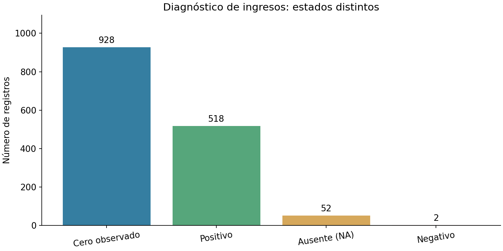
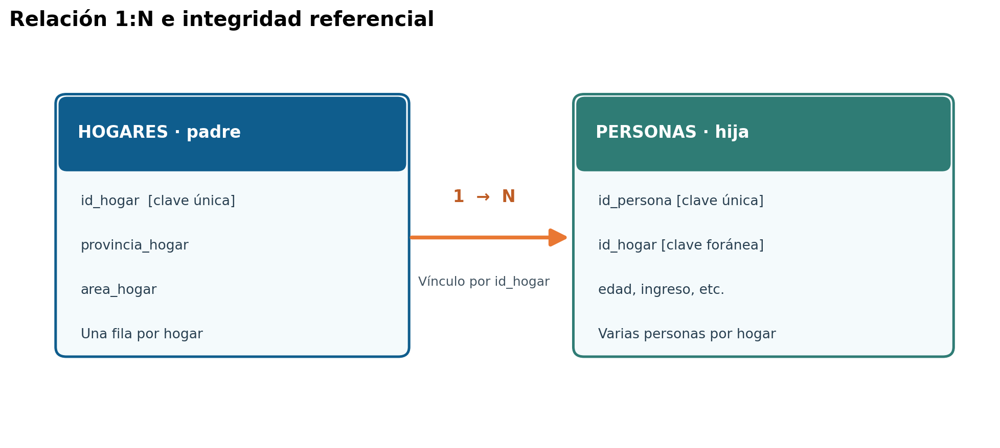
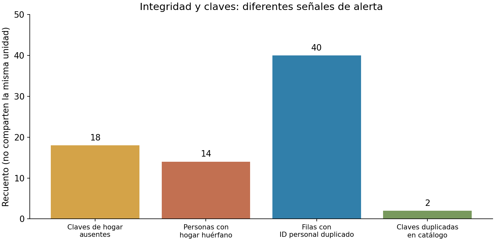
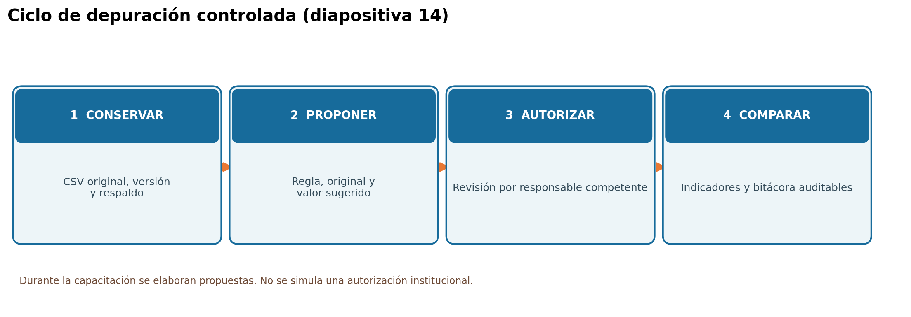
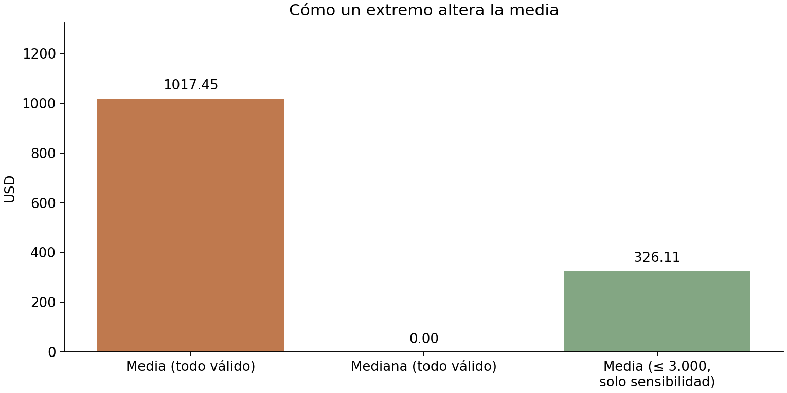
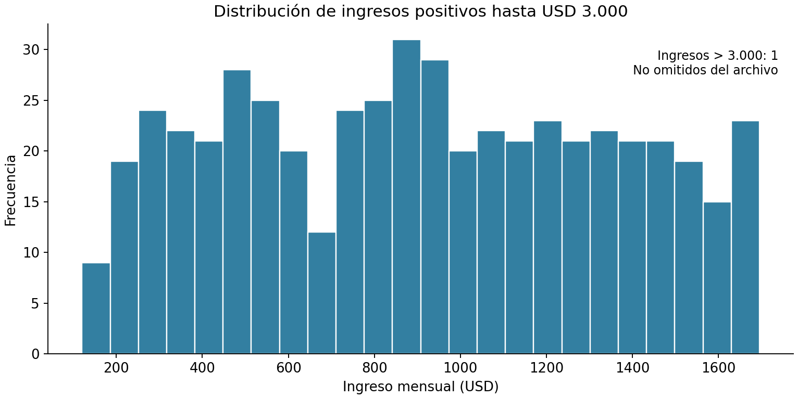
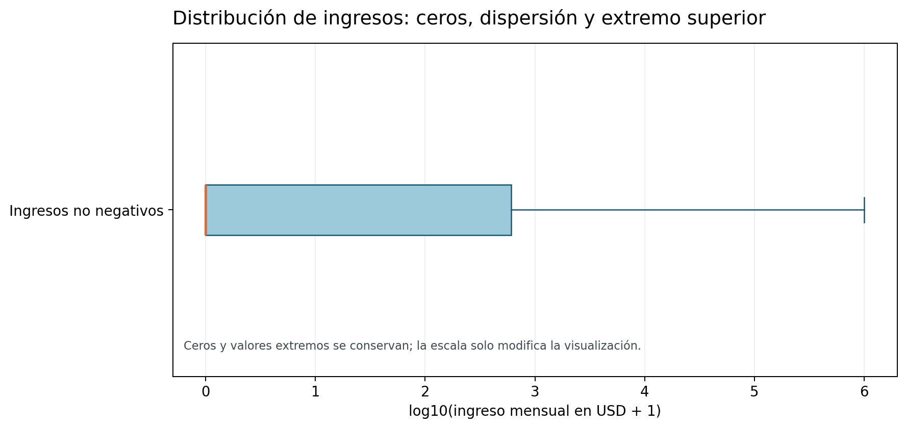
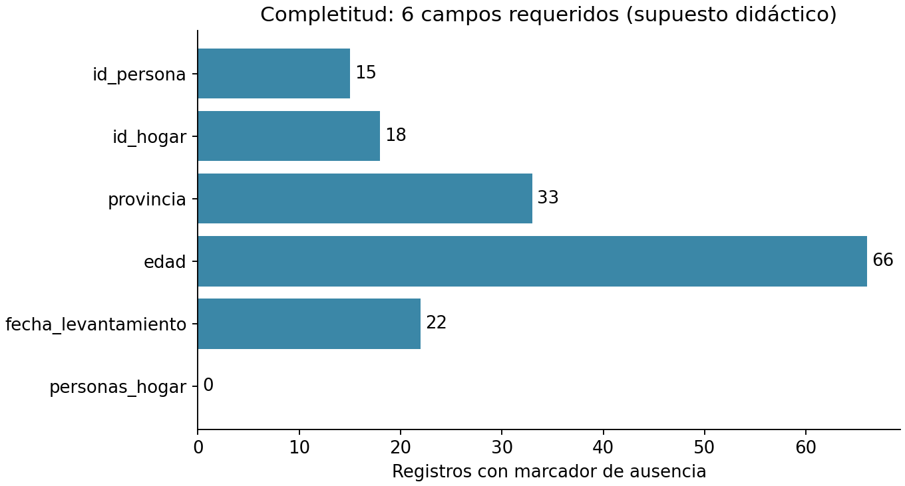
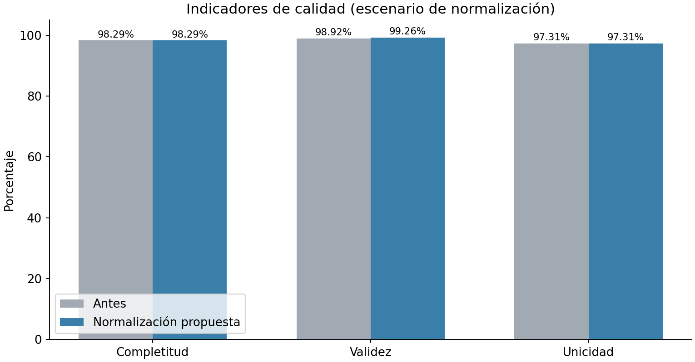

# GUÍA DE ESTUDIO AMPLIADA Y LABORATORIO PASO A PASO
## Módulos 5 y 6 — Consistencia, integridad, depuración y métricas de calidad con R

**Curso:** Evaluación de archivos de datos y automatización de reportes de calidad en R  
**Dirigido a:** personal técnico, analistas de información y estadísticos del Instituto Nacional de Estadística y Censos (INEC)  
**Instructor:** Ing. Ángel Geovanny Cudco Pomagualli, PhD(c).  
**Horas programadas:** 4 (dos horas por módulo) | **Tiempo adicional de estudio autónomo sugerido:** 4–6 horas.  
**Base principal:** `data_raw/personas_encuesta_sintetica_2026_10.csv`  
**Base relacionada:** `data_raw/hogares_catalogo_sintetico_2026_10.csv`  
**Modalidad:** construir los scripts línea por línea en RStudio, comentar, inspeccionar y contrastar los resultados. **No se exige ejecutar el proyecto completo de una vez.**

> **Alcance y cuidado estadístico.** Los archivos y sus incidencias son **sintéticos**. Las reglas sobre edades, horas, catálogos, ingresos, viviendas o períodos son **ejemplos didácticos**, no regulaciones, estadísticas ni controles oficiales del INEC. Una anomalía estadística no equivale por sí misma a un error. La autorización de cualquier corrección real compete al responsable metodológico y al procedimiento de calidad vigente. Los datos fuente deben mantenerse intactos.

---

## A. Orientación para utilizar esta guía

### A.1. Relación con las diapositivas

| Página de la presentación | Contenido de referencia | Sección desarrollada aquí | Producto en R |
|---|---|---|---|
| 12 | Relaciones lógicas: temporal, dependencia, identificador y semántica | B.1–B.7 | `alertas_logicas` |
| 13 | Integridad entre personas y hogares | B.8–B.12 | `huerfanos`, `alertas_integridad` |
| 14 | Conservar → proponer → autorizar → comparar; bitácora | C.1–C.8 | `personas_propuesta`, `bitacora_propuesta` |
| 15 | Completitud, validez, unicidad y consistencia | C.12–C.17 | `tabla_indicadores` |
| 16 | Comparación de indicadores antes/después (continuidad) | C.18 | `grafico_comparacion` |

**El producto de la capacitación no es una “base ya limpia”.** Es un proceso que permite explicar qué se detectó, dónde se detectó, qué regla se utilizó, qué decisión se propone y cómo se verificaría una intervención autorizada.

### A.2. Competencias y preguntas que resolverá el participante

Al finalizar, podrá diferenciar: *validez de una variable* de *consistencia entre variables*; *clave duplicada* de *fila duplicada*; *clave ausente* de *clave huérfana*; *normalización de representación* de *corrección semántica*; *cero* de *dato faltante*; *valor extremo* de *error confirmado*; *métrica de calidad* de *conteo de incidencias*. Podrá elaborar tablas reproducibles, gráficos y una bitácora que preserve la trazabilidad.

Preguntas guía:

1. ¿Cómo puede un registro tener variables válidas individualmente y ser inconsistente en conjunto?
2. ¿Qué sucede si se utiliza `left_join()` contra un catálogo con claves duplicadas?
3. ¿Por qué `sum(duplicated(id_persona))` no equivale a “filas afectadas por duplicidad”?
4. ¿Cómo documentar una propuesta sin modificar el archivo recibido?
5. ¿Qué diferencia produce usar media o mediana para imputar ingresos faltantes?
6. ¿Por qué una tasa de validez necesita indicar exactamente qué controles y registros se evaluaron?

### A.3. Método de clase: cinco acciones por bloque

**Leer la definición → escribir el código → predecir la salida → revisar el resultado → registrar una conclusión.** En las prácticas se indican pausas de verificación. Las salidas de referencia se ofrecen para contrastar los resultados, no para sustituir la experimentación.

### A.4. Plan sugerido de dos sesiones

| Sesión | Minutos | Secuencia de aula |
|---|---:|---|
| Módulo 5 | 15 | Recuperar el proyecto del módulo 4 y cargar fuentes |
| Módulo 5 | 25 | Consistencia condicional y lógica con `NA` |
| Módulo 5 | 30 | Duplicados, claves y referencias entre tablas |
| Módulo 5 | 35 | Construcción de alertas y gráficos |
| Módulo 5 | 15 | Interpretación y evidencias |
| Módulo 6 | 20 | Normalización y diferencias respecto a depuración |
| Módulo 6 | 25 | Elaboración de bitácora y propuesta |
| Módulo 6 | 30 | Estadística: media, mediana, cuantiles e imputación |
| Módulo 6 | 30 | Indicadores de calidad y gráficos |
| Módulo 6 | 15 | Conclusiones y revisión del código |

---

## B. Preparación del caso integrador

### B.1. Conocer el conjunto sintético antes de escribir reglas

El archivo de personas **conserva 1.500 filas y 27 columnas**. Cada fila representa una observación de persona y su vínculo con un hogar. El catálogo auxiliar de hogares contiene 595 filas y 5 variables. Ambas tablas fueron preparadas para enseñar detección, no para representar una operación estadística real.

| Variable | Interpretación didáctica | Tipo al importar | Uso en el taller |
|---|---|---|---|
| `id_persona` | Identificador de la persona | Texto | Unicidad y trazabilidad |
| `id_hogar` | Identificador del hogar asociado | Texto | Clave foránea y relación entre archivos |
| `periodo_referencia` | Mes de referencia, `AAAA-MM` | Texto | Consistencia temporal |
| `fecha_levantamiento` | Fecha de entrevista | Texto → fecha derivada | Consistencia temporal |
| `provincia` | Provincia informada | Texto | Normalización de etiquetas y dominio |
| `area` | Urbana / Rural | Texto | Categorías y equivalencias |
| `sexo` | Categoría capturada | Texto | Normalización, con diccionario validado |
| `edad` | Edad declarada | Texto → número derivado | Presencia, tipo y rango didáctico |
| `condicion_actividad` | Ocupado, Desocupado, Inactivo | Texto | Consistencia condicional |
| `horas_trabajo_semana` | Horas declaradas | Texto → número derivado | Reglas con condición de actividad |
| `ingreso_mensual_usd` | Ingreso mensual personal en USD | Texto decimal → número derivado | Estadística, presencia e imputación simulada |
| `personas_hogar` | Tamaño del hogar declarado | Texto → número derivado | Comparaciones de referencia |
| `peso_muestral` | Peso sintético | Texto → número derivado | Discusión del carácter descriptivo no ponderado |

**Metadatos indispensables:** unidad de observación; semántica de cada variable; dominio esperado; reglas de obligatoriedad; códigos de no respuesta; fecha/versión de la base; responsable de las validaciones. Nunca se debe inferir una regla institucional a partir del nombre de una columna.

### B.2. Diagnóstico conocido del archivo de práctica

Los siguientes valores se obtuvieron al examinar la copia CSV del paquete; sirven de puntos de comprobación del material, no de resultado del INEC:

| Condición | Referencia del archivo sintético |
|---|---:|
| Filas y columnas de personas | 1.500 y 27 |
| Identificadores `id_persona` ausentes | 15 |
| Repeticiones adicionales de `id_persona` no vacío | 20 |
| Filas afectadas por clave personal repetida | 40 |
| Filas completamente iguales, posteriores a la primera | 4 |
| `id_hogar` de personas ausente | 18 |
| Personas sin hogar en el catálogo auxiliar | 14, repartidas en 5 claves |
| Claves repetidas adicionalmente en el catálogo de hogares | 2 |
| Ingresos `NA`, cero y negativos | 52, 928 y 2 |
| Ingresos positivos | 518 |

**Interpretación importante:** 14 personas con referencia no encontrada no significa que el hogar “no exista en la realidad”: este **catálogo de enseñanza es deliberadamente parcial**. Y 40 filas con ID repetido no significa necesariamente 40 personas duplicadas: se requiere comparar su contenido y procedencia.



*Figura B1. El valor cero es una observación válida del archivo y debe distinguirse de `NA` y de valores bajo revisión.*

### B.3. Crear o abrir el archivo `.Rproj`

**Si se inicia un proyecto nuevo:** abrir RStudio → `File` → `New Project` → `New Directory` → `New Project`. Asignar un nombre, por ejemplo `calidad_inec_modulos_5_6`, y seleccionar la ubicación. RStudio creará un archivo `.Rproj`; guarde los archivos del paquete dentro de esa carpeta.

**Si se usa el material entregado:** descomprimir el ZIP y abrir `calidad_inec_modulos_5_6.Rproj`. No es necesario recrearlo. Verifique que el panel **Files** muestra `data_raw/`, `R/`, `diccionario/`, `resultados/`, `bitacoras/` y `figuras/`.

Estructura orientativa:

```text
calidad_inec_modulos_5_6.Rproj
├── data_raw/
│   ├── personas_encuesta_sintetica_2026_10.csv
│   └── hogares_catalogo_sintetico_2026_10.csv
├── datos_originales/
├── diccionario/
├── R/
│   ├── 00_preparacion.R
│   ├── 05_01_consistencia_logica_guiado.R
│   ├── 05_02_claves_integridad_guiado.R
│   ├── 06_01_normalizacion_bitacora_guiado.R
│   ├── 06_02_imputacion_escenarios_guiado.R
│   ├── 06_03_indicadores_calidad_guiado.R
│   └── TALLER_PARA_CONSTRUIR_EN_CLASE.R
├── bitacoras/
├── resultados/
└── figuras/
```

**Crear un script `.R`:** `File` → `New File` → `R Script` → `Ctrl+S` → guardar como `R/05_taller_personas.R`. Un **script `.R`** contiene instrucciones; el **archivo `.Rproj`** define el entorno y la carpeta de trabajo. Son archivos diferentes y se utilizan juntos.

### B.4. Cargar librerías: concepto de paquete y función

- **R**: lenguaje de programación estadístico.
- **RStudio**: entorno de desarrollo que permite editar scripts, ver objetos, explorar archivos y visualizar gráficos.
- **Paquete**: conjunto de funciones reutilizables, como `dplyr` o `ggplot2`.
- **Función**: operación que recibe argumentos, procesa datos y devuelve un resultado.
- **Objeto**: dato almacenado bajo un nombre, por ejemplo `personas_raw`.
- **Asignación `<-`**: guarda el resultado de una expresión en un objeto.
- **Operador `%>%`**: pasa el resultado de la izquierda a la operación de la derecha.

```r
# Instalar una sola vez si los paquetes aún no están instalados:
# install.packages(c("here", "readr", "dplyr", "tidyr", "ggplot2"))

library(here)     # Rutas relacionadas con el proyecto.
library(readr)    # Lectura de archivos delimitados (CSV).
library(dplyr)    # Filtrar, crear columnas, contar y relacionar tablas.
library(tidyr)    # Reorganizar tablas.
library(ggplot2)  # Visualizaciones estadísticas.
```

**Posible error:** `no se pudo encontrar la función "%>%"`. Solución: cargar `dplyr` con `library(dplyr)` o trabajar directamente con funciones base/`dplyr::funcion()`. Instalar un paquete no significa que ya esté cargado en la sesión.

### B.5. Importar los dos CSV sin perder su representación

```r
# Paso 1: formar rutas sin usar una ruta absoluta local del docente.
ruta_personas <- here::here(
  "data_raw", "personas_encuesta_sintetica_2026_10.csv"
)
ruta_hogares <- here::here(
  "data_raw", "hogares_catalogo_sintetico_2026_10.csv"
)

# Paso 2: comprobar que ambos archivos existen.
file.exists(ruta_personas)
file.exists(ruta_hogares)

# Paso 3: importar las 27 variables originales como texto.
personas_raw <- readr::read_csv(
  file = ruta_personas,
  col_types = readr::cols(.default = readr::col_character()),
  na = "NA",
  trim_ws = FALSE,
  locale = readr::locale(encoding = "UTF-8"),
  show_col_types = FALSE
)

# Paso 4: importar el catálogo de hogares de la misma manera.
hogares_raw <- readr::read_csv(
  file = ruta_hogares,
  col_types = readr::cols(.default = readr::col_character()),
  na = "NA",
  trim_ws = FALSE,
  show_col_types = FALSE
)

# Paso 5: inspeccionar, sin transformar aún.
dim(personas_raw)    # Esperado: 1500 27
names(personas_raw)  # Nombres de todas las columnas.
head(personas_raw, 6)
readr::problems(personas_raw)
```

**¿Por qué inicialmente todo como texto?** Porque `P00001`, `H00001` y `2026-10` son identificadores o períodos, no cantidades. Además, conservar `Guayas ` con espacio o `PICHINCHA` permite registrar problemas de representación. `problems()` detecta problemas de **lectura**, no todas las inconsistencias lógicas.

### B.6. Crear columnas derivadas sin perder las originales

```r
# Función local: unificar marcadores de no respuesta en una COPIA.
limpiar_ausencias <- function(x) {
  y <- trimws(as.character(x))
  y[is.na(y) | toupper(y) %in% c("", "NA", "N/D", "SIN DATO")] <- NA_character_
  y
}

# Añadir índice físico y versiones numéricas auxiliares.
personas <- personas_raw %>%
  mutate(
    fila_csv = row_number() + 1L,
    id_persona = limpiar_ausencias(id_persona),
    id_hogar = limpiar_ausencias(id_hogar),
    provincia = limpiar_ausencias(provincia),
    condicion_actividad = limpiar_ausencias(condicion_actividad),
    edad_n = suppressWarnings(as.numeric(limpiar_ausencias(edad))),
    horas_n = suppressWarnings(as.numeric(limpiar_ausencias(horas_trabajo_semana))),
    ingreso_n = suppressWarnings(as.numeric(limpiar_ausencias(ingreso_mensual_usd)))
  )

hogares <- hogares_raw %>%
  mutate(id_hogar = limpiar_ausencias(id_hogar))

# Ejemplo: comparar una columna original y su equivalente derivada.
personas %>% select(fila_csv, edad, edad_n, ingreso_mensual_usd, ingreso_n) %>% head(8)
```

**Nota:** `suppressWarnings()` evita imprimir advertencias de conversión, **pero no valida los datos**. Más adelante se crean alertas de formato explícitas. `fila_csv = row_number() + 1L` incluye el encabezado y sirve para regresar a la línea física original; su significado depende de que no se altere el orden de importación. **Nunca se debe considerar este índice una clave permanente del negocio.**

**Pausa de aprendizaje:** explique la diferencia entre `personas_raw` (27 variables originales), `personas` (tabla de análisis con auxiliares) y `personas_propuesta` (copia con cambios propuestos). La copia importada y el CSV original no son equivalentes a una copia corregida.

---

# MÓDULO 5 — CONSISTENCIA LÓGICA E INTEGRIDAD DE DATOS

## B.7. Definiciones fundamentales

**Consistencia lógica:** grado en que dos o más valores mantienen una relación esperada por la metodología o por un supuesto aprobado. Puede involucrar variables de una fila, registros de la misma tabla o registros de diferentes archivos.

**Validez:** propiedad de un valor que satisface una regla de tipo, dominio, rango o formato. Ejemplo: que `edad` sea un número entero entre límites definidos **no asegura** que otras variables relacionadas sean coherentes.

**Unicidad:** propiedad de una clave que identifica de modo no ambiguo una entidad en la tabla correspondiente.

**Integridad referencial:** propiedad por la cual cada referencia no nula hacia una entidad de otra tabla encuentra un registro válido en esa tabla, bajo el alcance de un catálogo completo y confiable.

**Trazabilidad:** posibilidad de reconstruir el origen, la regla, el responsable, la fecha y cualquier transformación de un dato.

| Dimensión | Pregunta que responde | Ejemplo concreto |
|---|---|---|
| Validez | ¿Este campo cumple una regla? | `edad = "treinta"` no es numérico |
| Consistencia | ¿Esta combinación de campos tiene sentido? | Condición de actividad y horas declaradas |
| Unicidad | ¿Esta entidad aparece una sola vez según su clave? | `id_persona` repetido |
| Integridad | ¿Existe la entidad referenciada? | `id_hogar` no encontrado en hogares |
| Completitud | ¿Está presente el dato requerido? | `id_hogar` vacío |
| Trazabilidad | ¿Qué pasó y por qué? | Regla `L5-03`, fila y evidencia |

**Ejemplo razonado:** una persona puede tener `horas_trabajo_semana = 12`, que es un número admisible. Si su condición es `Inactivo`, podría activarse una advertencia didáctica. Antes de afirmar que el dato es falso, hay que revisar el período y la definición de “horas trabajadas”.

## B.8. La lógica en R: TRUE, FALSE y NA

En R, las comparaciones suelen devolver `TRUE` o `FALSE`; cuando se involucra un valor desconocido, algunas expresiones devuelven `NA`.

| Expresión | Resultado | Interpretación |
|---|---|---|
| `5 > 3` | `TRUE` | 5 es mayor que 3 |
| `5 == 3` | `FALSE` | 5 no es igual a 3 |
| `NA == 0` | `NA` | No se conoce el valor |
| `is.na(NA)` | `TRUE` | Es una ausencia explícita |
| `TRUE & FALSE` | `FALSE` | Ambas condiciones no se cumplen |
| `TRUE \| FALSE` | `TRUE` | Se cumple al menos una |

```r
# Ejercicios de lógica: ejecutar una expresión por línea.
5 > 3
5 == 3
is.na(NA)
"Ocupado" %in% c("Ocupado", "Inactivo")

# No use sum() directamente sobre condiciones que incluyan NA.
x <- c(10, NA, 0, 5)
sum(x > 0, na.rm = TRUE)   # Dos valores positivos observados.
sum(is.na(x))              # Una ausencia.
```

**Operadores esenciales:** `==` igual; `!=` distinto; `<` menor; `>` mayor; `<=` menor o igual; `>=` mayor o igual; `&` conjunción; `|` disyunción; `%in%` pertenencia; `!` negación; `is.na()` ausencia. Una regla debe indicar también qué hacer con los registros en que **no puede evaluarse** por falta de información.

## B.9. Reglas condicionales entre variables

### Regla L5-01 — Ocupado con cero horas (revisión)

**Pregunta:** ¿existen observaciones registradas como “Ocupado” con exactamente cero horas declaradas? **Supuesto didáctico:** activar una señal para revisión; no declarar error automático.

```r
# Convertimos la pregunta a una combinación de condiciones.
ocupado_con_cero <- personas %>%
  filter(
    condicion_actividad == "Ocupado", # Estado declarado.
    !is.na(horas_n),                   # Se conoce la cantidad de horas.
    horas_n == 0                       # Las horas son exactamente cero.
  )

# Se revisa el número de filas y su identificación.
nrow(ocupado_con_cero)
ocupado_con_cero %>% select(fila_csv, id_persona, condicion_actividad, horas_n)
```

**Resultado de referencia:** 0 filas. **Interpretación correcta:** esta condición específica no aparece en el CSV; no implica que todos los campos sean correctos ni que esta regla sea universalmente apropiada.

### Regla L5-02 — No ocupado con horas positivas

```r
no_ocupado_con_horas <- personas %>%
  filter(
    condicion_actividad %in% c("Desocupado", "Inactivo"),
    !is.na(horas_n),
    horas_n > 0
  )

nrow(no_ocupado_con_horas)
no_ocupado_con_horas %>%
  select(fila_csv, id_persona, condicion_actividad, horas_trabajo_semana)
```

**Referencia:** 6 filas. La salida se interpreta como **seis incidencias de revisión**, no como seis declaraciones fraudulentas o erróneas. Verificar la metodología de horas y actividad antes de decidir.

### Regla L5-03 — Incompatibilidad temporal entre fecha y período

**Regla didáctica:** el mes de `fecha_levantamiento` debe coincidir con `periodo_referencia` cuando la fecha es interpretable y el diseño exige tal coincidencia.

```r
# Transformar una fecha con el formato esperado: AAAA-MM-DD.
fecha_d <- suppressWarnings(
  as.Date(personas$fecha_levantamiento, format = "%Y-%m-%d")
)

# Detectar la diferencia solo para fechas no ausentes y válidas.
desfase <- !is.na(fecha_d) &
  !is.na(personas$periodo_referencia) &
  format(fecha_d, "%Y-%m") != personas$periodo_referencia

# 'which()' devuelve las posiciones donde la condición es TRUE.
filas_desfase <- which(!is.na(desfase) & desfase)
length(filas_desfase)

personas[filas_desfase, ] %>%
  select(fila_csv, id_persona, fecha_levantamiento, periodo_referencia)
```

**Referencia:** 8 desfases. *Advertencia:* las fechas no interpretables deben tratarse en una **alerta de formato separada**, no incluirse como desfases. En esta base se encuentran 22 fechas faltantes y 6 cadenas de fecha no interpretables bajo `AAAA-MM-DD`; también conviene verificar que no exista una conversión permisiva mediante comparación del texto de salida con el valor original.

```r
# Ejercicio extra: fechas que tienen texto, pero no pudieron convertirse.
fecha_texto <- limpiar_ausencias(personas$fecha_levantamiento)
formato_fecha_invalido <- !is.na(fecha_texto) & is.na(fecha_d)
sum(formato_fecha_invalido)
```

### Regla L5-04 — ¿Coherencia de personas y tamaño del hogar?

Se puede comparar `personas_hogar` con el conteo de observaciones por `id_hogar`, **pero no debe llamarse error inmediatamente**. Un archivo de personas puede corresponder a una muestra, subconjunto o cobertura parcial, mientras que `personas_hogar` puede registrar el tamaño total declarado. El conteo de filas y el número de integrantes **no son necesariamente comparables**. Esta regla se deja como discusión conceptual hasta aclarar la unidad y cobertura de cada fuente.

## B.10. Transformar reglas en una tabla de alertas

Una alerta útil debe conservar **identificador de regla, versión de regla, fila original, identificadores, variable, valor observado, severidad sugerida, explicación y estado**.

```r
# Esta función toma una condición lógica y construye una tabla de evidencias.
crear_alerta <- function(tabla, condicion, regla, variable, descripcion) {
  posiciones <- which(!is.na(condicion) & condicion)

  tibble::tibble(
    fila_csv = tabla$fila_csv[posiciones],
    id_persona = tabla$id_persona[posiciones],
    id_hogar = tabla$id_hogar[posiciones],
    regla_id = rep(regla, length(posiciones)),
    version_regla = rep("1.0-DIDACTICA", length(posiciones)),
    variable = rep(variable, length(posiciones)),
    valor_observado = as.character(tabla[[variable]][posiciones]),
    severidad = rep("REVISAR", length(posiciones)),
    descripcion = rep(descripcion, length(posiciones)),
    estado = rep("PENDIENTE", length(posiciones))
  )
}

# Convertir los dos tipos de excepciones en la misma estructura.
condicion_l2 <- personas$condicion_actividad %in% c("Desocupado", "Inactivo") &
  !is.na(personas$horas_n) & personas$horas_n > 0

alertas_logicas <- dplyr::bind_rows(
  crear_alerta(personas, condicion_l2, "L5-02", "horas_trabajo_semana",
               "No ocupado con horas positivas"),
  crear_alerta(personas, desfase, "L5-03", "fecha_levantamiento",
               "Mes de levantamiento distinto del período")
)

# Una regla puede producir cero o muchas filas.
alertas_logicas %>% count(regla_id, severidad, name = "total")
head(alertas_logicas, 10)
```

**Qué hace cada función:** `function(...)` define una operación reutilizable; `which()` localiza posiciones; `tibble()` crea una tabla moderna; `rep()` repite etiquetas; `bind_rows()` concatena tablas que comparten columnas; `count()` resume frecuencias. La ausencia de alertas no equivale por sí sola a una verificación completa.

### Gráfico de alertas

```r
resumen_logico <- alertas_logicas %>%
  count(regla_id, name = "total")

ggplot(resumen_logico, aes(x = regla_id, y = total)) +
  geom_col(fill = "#14679E") +
  geom_text(aes(label = total), vjust = -0.3) +
  labs(title = "Alertas por regla lógica (datos sintéticos)",
       x = "Regla", y = "Número de registros señalados") +
  theme_minimal()
```

**Cómo interpretar:** la altura corresponde al número de alertas de cada regla, **no** al total de individuos únicos; una misma persona podría estar en varias reglas. El gráfico muestra señales y prioridades de revisión, nunca errores confirmados por sí mismo.

## B.11. Unicidad: cuatro situaciones que no deben confundirse

**Clave primaria:** atributo o conjunto de atributos que identifica una única entidad en su tabla. **Clave foránea:** atributo que referencia la clave de otra tabla. En el archivo de personas, `id_persona` se propone como clave única y `id_hogar` como clave foránea. El mismo hogar **sí puede aparecer varias veces entre personas**, porque la relación es uno a muchos (1:N).



| Caso | ¿Se espera repetición? | ¿Cómo se interpreta? |
|---|---|---|
| `id_persona` repetido entre personas | No bajo el supuesto de clave única | Revisar conflictos de identidad |
| `id_hogar` repetido entre personas | Sí | Varias personas pueden vivir en un hogar |
| `id_hogar` repetido en catálogo de hogares | No bajo una clave única de catálogo | Riesgo de unir múltiples filas padre |
| Todas las 27 columnas de personas idénticas | No necesariamente | Posible repetición de recepción/carga |

### Encontrar repeticiones adicionales vs. filas involucradas

```r
# Excluir claves ausentes para no confundirlas con duplicados.
ids_presentes <- personas %>% filter(!is.na(id_persona))

# Conteo 1: filas después de la primera aparición.
repeticiones_adicionales <- ids_presentes %>%
  filter(duplicated(id_persona))

# Conteo 2: TODAS las filas cuyo ID aparece más de una vez.
filas_afectadas <- ids_presentes %>%
  filter(
    duplicated(id_persona) |
    duplicated(id_persona, fromLast = TRUE)
  ) %>%
  arrange(id_persona, fila_csv)

nrow(repeticiones_adicionales)   # Referencia: 20.
nrow(filas_afectadas)            # Referencia: 40.

# Buscar filas idénticas comparando solo las 27 variables de origen.
sum(duplicated(personas_raw))   # Referencia: 4 repeticiones.
```

**Interpretación:** para un ID que aparece dos veces, el número de **filas implicadas** es 2, pero solo existe 1 **repetición adicional**. Si aparece tres veces, hay 3 filas afectadas y 2 repeticiones. Esta distinción cambia tanto los porcentajes como la severidad de un reporte.

**No ejecutar** `distinct(id_persona, .keep_all=TRUE)` para “arreglar” duplicados sin investigar: puede conservar una fila arbitraria y descartar evidencia contradictoria.

### Visualización de frecuencia de claves duplicadas

```r
frecuencia_ids <- ids_presentes %>%
  count(id_persona, name = "apariciones") %>%
  count(apariciones, name = "numero_ids")

ggplot(frecuencia_ids, aes(x = factor(apariciones), y = numero_ids)) +
  geom_col(fill = "#14679E") +
  labs(title = "Frecuencia de aparición de identificadores",
       x = "Apariciones por ID", y = "Número de IDs") +
  theme_minimal()
```

## B.12. Integridad referencial y operaciones entre tablas

Imagine dos archivos:

```text
HOGARES (tabla padre)             PERSONAS (tabla hija)
H00001                            P00001 → H00001
H00002                            P00002 → H00001
H00003                            P00003 → H00002
                                  P00004 → H99999  ← no hay padre encontrado
```

**Relación 1:N:** un hogar puede tener varias personas; una observación de persona refiere a un hogar. En R, los principales cruces son:

| Función | Conserva | Utilidad |
|---|---|---|
| `inner_join()` | Coincidencias entre ambas tablas | Revisar registros relacionados |
| `left_join()` | Todas las filas de la izquierda, con datos asociados | Agregar atributos (cuidado: duplicados padre multiplican filas) |
| `semi_join()` | Filas de la izquierda que sí tienen pareja | Identificar referencias existentes |
| `anti_join()` | Filas de la izquierda que no tienen pareja | Detectar referencias sin correspondencia |

### Paso 1. Comprobar unicidad de la tabla padre

```r
hogares %>%
  count(id_hogar, name = "apariciones") %>%
  filter(apariciones > 1)
```

**Resultado esperado:** 2 repeticiones adicionales de claves de hogar en el catálogo auxiliar. No unir aún todos los campos: una tabla padre duplicada puede inflar el número de filas de personas.

### Paso 2. Construir una referencia de existencia sin duplicados

```r
catalogo_ids <- hogares %>%
  filter(!is.na(id_hogar)) %>%
  distinct(id_hogar)
```

Esto **no limpia** el catálogo de origen: obtiene una lista única temporal para comprobar solamente la **existencia** de una clave. Para asociar atributos de hogares es necesario resolver la duplicación padre o utilizar una regla de selección aprobada.

### Paso 3. Separar dos problemas distintos

```r
# Clave faltante en la tabla de personas.
hogar_ausente <- personas %>%
  filter(is.na(id_hogar))

# Clave presente sin referencia en el catálogo auxiliar.
huerfanos <- personas %>%
  filter(!is.na(id_hogar)) %>%
  anti_join(catalogo_ids, by = "id_hogar")

nrow(hogar_ausente)             # Referencia: 18.
nrow(huerfanos)                 # Referencia: 14.
n_distinct(huerfanos$id_hogar)  # Referencia: 5 claves distintas.
```



**Interpretación estadística:** la cantidad de **filas** afectadas no siempre coincide con la cantidad de **claves** distintas. Además, una referencia no encontrada puede deberse a un catálogo incompleto, una fecha de corte diferente o un error en las claves; por tanto, no debe etiquetarse como error definitivo sin verificar el universo de referencia.

### Paso 4. Identificar hogares del catálogo sin personas asociadas

```r
# No significa necesariamente que el hogar esté vacío.
hogares_sin_personas <- catalogo_ids %>%
  anti_join(personas %>% filter(!is.na(id_hogar)) %>% distinct(id_hogar),
            by = "id_hogar")

nrow(hogares_sin_personas)  # Referencia: 1 hogar del catálogo auxiliar.
```

### Paso 5. Evitar multiplicaciones no deseadas en un join

```r
# Comparar la cantidad antes/después de unir CONTRA un catálogo temporal único.
comparacion <- personas %>%
  left_join(catalogo_ids, by = "id_hogar")

nrow(personas)
nrow(comparacion)  # Debe conservar las 1.500 filas en este ejemplo.
```

El `left_join()` contra la lista única de **una sola columna** solo comprueba el vínculo; no añade atributos nuevos de hogares. Para enriquecimiento real debe garantizarse previamente que la tabla padre tiene exactamente una fila válida por clave.

## B.13. Construir alertas de integridad con severidad orientativa

```r
# Generar alertas reproducibles con un esquema común.
alertas_id_ausente <- tibble::tibble(
  fila_csv = hogar_ausente$fila_csv,
  id_persona = hogar_ausente$id_persona,
  id_hogar = hogar_ausente$id_hogar,
  regla_id = "I5-01",
  severidad = "REVISAR",
  descripcion = "id_hogar no informado"
)

alertas_sin_referencia <- tibble::tibble(
  fila_csv = huerfanos$fila_csv,
  id_persona = huerfanos$id_persona,
  id_hogar = huerfanos$id_hogar,
  regla_id = "I5-02",
  severidad = "REVISAR",
  descripcion = "id_hogar no encontrado en catálogo auxiliar"
)

alertas_integridad <- bind_rows(alertas_id_ausente, alertas_sin_referencia)
alertas_integridad %>% count(regla_id, name = "n_alertas")
```

**Extensión guiada:** incorpore los 40 registros con `id_persona` repetido como regla `I5-03`; mantenga `fila_csv` y añada `version_regla`, `responsable_metodologico`, `fecha_revision` y `estado`. Es posible que una fila active simultáneamente varias reglas: el total de alertas **no debe interpretarse como total de personas únicas afectadas**.

### Ejercicio de cierre del módulo 5

Escriba un párrafo que responda: (a) ¿por qué no puede eliminar automáticamente las filas huérfanas?, (b) ¿por qué `id_hogar` repetido entre personas es esperable?, (c) ¿cuál es la diferencia entre duplicación de clave y duplicación de registro completo?, y (d) ¿por qué una alerta debe contener la versión de la regla?

---

# MÓDULO 6 — DEPURACIÓN CONTROLADA Y MÉTRICAS DE CALIDAD

## C.1. ¿Qué significa depurar datos?

La **depuración** agrupa procedimientos que permiten examinar, documentar y, cuando existe autorización, corregir o tratar problemas de calidad. Una acción responsable no oculta el valor observado ni confunde ausencia, incertidumbre y error.

| Acción | Definición | Ejemplo didáctico | Precaución |
|---|---|---|---|
| Perfilado | Describir patrones y anomalías | Contar provincias, faltantes e ingresos | No corrige nada |
| Normalización | Unificar representaciones equivalentes | `urban` → `Urbana` | Requiere equivalencia documentada |
| Corrección | Reemplazar un dato por otro sustentado | Cambiar una provincia según documento fuente | Debe estar autorizada |
| Imputación | Estimar un valor faltante | Mediana de ingresos de un grupo | Puede introducir sesgo y falsa precisión |
| Exclusión | Apartar una observación del análisis | Separar un extremo para sensibilidad | No borrar su evidencia |
| Anonimización | Reducir identificabilidad | Sustituir IDs en una copia de presentación | No confundir con depuración de calidad |

**Una “mejora de indicador” no demuestra por sí sola una “mejora en la realidad”.** Cambiar una etiqueta puede incrementar la validez de formato, pero no certificar que la respuesta original sea correcta.

## C.2. Las cuatro etapas del tratamiento controlado



1. **Conservar** — Archivo original, versión, nombre, fecha de recepción y, cuando corresponda, una huella digital (hash). El archivo `data_raw/` no se sobrescribe.
2. **Proponer** — Detectar la incidencia y documentar la transformación sugerida sin aplicarla al origen.
3. **Autorizar** — Un responsable competente acepta, modifica o rechaza la propuesta con fundamento técnico. En este taller no se simulan aprobaciones reales.
4. **Comparar** — Contrastar origen, propuesta, reglas y métricas; comprobar que los cambios no creen nuevos conflictos.

**Diferencia entre una propuesta y una versión de producción:** en el proyecto didáctico todas las transformaciones permanecen en objetos derivados y el estado de bitácora es `PENDIENTE_DE_APROBACION`.

## C.3. Reconocer categorías que requieren normalización

```r
# Comprobar el material observado antes de intervenir.
personas_raw %>% count(provincia, sort = TRUE)
personas_raw %>% count(area, sort = TRUE)
personas_raw %>% count(sexo, sort = TRUE)
```

Observe que existen variantes como `PICHINCHA`, `Guayas `, `urban` y `F`. La posible equivalencia con `Pichincha`, `Guayas`, `Urbana` y `Mujer` se incorpora como **supuesto explícito del ejercicio**. No se transforman automáticamente `99`, `Desconocida` ni categorías sin equivalencia definida.

### Paso 6.1. Crear una propuesta en otro objeto

```r
personas_propuesta <- personas_raw %>%
  mutate(
    area = case_when(
      trimws(area) == "urban" ~ "Urbana",
      TRUE ~ area
    ),
    sexo = case_when(
      trimws(sexo) == "F" ~ "Mujer",
      TRUE ~ sexo
    ),
    provincia = case_when(
      trimws(provincia) == "PICHINCHA" ~ "Pichincha",
      trimws(provincia) == "Guayas" ~ "Guayas",
      TRUE ~ provincia
    )
  )

# Comparar frecuencias antes y después; no sobreescribir datos fuente.
personas_raw %>% count(provincia, sort = TRUE) %>% head(10)
personas_propuesta %>% count(provincia, sort = TRUE) %>% head(10)
```

**Explicación de funciones:** `mutate()` crea/modifica columnas en la tabla devuelta; `case_when()` prueba condiciones de arriba hacia abajo; `trimws()` quita espacios iniciales/finales de una cadena; `TRUE ~ area` conserva el valor cuando las condiciones anteriores no se cumplen. El objeto `personas_raw` permanece intacto.

### Paso 6.2. Comparar cambios propuestos con originales

```r
# Una función pequeña para comparar dos vectores, incluyendo NA.
es_diferente <- function(antes, despues) {
  antes_txt <- ifelse(is.na(antes), "<AUSENTE>", as.character(antes))
  despues_txt <- ifelse(is.na(despues), "<AUSENTE>", as.character(despues))
  antes_txt != despues_txt
}

# Inspeccionar solo las tres columnas con propuestas de normalización.
columnas_propuesta <- c("area", "sexo", "provincia")

for (columna in columnas_propuesta) {
  cambios <- es_diferente(personas_raw[[columna]], personas_propuesta[[columna]])
  cat(columna, ":", sum(cambios), "cambios propuestos\n")
}
```

**Lectura crítica:** `Guayas ` y `Guayas` no son la misma cadena original, aunque suelen representar el mismo nombre geográfico. Esta propuesta no autoriza cambios en registros de producción.

## C.4. Diseñar una bitácora de transformaciones

Una **bitácora** es una tabla que permite reconstruir una decisión. Debe permitir responder quién propuso un cambio, cuál era el valor, qué se propone, por qué, bajo qué regla, en qué versión del archivo y qué estado tiene la propuesta.

| Campo mínimo | ¿Qué registra? |
|---|---|
| `archivo_origen` | Nombre/version del archivo fuente |
| `fila_csv` | Línea física en el archivo importado, con cabecera |
| `id_persona` | Identificador de negocio, si existe |
| `variable` | Columna de la intervención |
| `valor_original` | Representación original |
| `valor_propuesto` | Representación sugerida |
| `regla_id` y `version_regla` | Identificación reproducible del criterio |
| `motivo` | Justificación semántica o documental |
| `estado` | Pendiente, aprobado o rechazado |
| `responsable` | Quien registra/revisa la intervención |
| `fecha_propuesta` | Fecha de elaboración |

### Paso 6.3. Construir la bitácora de forma progresiva

```r
# 1) Empezar con una variable, para comprender el mecanismo.
columna <- "area"
cambios_area <- es_diferente(personas_raw[[columna]],
                             personas_propuesta[[columna]])
posiciones <- which(cambios_area)

# 2) Crear un registro por cambio encontrado.
bitacora_area <- tibble::tibble(
  archivo_origen = "personas_encuesta_sintetica_2026_10.csv",
  fila_csv = posiciones + 1L,
  id_persona = personas_raw$id_persona[posiciones],
  variable = columna,
  valor_original = personas_raw[[columna]][posiciones],
  valor_propuesto = personas_propuesta[[columna]][posiciones],
  regla_id = "N6-AREA",
  version_regla = "1.0-DIDACTICA",
  estado = "PENDIENTE_DE_APROBACION",
  responsable = "PARTICIPANTE",
  fecha_propuesta = as.character(Sys.Date())
)

head(bitacora_area, 10)
nrow(bitacora_area)
```

**Ejercicio:** reproduzca el mismo bloque para `sexo` y `provincia`, y combine con `bind_rows()`. Después sustituya la repetición por una función general como la mostrada en `R/06_01_normalizacion_bitacora_guiado.R`.

```r
# 3) Guardar en ruta NUEVA, cuando el docente revise la tabla.
# dir.create(here::here("bitacoras"), showWarnings = FALSE)
# readr::write_csv(bitacora_area,
#   here::here("bitacoras", "bitacora_propuesta_area.csv"), na = "NA")
```

**Importante:** `Sys.Date()` toma la fecha del computador del participante cuando ejecute el bloque. Una bitácora real también debe indicar responsable, versión y aprobación documental, no solo una fecha.

## C.5. Distinguir ausencia, cero, valor negativo y extremo

La variable `ingreso_mensual_usd` del CSV estandarizado almacena texto decimal sin `$`, sin sufijos y con **dos decimales**, o el marcador `NA`. Su unidad es USD por mes. El archivo preserva dos ingresos negativos y un valor positivo extremadamente alto para enseñar revisión.

| Registro | ¿Es ausencia? | ¿Se permite calcularlo como número? | Interpretación |
|---|---|---|---|
| `NA` | Sí | No | No observado; documentar motivo si se conoce |
| `0.00` | No | Sí | Cero informado; puede ser legítimo |
| `350.50` | No | Sí | Cantidad observada |
| `-80.00` | No | Sí | Número interpretable, pero requiere revisión por regla didáctica de no negatividad |
| `999999.99` | No | Sí | Valor extremo; investigar origen antes de excluir |

```r
# Comprobar cada situación en la copia numérica.
personas %>% summarise(
  n_total = n(),
  ausentes = sum(is.na(ingreso_n)),
  ceros = sum(ingreso_n == 0, na.rm = TRUE),
  negativos = sum(ingreso_n < 0, na.rm = TRUE),
  positivos = sum(ingreso_n > 0, na.rm = TRUE),
  maximo = max(ingreso_n, na.rm = TRUE)
)
```

**Referencia:** 1.500 observaciones; 52 ausentes; 928 ceros; 2 negativos; 518 positivos. **Nunca** usar `ingreso_n == 0` como sinónimo de `is.na(ingreso_n)`.

## C.6. Estadística descriptiva: media, mediana y cuantiles

### Media aritmética

Es la suma de los valores observados dividida por el número de observaciones utilizadas:

\[
\bar{x} = \frac{1}{n}\sum_{i=1}^{n} x_i
\]

- **Ventaja:** usa la magnitud de todos los valores incluidos.
- **Limitación:** es sensible a valores extremos.
- **Precaución:** el denominador `n` debe excluir las ausencias y reflejar explícitamente los criterios de inclusión. Aquí se separan los ingresos negativos para un **cálculo didáctico**; las filas siguen disponibles para revisión.

### Mediana

Es el valor central de la serie ordenada; si el número de observaciones es par, es el promedio de los dos valores centrales. Es menos sensible a valores muy altos o bajos. Puede ser **cero** aunque muchas otras personas tengan ingresos positivos.

### Cuartiles e intervalo intercuartílico (IQR)

Los cuartiles `Q1` y `Q3` delimitan aproximadamente los percentiles 25 y 75; el **IQR = Q3 − Q1** expresa la dispersión central. El criterio usual `Q3 + 1.5 × IQR` es un *detector exploratorio de atípicos*, **no** una regla institucional de invalidez.

### Paso 6.4. Calcular estadísticos con criterio explícito

```r
# Crear el vector analítico: incluir ceros, excluir NA y negativos.
ingresos_validos <- personas$ingreso_n[
  !is.na(personas$ingreso_n) & personas$ingreso_n >= 0
]

media_global <- mean(ingresos_validos)
mediana_global <- median(ingresos_validos)
cuartiles <- quantile(ingresos_validos, probs = c(0.25, 0.50, 0.75))
desviacion <- sd(ingresos_validos)

# Análisis de sensibilidad: no usar como corrección de datos.
media_hasta_3000 <- mean(ingresos_validos[ingresos_validos <= 3000])

round(c(
  media = media_global,
  mediana = mediana_global,
  desviacion = desviacion,
  media_sensibilidad = media_hasta_3000
), 2)
cuartiles
```

**Valores de contraste:** media ≈ **USD 1.017,45**; mediana **USD 0,00**; media de sensibilidad con filtro `≤ 3000` ≈ **USD 326,11**. La gran diferencia es coherente con 928 ceros observados y un extremo de 999.999,99 USD. **El filtro ≤3000 es arbitrario y solo se usa para demostrar sensibilidad**, no para eliminar datos ni establecer un límite de ingresos.



### Paso 6.5. Graficar la distribución en R

```r
# Eliminar ausentes y negativos solo del OBJETO PARA GRAFICAR.
datos_grafico <- personas %>%
  filter(!is.na(ingreso_n), ingreso_n >= 0)

# Histograma en escala logarítmica para mantener el extremo visible.
ggplot(datos_grafico, aes(x = log10(ingreso_n + 1))) +
  geom_histogram(bins = 35, fill = "#14679E", color = "white") +
  labs(title = "Ingresos observados: escala log10(ingreso + 1)",
       x = "log10(ingreso mensual en USD + 1)",
       y = "Número de observaciones") +
  theme_minimal()
```

**Por qué `+1`:** el logaritmo de cero no es finito; `log10(0 + 1) = 0` permite conservar los ceros. **Advertencia:** una escala transformada cambia la presentación, no el valor almacenado.




### Paso 6.6. Visualizar posibles atípicos con IQR

```r
# La regla IQR es una señal exploratoria, no una instrucción de eliminación.
q1 <- quantile(ingresos_validos, 0.25)
q3 <- quantile(ingresos_validos, 0.75)
iqr <- IQR(ingresos_validos)
limite_superior <- q3 + 1.5 * iqr

# Contar observaciones por encima del criterio exploratorio.
sum(ingresos_validos > limite_superior)
limite_superior
```

**Pregunta:** si la distribución concentra muchos ceros y una cola derecha larga, ¿qué evidencia adicional necesita antes de considerar un valor alto erróneo? Considere el marco muestral, la actividad económica, los topes de captación, los errores de digitación y las unidades monetarias.

## C.7. Imputación: media, mediana y grupos

**Imputar** significa asignar un valor estimado a una ausencia. No es lo mismo que recuperar una respuesta observada ni demuestra que ese sea el ingreso real. Antes de hacerlo deben conocerse el mecanismo de ausencia, el objetivo analítico y las implicaciones de sesgo y varianza. En este curso se crean **columnas de simulación**: no se reemplaza `ingreso_mensual_usd`.

### Escenario 1. Imputación por media global

```r
escenarios <- personas %>%
  mutate(
    fue_imputado = is.na(ingreso_n),
    ingreso_media_sim = if_else(fue_imputado, media_global, ingreso_n)
  )

# Revisar solamente registros que tenían el ingreso ausente.
escenarios %>%
  filter(fue_imputado) %>%
  select(fila_csv, id_persona, ingreso_n, ingreso_media_sim) %>%
  head(10)
```

**¿Qué significa el resultado?** Una copia de 52 observaciones sin ingreso recibe el valor de la media de los ingresos admitidos para el cálculo; los valores originales siguen siendo `NA` en `ingreso_n`.

### Escenario 2. Imputación por mediana global

```r
escenarios <- escenarios %>%
  mutate(
    ingreso_mediana_sim = if_else(fue_imputado, mediana_global, ingreso_n)
  )
```

Como la mediana global del conjunto es cero, este escenario convierte las 52 ausencias en estimaciones de **0 USD**. Ello no significa que se haya observado ingreso cero. La variable `fue_imputado` debe acompañar cualquier resultado de este escenario.

### Escenario 3. Mediana por condición de actividad

```r
medianas_grupo <- personas %>%
  filter(!is.na(condicion_actividad)) %>%
  group_by(condicion_actividad) %>%
  summarise(
    n_observados = sum(!is.na(ingreso_n) & ingreso_n >= 0),
    mediana_grupo = if (sum(!is.na(ingreso_n) & ingreso_n >= 0) > 0) {
      median(ingreso_n[!is.na(ingreso_n) & ingreso_n >= 0])
    } else { NA_real_ },
    .groups = "drop"
  )

escenarios <- escenarios %>%
  left_join(medianas_grupo, by = "condicion_actividad") %>%
  mutate(
    ingreso_grupo_sim = if_else(
      fue_imputado,
      coalesce(mediana_grupo, mediana_global),
      ingreso_n
    )
  )

# Comparar los tres métodos, conservando los valores observados.
escenarios %>%
  filter(fue_imputado) %>%
  select(fila_csv, condicion_actividad,
         ingreso_media_sim, ingreso_mediana_sim, ingreso_grupo_sim) %>%
  head(12)
```

**Explicación:** `group_by()` divide por categorías; `summarise()` construye una fila resumida por grupo; `median()` calcula el centro de los valores observados válidos; `left_join()` adjunta el estimador; `coalesce()` utiliza la mediana global cuando no hay mediana de grupo. El umbral de tamaño mínimo de grupo y la posibilidad misma de imputar **necesitan una decisión metodológica**, por lo que este bloque solo demuestra alternativas.

### Cuándo NO realizar una imputación automática

- Cuando la ausencia significa **“no aplica”** y no una falta de respuesta.
- Cuando el dato es indispensable para una decisión individual y no puede estimarse confiablemente.
- Cuando el mecanismo de ausencia puede depender del propio ingreso o de variables no observadas.
- Cuando el cambio introduce una certeza ficticia, altera distribuciones o compromete inferencia posterior.
- Cuando no hay autorización, reglas de tratamiento, indicadores de imputación o registro de versión.

**Discusión:** completar todos los `NA` produce una tasa aparente de presencia más alta, pero puede reducir la capacidad de distinguir información observada de estimada. En un informe se deben mostrar ambos tipos de registro.

## C.8. Evaluar impacto estadístico de los escenarios

```r
# Mostrar indicadores estadísticos de cada columna de simulación.
resumen_escenarios <- escenarios %>%
  summarise(
    total_estimados = sum(fue_imputado),
    media_media_sim = mean(ingreso_media_sim[ingreso_media_sim >= 0]),
    media_mediana_sim = mean(ingreso_mediana_sim[ingreso_mediana_sim >= 0]),
    media_grupo_sim = mean(ingreso_grupo_sim[ingreso_grupo_sim >= 0]),
    mediana_media_sim = median(ingreso_media_sim[ingreso_media_sim >= 0]),
    mediana_mediana_sim = median(ingreso_mediana_sim[ingreso_mediana_sim >= 0])
  )

print(resumen_escenarios)
```

**Interpretación:** comparar media, mediana y la cantidad de casos sustituidos. Los ceros reales siguen siendo cero; los negativos se separan del resumen por el criterio exploratorio, sin alterarse en el conjunto original.

## C.9. Métricas de calidad: lo que debe explicar cualquier indicador

Un indicador reproducible debe declarar: **objeto** (personas, hogares, campos o pruebas), **universo**, **numerador**, **denominador**, **regla**, **tratamiento de ausencias**, **momento**, **versión del archivo** y **responsable de la interpretación**.

No se deben sumar porcentajes ni promediar tasas con universos distintos sin ponderación metodológica. Tampoco debe tratarse el número de alertas como si fuera el número de personas únicas afectadas.

### Métrica 1. Completitud

**Definición:** proporción de campos requeridos y aplicables que tienen un valor presente bajo la regla de ausencia correspondiente.

\[
\text{Completitud (\%)} =
100 \times \frac{\text{celdas requeridas presentes}}{\text{celdas requeridas evaluadas}}
\]

En el taller, se evalúan seis columnas requeridas: `id_persona`, `id_hogar`, `provincia`, `edad`, `fecha_levantamiento` y `personas_hogar`.

```r
requeridas <- c(
  "id_persona", "id_hogar", "provincia", "edad",
  "fecha_levantamiento", "personas_hogar"
)

# Denominador = 6 variables * 1500 observaciones = 9000.
den_completitud <- nrow(personas_raw) * length(requeridas)

# Contar presentes en cada variable, sin transformar el archivo.
presentes_x_variable <- vapply(
  requeridas,
  function(nombre) sum(!is.na(limpiar_ausencias(personas_raw[[nombre]]))),
  integer(1)
)

num_completitud <- sum(presentes_x_variable)
tasa_completitud <- 100 * num_completitud / den_completitud

num_completitud
den_completitud
round(tasa_completitud, 2)  # Referencia: 98.29 %.
```

**Resultado esperado:** hay **154 ausencias** en las 9.000 celdas requeridas; por tanto, **8.846 presentes**. Se muestran numerador y denominador para que el indicador pueda reproducirse.



### Métrica 2. Validez

**Definición:** porcentaje de **pruebas aplicables** que satisfacen las reglas declaradas. Es una métrica a nivel de **prueba**, no necesariamente de persona. Se proponen tres reglas de aula: (1) provincia presente en catálogo; (2) edad presente, entera y dentro del intervalo didáctico 0–110; (3) ingreso presente, con formato decimal de dos dígitos y no negativo. La ausencia se contabiliza por separado en completitud.

\[
\text{Validez (\%)} = 100\times
\frac{\text{pruebas aplicables que cumplen}}{\text{pruebas aplicables evaluadas}}
\]

```r
# Catálogo didáctico: cargar las provincias definidas para el ejercicio.
provincias_permitidas <- readr::read_csv(
  here::here("diccionario", "catalogo_provincias_didactico.csv"),
  show_col_types = FALSE
)$provincia

# Diferenciar presencia del cumplimiento.
prov <- limpiar_ausencias(personas_raw$provincia)
edad <- limpiar_ausencias(personas_raw$edad)
ingreso <- limpiar_ausencias(personas_raw$ingreso_mensual_usd)

edad_n <- suppressWarnings(as.numeric(edad))
ingreso_n <- suppressWarnings(as.numeric(ingreso))

# Regla de provincia: variable presente y código exacto en catálogo.
den_prov <- sum(!is.na(prov))
num_prov <- sum(!is.na(prov) & prov %in% provincias_permitidas)

# Regla de edad: texto de entero sin signo, rango ilustrativo 0–110.
den_edad <- sum(!is.na(edad))
num_edad <- sum(!is.na(edad) & grepl("^[0-9]{1,3}$", edad) &
                  !is.na(edad_n) & edad_n >= 0 & edad_n <= 110)

# Regla de ingreso: decimal no negativo con exactamente 2 decimales.
den_ingreso <- sum(!is.na(ingreso))
num_ingreso <- sum(!is.na(ingreso) &
                     grepl("^[0-9]+\\.[0-9]{2}$", ingreso) &
                     !is.na(ingreso_n) & ingreso_n >= 0)

# Sumar PRUEBAS, no tasas porcentuales.
num_validez <- num_prov + num_edad + num_ingreso
den_validez <- den_prov + den_edad + den_ingreso
tasa_validez <- 100 * num_validez / den_validez
round(tasa_validez, 2)  # Referencia antes de normalización: 98.92 %.
```

**Por qué no basta `as.numeric()`:** una cadena convertida a número podría conservar una interpretación no prevista, y un negativo puede convertirse correctamente aunque viole una regla ilustrativa de no negatividad. La validación debe distinguir **formato**, **dominio** y **semántica**.

### Métrica 3. Unicidad

**Definición utilizada en esta guía:** porcentaje de **filas con `id_persona` presente que pertenecen a una clave que aparece exactamente una vez**, dividido por el total de filas cuyo `id_persona` está presente.

\[
\text{Unicidad (\%)} = 100 \times
\frac{\text{filas con ID presente y no repetido}}{\text{filas con ID presente}}
\]

```r
ids <- limpiar_ausencias(personas_raw$id_persona)
ids <- ids[!is.na(ids)]

den_unicidad <- length(ids)
num_unicidad <- sum(
  !duplicated(ids) & !duplicated(ids, fromLast = TRUE)
)
tasa_unicidad <- 100 * num_unicidad / den_unicidad

num_unicidad           # Referencia: 1445.
den_unicidad           # Referencia: 1485.
round(tasa_unicidad, 2) # Referencia: 97.31 %.
```

**Importante:** esta métrica difiere de `n_distinct(ids) / length(ids)`, que mide proporción de identificadores distintos, no proporción de filas con ID de aparición única. Debe declararse la definición exacta en todos los informes.

### Métrica 4. Consistencia lógica (ampliación pedagógica)

Se propone calcular una tasa para un conjunto de **pruebas aplicables**: condición de actividad frente a horas y mes de levantamiento frente al período. El denominador no es el total de filas dos veces si las pruebas no se pueden evaluar; cada relación tiene su propio conjunto aplicable.

\[
\text{Consistencia (\%)} = 100\times
\frac{\text{evaluaciones lógicas satisfechas}}{\text{evaluaciones lógicas aplicables}}
\]

```r
# Prueba A: se conoce actividad y se conocen las horas.
prueba_a_aplica <- !is.na(personas$condicion_actividad) & !is.na(personas$horas_n)

# Dos supuestos de revisión: ocupado con cero; no ocupado con horas positivas.
prueba_a_incumple <- (personas$condicion_actividad == "Ocupado" & personas$horas_n == 0) |
  (personas$condicion_actividad %in% c("Desocupado", "Inactivo") & personas$horas_n > 0)

# Prueba B: se conoce fecha interpretable y se conoce el período.
prueba_b_aplica <- !is.na(fecha_d) & !is.na(personas$periodo_referencia)
prueba_b_incumple <- format(fecha_d, "%Y-%m") != personas$periodo_referencia

# Separar denominadores, y usar na.rm para condiciones no evaluables.
den_consistencia <- sum(prueba_a_aplica) + sum(prueba_b_aplica)
incumplimientos <- sum(prueba_a_aplica & prueba_a_incumple, na.rm = TRUE) +
  sum(prueba_b_aplica & prueba_b_incumple, na.rm = TRUE)
num_consistencia <- den_consistencia - incumplimientos

round(100 * num_consistencia / den_consistencia, 2)
```

**Observación:** esta fórmula es una **propuesta de aula**, no una métrica estándar de la operación; su valor depende por completo de las reglas elegidas. Por ello debe reportarse junto a sus criterios y al número de pruebas aplicables.

## C.10. Tabla de indicadores con denominadores explícitos

```r
# Construir una tabla de cuatro indicadores para visualizar resultados.
tabla_indicadores <- tibble::tibble(
  indicador = c("Completitud", "Validez", "Unicidad", "Consistencia"),
  numerador = c(num_completitud, num_validez,
                num_unicidad, num_consistencia),
  denominador = c(den_completitud, den_validez,
                  den_unicidad, den_consistencia)
) %>%
  mutate(
    porcentaje = round(100 * numerador / denominador, 2)
  )

print(tabla_indicadores)
```

**Tres cuidados para interpretar la tabla:** no sumar las cuatro tasas; no confundir pruebas con personas; no usar semáforos “aprobado/reprobado” sin umbrales previamente definidos por el proceso estadístico responsable.

## C.11. Comparación original vs. propuesta de normalización

Para comparar la misma función de métricas en diferentes escenarios, el script `R/06_03_indicadores_calidad_guiado.R` define `calcular_indicadores(datos)` con tres dimensiones; la cuarta tasa de consistencia puede añadirse como trabajo de ampliación. La propuesta de normalización se compara con los datos observados **sin afirmar que fue autorizada**.

| Métrica de las tres primeras dimensiones | CSV estandarizado | Propuesta didáctica de normalización |
|---|---:|---:|
| Completitud | 98.29 % | 98.29 % |
| Validez | 98.92 % | 99.26 % |
| Unicidad | 97.31 % | 97.31 % |



**¿Por qué cambia solo la validez?** El escenario modifica ciertas representaciones de provincia y otras etiquetas, pero no inventa celdas requeridas ni resuelve duplicados de identificadores. Por eso la completitud y unicidad de estas definiciones permanecen iguales. **No es evidencia de que se hayan corregido oficialmente registros.**

### Construir un gráfico comparable en R

```r
# Se utiliza la función del script docente para reproducir la comparación.
source(here::here("R", "06_03_indicadores_calidad_guiado.R"))

# Se crea el objeto 'comparativa' con dos escenarios.
comparativa %>% select(indicador, escenario, numerador, denominador, porcentaje)

# El script contiene la construcción de geom_col(position = "dodge").
# Reproduzca ese bloque manualmente en su archivo de trabajo.
```

## C.12. Decidir sobre calidad no significa ocultar incertidumbre

Un resultado técnico debe distinguir cuatro estados:

| Estado | Significado práctico | Acción sugerida |
|---|---|---|
| Sin incidencia según regla aplicada | No se activó la condición específica | Conservar evidencia de la prueba |
| Advertencia | Patrón atípico o inconsistencia contextual posible | Revisar metodología y documento fuente |
| Error confirmado | Existe evidencia suficiente de incumplimiento | Proponer corrección con aprobación |
| Excepción justificada | Existe motivo documentado para no aplicar la regla | Registrar responsable y justificación |

La categoría `PENDIENTE_DE_APROBACION` corresponde al flujo administrativo/metodológico de una **propuesta de corrección**; no debe sustituirse por `APROBADO` porque un script se ejecutó sin errores.

## C.13. Salidas auditables del laboratorio

Se recomienda que cada estudiante elabore, **solo después de revisar los objetos en memoria**, los siguientes archivos opcionales:

```text
resultados/
  alertas_logicas.csv
  alertas_integridad.csv
  indicadores_calidad.csv
  resumen_imputacion_simulada.csv
bitacoras/
  bitacora_propuesta.csv
figuras/
  barras_alertas.png
  distribucion_ingresos.png
  indicadores_comparacion.png
```

Los nombres de archivos son sugeridos. **No escribir jamás resultados sobre `data_raw/personas_encuesta_sintetica_2026_10.csv`**. En el taller se avanza primero construyendo objetos, verificando resultados y explicando cada bloque.

---

# D. ACTIVIDADES DE APRENDIZAJE Y AUTOEVALUACIÓN

## D.1. Actividades del módulo 5

| N.º | Actividad a construir | Evidencia mínima | Pista de R |
|---|---|---|---|
| 1 | Identifique “no ocupado con horas positivas”. | Conteo y filas correspondientes | `filter()`, `%in%` |
| 2 | Detecte fechas presentes no interpretables. | Tabla con `fila_csv` | `as.Date()`, `is.na()` |
| 3 | Localice fechas cuya mensualidad no coincide con el período. | Tabla y explicación de aplicabilidad | `format()` |
| 4 | Distinga repeticiones adicionales y filas afectadas de `id_persona`. | Dos conteos diferentes | `duplicated(..., fromLast=TRUE)` |
| 5 | Inspeccione claves repetidas de catálogo de hogares. | Tabla de claves y multiplicidad | `count()` |
| 6 | Separe hogares ausentes y referencias no encontradas. | Dos tablas y conteo de claves huérfanas | `is.na()`, `anti_join()` |
| 7 | Construya una tabla de alertas con regla y severidad. | Al menos dos reglas documentadas | `tibble()`, `bind_rows()` |
| 8 | Grafique el número de alertas de dos reglas. | Gráfico de barras explicado | `ggplot()`, `geom_col()` |

## D.2. Actividades del módulo 6

| N.º | Actividad a construir | Evidencia mínima | Pista de R |
|---|---|---|---|
| 9 | Proponga tres normalizaciones con equivalencias justificadas. | Tabla antes/propuesta | `mutate()`, `case_when()` |
| 10 | Registre todos los cambios de un campo en bitácora. | Filas originales y estado pendiente | `which()`, `tibble()` |
| 11 | Distinga ausencias, ceros, negativos y extremos de ingreso. | Tabla de frecuencias | `summarise()` |
| 12 | Compare media, mediana y sensibilidad. | Tres estimadores y explicación | `mean()`, `median()` |
| 13 | Grafique ingresos y señale atípicos exploratorios. | Histograma y boxplot | `geom_histogram()`, `geom_boxplot()` |
| 14 | Simule imputación por media y por mediana sin sobrescribir el ingreso. | Dos columnas nuevas y etiqueta de imputación | `if_else()` |
| 15 | Construya completitud, validez y unicidad con fracciones auditables. | Tabla numerador/denominador/porcentaje | `vapply()`, `sum()` |
| 16 | Añada consistencia lógica y compare escenarios de calidad. | Cuarta métrica y conclusión | `bind_rows()`, `geom_col()` |

### D.3. Preguntas de interpretación (sin necesidad de computador)

1. Un ingreso es `0.00`. ¿Está ausente? ¿Debe reemplazarse por una mediana?
2. Dos personas comparten `id_hogar`. ¿Es una violación de unicidad?
3. ¿Qué dos causas distintas pueden producir un hogar no encontrado por `anti_join()`?
4. ¿Por qué el porcentaje de unicidad cambia si su numerador usa claves distintas en lugar de filas únicas?
5. ¿Se pueden sumar 6 incidencias lógicas y 14 huérfanos para afirmar “20 personas incorrectas”?
6. ¿Qué información necesita antes de imputar una ausencia con la media?
7. ¿Por qué una mejora del porcentaje de validez tras normalizar textos no prueba que la provincia observada sea correcta?
8. ¿Por qué la tasa de consistencia cambia cuando se incorporan nuevas reglas?

### D.4. Puntos de comprobación con el CSV del paquete

| Resultado | Valor de referencia | Interpretación |
|---|---:|---|
| Filas y columnas | 1.500 y 27 | Estructura fuente |
| Personas `id_persona` ausente | 15 | Completitud de ID |
| Repeticiones adicionales de ID de persona | 20 | No son filas únicas |
| Filas involucradas en repetición de ID | 40 | Afectación de registros |
| Hogares ausentes en personas | 18 | Sin clave foránea informada |
| Filas sin hogar en catálogo auxiliar | 14 | Incidencia referencial de aula |
| Claves distintas no encontradas | 5 | Conteo de hogares por ID |
| “No ocupado” con horas positivas | 6 | Señal condicional didáctica |
| Desfase de fecha válida y mes de referencia | 8 | Señal temporal |
| Ingresos `NA` | 52 | Ausencia, no cero |
| Ingresos cero | 928 | Ceros observados |
| Media de ingreso no negativo | 1.017,45 USD | Sensible al extremo |
| Mediana de ingreso no negativo | 0,00 USD | Refleja ceros predominantes |
| Completitud | 8.846 / 9.000 = 98,29 % | Seis campos requeridos |
| Unicidad | 1.445 / 1.485 = 97,31 % | Filas con ID no repetido |

Estas salidas sirven para comprobar pasos específicos. **No se declara que los scripts hayan sido ejecutados de principio a fin dentro de RStudio.**

### D.5. Rúbrica sugerida (20 puntos)

| Criterio | Peso |
|---|---:|
| Definiciones y reglas de consistencia correctamente implementadas | 4.00 |
| Duplicados, claves e integridad referencial correctamente interpretados | 4.00 |
| Propuesta de normalización con bitácora trazable | 4.00 |
| Estadística e imputación simulada, con análisis de sesgo | 4.00 |
| Indicadores, gráficos y conclusiones con denominadores claros | 4.00 |
| **Total** | **20.00** |

---

# E. GUÍA DE RESOLUCIÓN DE PROBLEMAS FRECUENTES

| Mensaje o situación | Causa habitual | Cómo proceder |
|---|---|---|
| `could not find function "%>%"` | No se cargó `dplyr` | Ejecutar `library(dplyr)` |
| `object 'personas' not found` | No se creó el objeto anterior | Desarrollar primero la preparación/importación |
| `file.exists(...)` da `FALSE` | Proyecto abierto en otra carpeta, nombre equivocado | Revisar `.Rproj`, `here::here()` y `data_raw/` |
| `NAs introduced by coercion` | Texto no numérico convertido a número | Identificar las filas; no ocultar el problema solo con `suppressWarnings()` |
| `sum(...)` devuelve `NA` | La expresión contiene desconocidos | Tratar `NA` explícitamente o usar `na.rm=TRUE` según la regla |
| `left_join()` aumenta filas | Varias coincidencias por clave en la tabla referenciada | Revisar unicidad padre antes de unir atributos |
| La media de ingresos supera mucho a la mediana | Distribución asimétrica y/o valores altos | Presentar distribución y análisis de sensibilidad |
| Porcentaje de calidad “perfecto” tras imputación | Se confundió observado con estimado | Calcular indicador observado e imputado por separado |
| `ggplot()` no muestra barras | Objeto vacío o no existen datos aplicables | Revisar `nrow()` y resumen previo |
| Diferentes valores en los indicadores | Cambiaron los denominadores o reglas | Documentar universo, versión, NA y criterios |

**Herramientas para inspeccionar:** `View(personas)`, `names(personas)`, `str(personas)`, `summary(personas$ingreso_n)`, `head()`, `tail()`, `count()` y `glimpse()`. No se recomienda usar `setwd()` con rutas fijas cuando existe un proyecto `.Rproj`.

---

# F. GLOSARIO BÁSICO DE FUNCIONES R

| Función | Significado | Uso didáctico |
|---|---|---|
| `read_csv()` | Importación controlada de CSV | Conservar tipos y marcadores de ausencia |
| `here()` | Ruta relativa al proyecto | Evitar rutas particulares de cada computador |
| `dim()`, `nrow()` | Dimensiones y cantidad de filas | Verificar alcance |
| `names()`, `glimpse()` | Nombres y estructura | Comprender variables |
| `is.na()` | Reconoce ausencias | Contar faltantes |
| `as.numeric()` | Convierte texto a número | Crear columna auxiliar, con chequeo de formato |
| `as.Date()` | Convierte a fecha | Comparaciones temporales |
| `mutate()` | Crea o modifica columnas en un resultado | Variables derivadas y propuestas |
| `filter()` | Selecciona filas que cumplen condiciones | Hallar incidencias |
| `case_when()` | Aplica varias condiciones | Normalizaciones documentadas |
| `summarise()` | Resumen por variables/grupos | Indicadores y estadísticas |
| `count()` | Frecuencias de valores | Duplicados y categorías |
| `group_by()` | Crea grupos de análisis | Mediana por actividad |
| `duplicated()` | Detecta repeticiones posteriores | Identificadores no únicos |
| `distinct()` | Selecciona combinaciones diferentes | Lista de claves del catálogo |
| `anti_join()` | Filas de la izquierda sin coincidencias | Claves huérfanas |
| `semi_join()` | Filas de la izquierda con coincidencias | Referencias presentes |
| `left_join()` | Anexa datos según claves | Enriquecimiento, vigilando duplicados |
| `bind_rows()` | Apila tablas de la misma estructura | Consolidar alertas |
| `median()` | Mediana de valores | Evaluar sesgo de ingresos |
| `mean()` | Promedio de valores | Comparar con mediana |
| `quantile()` | Obtiene percentiles | Describir distribuciones |
| `IQR()` | Rango intercuartílico | Señal exploratoria de valores atípicos |
| `if_else()` | Selección condicional según una prueba | Construir escenarios de imputación |
| `coalesce()` | Usa el primer valor no ausente | Respaldo de mediana por grupo |
| `ggplot()` | Inicializa una gráfica | Visualizar distribuciones y métricas |
| `geom_histogram()` | Histograma de una variable | Distribución de ingresos |
| `geom_boxplot()` | Diagrama de caja | Valores extremos |
| `geom_col()` | Barras de valores ya calculados | Conteos por regla |
| `write_csv()` | Exporta a un CSV nuevo | Guardar salidas revisadas |
| `source()` | Ejecuta instrucciones de otro script | Referencia docente; no sustituto del armado paso a paso |

---

# G. CIERRE Y REFERENCIAS

## Conclusiones para recordar

1. **Las validaciones tienen alcance definido.** Un registro sin alertas de ciertas reglas no equivale a un registro sin problemas.
2. **Conservar evidencia es tan importante como detectar.** Toda propuesta debe poder reconstruirse.
3. **Una clave repetida no siempre equivale a una fila duplicada.** La unidad de análisis determina el control.
4. **Los archivos auxiliares también pueden estar incompletos.** La falta de correspondencia requiere contexto.
5. **Los ceros observados no son ausencias.** Imputar no crea una nueva observación real.
6. **Los valores extremos no son necesariamente errores.** Un criterio estadístico guía la revisión, no decide por sí solo la corrección.
7. **Cada indicador tiene su propio numerador, denominador y regla.** Esas definiciones deben acompañar cualquier informe técnico.

## Fuentes de estudio

- Presentación facilitada para el curso INEC: *Evaluación de archivos de datos y automatización de reportes de calidad en R*, diapositivas 12–16. La estructura conceptual procede de esas diapositivas; reglas, números, gráficos y soluciones ampliadas de esta guía pertenecen al **caso sintético didáctico**.
- Posit / RStudio: [RStudio Projects](https://docs.posit.co/ide/user/ide/guide/code/projects.html).
- `dplyr`: [Two-table verbs](https://dplyr.tidyverse.org/articles/two-table.html) y [dplyr](https://dplyr.tidyverse.org/).
- `readr`: [Introducción y lectura de datos](https://readr.tidyverse.org/).
- `ggplot2`: [ggplot2](https://ggplot2.tidyverse.org/).
- Wickham, H., Çetinkaya-Rundel, M., y Grolemund, G. *R for Data Science* (2.ª edición), [r4ds.hadley.nz](https://r4ds.hadley.nz/).

> **Última indicación didáctica:** abra el proyecto `.Rproj`, cree un script personal nuevo, escriba y comente cada bloque, confronte los resultados con el CSV, anote sus conclusiones y mantenga intactos los archivos de `data_raw/`. Los scripts ya incluidos son referencias docentes para consultar al terminar cada ejercicio.
