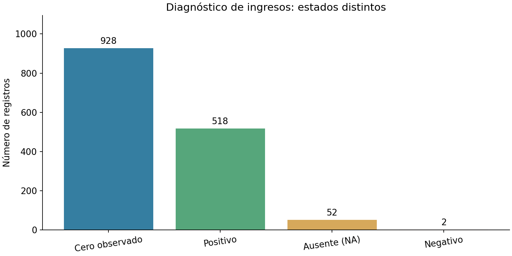
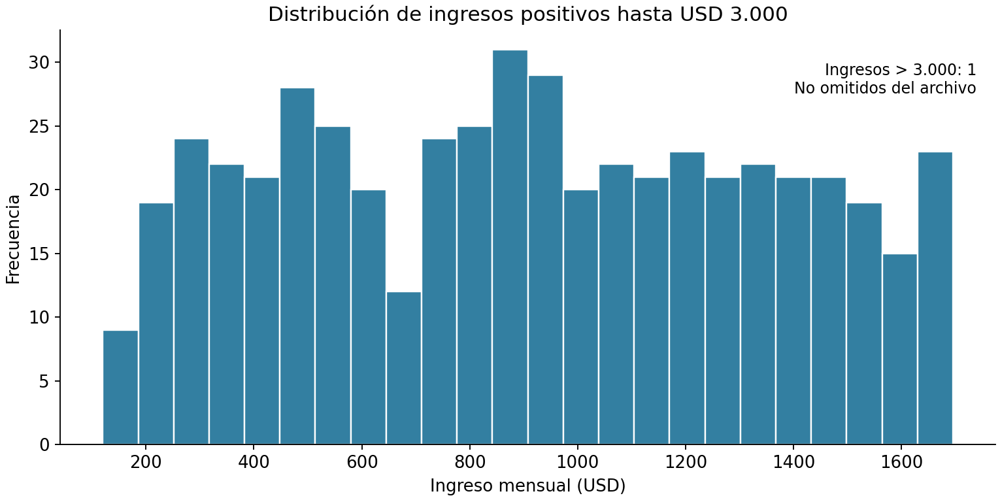
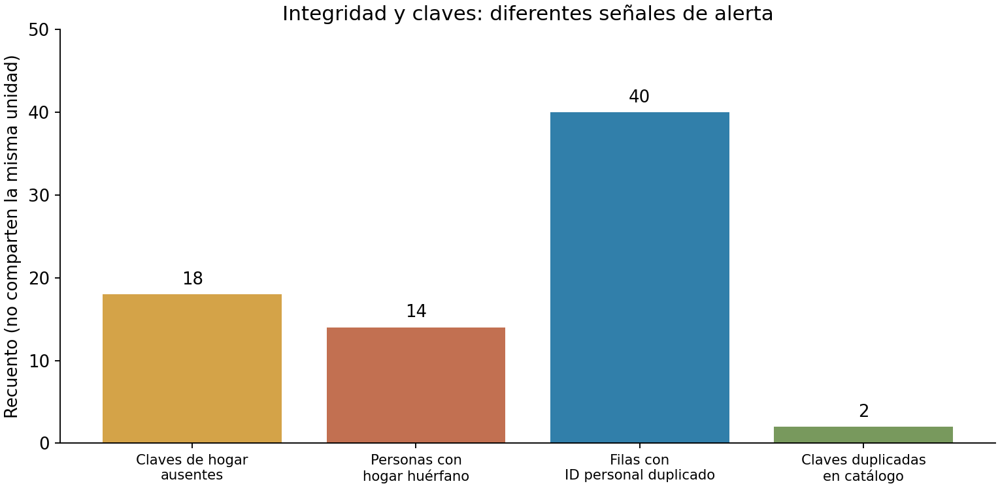
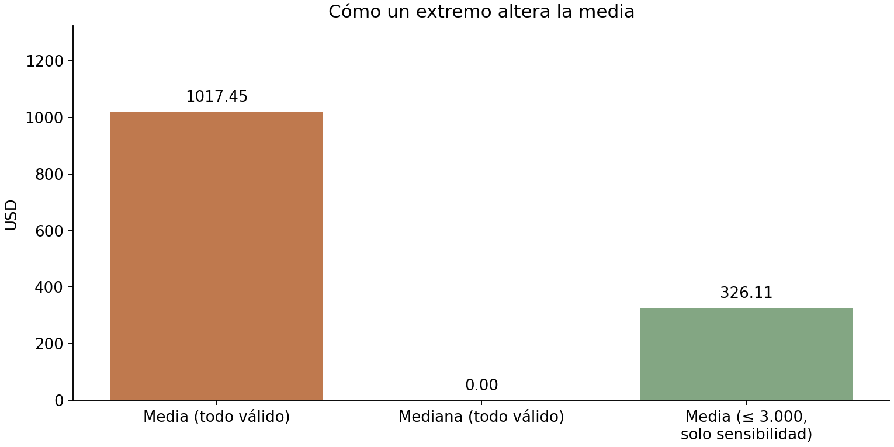
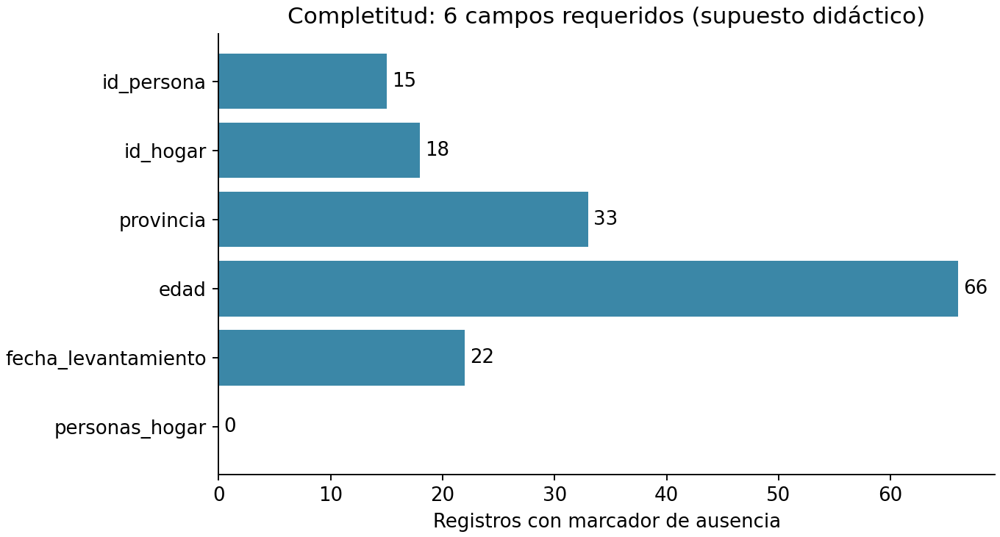
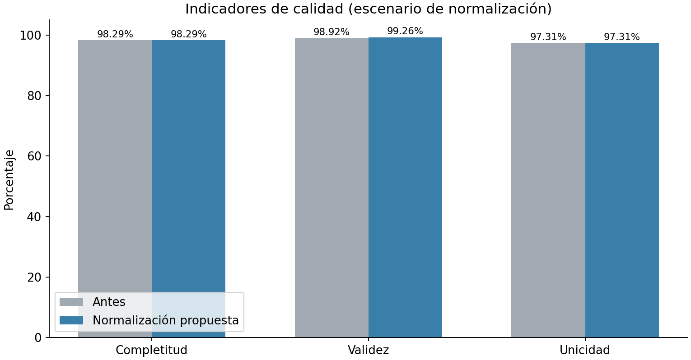

# Guía de estudio y laboratorio guiado: módulos 5 y 6

**Curso:** Evaluación de archivos de datos y automatización de reportes de calidad en R  
**Institución beneficiaria:** Instituto Nacional de Estadística y Censos (INEC)  
**Instructor:** Ing. Ángel Geovanny Cudco Pomagualli, PhD(c).  
**Duración:** 4 horas (2 horas por módulo).  
**Archivo de trabajo:** `personas_encuesta_sintetica_2026_10.csv` (base actualizada y estandarizada).  
**Propósito:** construir el proyecto progresivamente en RStudio; **no ejecutar de una vez todos los scripts**.

> **Importante:** los datos, los umbrales y el catálogo de hogares de este proyecto son **sintéticos y didácticos**. No son resultados, procedimientos obligatorios ni políticas oficiales del INEC. La aprobación de reglas y correcciones reales corresponde a los responsables metodológicos. Nunca sobrescribir el CSV fuente.

## 1. Relación con las diapositivas del curso

| Diapositivas | Módulo | Idea principal | Producto que construirá el participante |
|---|---|---|---|
| 12–13 | **5. Consistencia lógica e integridad** | Reglas entre variables; identificación de claves y relaciones entre archivos | `alertas_logicas`, `claves_huerfanas`, `alertas_integridad` |
| 14–15 | **6. Depuración y métricas** | Conservar, proponer, autorizar y comparar; completitud, validez, unicidad | `personas_propuesta`, `bitacora_propuesta`, `indicadores_antes`, `indicadores_propuestos` |
| 16 (continuidad) | Seguimiento | Comparar indicadores en escenarios | Gráficos de control antes/propuesta |

**Secuencia del curso:** identificar → describir → verificar → documentar → proponer → autorizar → comparar → reportar. En este taller **se llega a la propuesta y a la comparación didáctica; no se simula autorización institucional**.

## 2. Objetivos de aprendizaje

Al finalizar, cada participante podrá: (a) distinguir consistencia interna de validez de una variable aislada; (b) identificar filas duplicadas, claves repetidas y vínculos sin referencia; (c) construir alertas con reglas, identificadores y severidades; (d) normalizar representaciones sin perder evidencia; (e) comparar media y mediana frente a valores extremos sin imputar automáticamente; y (f) calcular tres métricas con numeradores y denominadores verificables.

## 3. Distribución didáctica (120 minutos por módulo)

| Módulo 5 | Minutos | Módulo 6 | Minutos |
|---|---:|---|---:|
| Conceptos de consistencia y relaciones | 25 | Normalización y control de versiones | 25 |
| Reglas entre campos y fechas | 30 | Bitácora y comparación original/propuesta | 30 |
| Unicidad e integridad entre archivos | 40 | Ingresos, media, mediana y escenarios | 30 |
| Alertas y reflexión final | 25 | Indicadores, gráfico y evaluación | 35 |

---

# Parte I. Preparación del proyecto y dataset

## 4. ¿Qué significa un ingreso estandarizado?

La variable `ingreso_mensual_usd` se almacena como **USD mensual**, en formato de texto numérico decimal portable: `0.00`, `850.00`, `1250.50`. No se usan `$`, separadores de millares, coma decimal ni sufijos `USD`. La ausencia se representa **únicamente con `NA`**.

Ejemplos de transformación del archivo anterior:

| Antes | Después | Razón |
|---|---|---|
| `1.250,50` | `1250.50` | Separadores reconocibles |
| `120 USD` | `120.00` | Sufijo monetario eliminado |
| `N/D` o vacío | `NA` | Marcador único de ausencia |
| `mil` | `NA` | Texto ambiguo: no se supone que valga 1000 |
| `-80.00` | `-80.00` | Tiene formato correcto pero valor cuestionable |
| `999999.99` | `999999.99` | Se conserva para sensibilidad y alerta de extremo |

**Prohibición conceptual:** `NA` (dato sin respuesta) no es igual a `0.00` (cero reportado). Tampoco se debe convertir automáticamente un dato negativo en cero. La bitácora `bitacoras/bitacora_normalizacion_ingresos.csv` documenta las 35 transformaciones de representación aplicadas a una **copia para capacitación**, no a la base fuente anterior.



**Pregunta para analizar:** si la mayoría de respuestas son cero, ¿la media representa a la persona típica? Observe el histograma antes de responder.



## 5. Estructura de carpetas y archivo `.Rproj`

```text
INEC_Modulos_5_y_6_Calidad_R/
├── calidad_inec_modulos_5_6.Rproj
├── data_raw/
│   ├── personas_encuesta_sintetica_2026_10.csv
│   └── hogares_catalogo_sintetico_2026_10.csv
├── datos_originales/
│   └── personas_encuesta_sintetica_2026_10_original.csv
├── diccionario/
│   ├── diccionario_variables.csv
│   ├── catalogo_provincias_didactico.csv
│   └── ESTANDAR_INGRESOS.md
├── R/
│   ├── 00_preparacion.R
│   ├── 05_01_consistencia_logica_guiado.R
│   ├── 05_02_claves_integridad_guiado.R
│   ├── 06_01_normalizacion_bitacora_guiado.R
│   ├── 06_02_imputacion_escenarios_guiado.R
│   ├── 06_03_indicadores_calidad_guiado.R
│   └── TALLER_PARA_CONSTRUIR_EN_CLASE.R
├── bitacoras/
├── resultados/
├── figuras/
└── actividades/
```

**Para crear un proyecto desde cero:** en RStudio, elegir `File > New Project > New Directory > New Project`, definir el nombre y el directorio, y copiar las carpetas del ZIP dentro del proyecto. Si está trabajando con el paquete entregado, abra directamente `calidad_inec_modulos_5_6.Rproj`.

### Paso 0. Preparar R e importar el archivo

Abra `R/00_preparacion.R` y **escriba cada bloque manualmente en un script nuevo**. Instale los paquetes una sola vez (descomente la línea de instalación solo si falta alguno). Después cargue las bibliotecas:

```r
library(here)     # localización del proyecto RStudio
library(readr)    # importación controlada del CSV
library(dplyr)    # filtros, resúmenes, joins y transformaciones
library(tidyr)    # estructura de tablas
library(ggplot2)  # gráficos
```

**¿Por qué `library(dplyr)`?** El operador `%>%` pertenece al ecosistema de `dplyr`/`magrittr`; sin cargarlo se puede producir el error `no se pudo encontrar la función "%>%"`. Puede usar explícitamente `dplyr::funcion()` como alternativa para muchas funciones.

```r
archivo <- here::here("data_raw", "personas_encuesta_sintetica_2026_10.csv")
file.exists(archivo)  # debe ser TRUE antes de continuar

datos <- readr::read_csv(
  file = archivo,
  col_types = readr::cols(.default = readr::col_character()),
  na = "NA", trim_ws = FALSE,
  locale = readr::locale(encoding = "UTF-8"),
  show_col_types = FALSE
)

dim(datos)                  # filas x columnas
names(datos)                # cabeceras
head(datos, 6)              # primeras seis filas
readr::problems(datos)      # problemas de importación (no de validez lógica)
```

**Explicación:** todos los campos se importan inicialmente como texto para evitar convertir `H00016` en `16` y para detectar entradas originales con espacios. Luego se crean **columnas numéricas derivadas** sin modificar las 27 variables originales.

**Checkpoint:** confirme 1.500 filas, 27 variables y localización del CSV. `problems(datos)` puede devolver cero problemas porque importar un valor como texto no equivale a comprobar que cumpla las reglas del negocio.

---

# Parte II. Módulo 5: Consistencia lógica e integridad de datos

## 6. ¿Qué es consistencia lógica?

**Definición:** la consistencia lógica comprueba que diferentes variables o registros cumplen relaciones mutuas. Una fecha individual puede ser válida, pero contradecir el período de referencia; una persona puede declarar una condición de actividad y horas semanales incompatibles según el diseño de la encuesta.

| Nivel | Ejemplo de pregunta | Técnica R |
|---|---|---|
| Entre variables | ¿La condición de actividad concuerda con las horas? | `mutate()`, `filter()`, `case_when()` |
| Temporal | ¿La fecha de levantamiento pertenece al período declarado? | `as.Date()`, `format()` |
| Entre registros | ¿Hay dos personas con el mismo `id_persona`? | `duplicated()`, `count()` |
| Entre archivos | ¿Cada `id_hogar` de personas existe en el catálogo? | `anti_join()` |
| En tabla principal | ¿Una clave `id_hogar` aparece una sola vez en el catálogo de hogares? | `count()` y `filter(n > 1)` |

**Advertencia:** las reglas ilustrativas de actividad/horas no son normas INEC. Deben tener responsable, vigencia, propósito y justificación antes de utilizarse en producción.

### Paso 5.1. Comprobar coherencia entre actividad y horas

**Definiciones de operadores:** `==` significa igualdad; `!=` desigualdad; `&` significa «y»; `|` significa «o»; `%in%` pregunta si un valor pertenece a un conjunto; `is.na(x)` detecta valores faltantes.

```r
# Ya contamos con 'personas' desde R/00_preparacion.R
# horas_n es la copia numérica de horas_trabajo_semana

ocupado_con_cero <- personas %>%
  filter(condicion_actividad == "Ocupado", !is.na(horas_n), horas_n == 0)

no_ocupado_con_horas <- personas %>%
  filter(condicion_actividad %in% c("Desocupado", "Inactivo"),
         !is.na(horas_n), horas_n > 0)

nrow(ocupado_con_cero)
nrow(no_ocupado_con_horas)
```

**Cómo interpretar:** una salida con cero filas significa que **no se encontró una fila con esa condición**, no que todo el archivo es perfecto. Las incidencias de horas positivas para personas no ocupadas requieren verificar la definición de trabajo y período.

### Paso 5.2. Verificar relación de fechas

```r
# Convertir únicamente fechas que puedan interpretarse en el formato esperado
fecha_d <- suppressWarnings(as.Date(
  personas$fecha_levantamiento, format = "%Y-%m-%d"
))

# Contrastar mes observado y mes declarado (solo cuando hay fecha válida)
fuera_periodo <- !is.na(fecha_d) &
  format(fecha_d, "%Y-%m") != personas$periodo_referencia

sum(fuera_periodo, na.rm = TRUE)
```

**Importante:** fecha inválida y período incompatible son **incidencias diferentes**. Una cadena como `ayer` no puede evaluarse como fecha sin una aclaración; no debe transformarse en la fecha del computador.

### Paso 5.3. Construir una tabla de alertas

Una **alerta** es un registro de observación que identifica qué regla se activó, sobre qué fila y con qué valor. No es una corrección.

```r
# La función generar_alerta() está desarrollada paso a paso en
# R/05_01_consistencia_logica_guiado.R

# Tabla resultante esperada:
# fila_csv | id_persona | id_hogar | regla_id | variable |
# valor | severidad | descripcion

alertas_logicas %>%
  count(regla_id, severidad, name = "incidencias")
```

**Actividad:** explicar por qué se incluye `fila_csv`. Si el identificador está duplicado o ausente, la posición original permite ubicar la observación exacta.

## 7. Unicidad: duplicado de fila vs duplicado de clave

Una **clave primaria** identifica una sola entidad en una tabla. En este caso `id_persona` debe identificar una persona única, de acuerdo con el diseño didáctico. Una **clave foránea** en la tabla de personas, `id_hogar`, referencia a un hogar. Por tanto, es correcto que varias personas tengan el mismo `id_hogar`.

| Fenómeno | ¿Qué se compara? | ¿Qué significa? |
|---|---|---|
| Fila idéntica | Todas las columnas de origen | Posible reenvío duplicado |
| Clave repetida | Solo `id_persona` | Dos o más filas tienen el mismo identificador |
| ID de hogar repetido en personas | `id_hogar` de diferentes personas | Relación 1:N esperada, no es error por sí sola |
| ID de hogar repetido en catálogo | `id_hogar` de la tabla de hogares | Posible falla de unicidad de la entidad padre |

### Paso 5.4. Hallar todas las filas involucradas en una clave repetida

```r
ids <- personas %>% filter(!is.na(id_persona))

# Repeticiones posteriores a la primera aparición
repeticiones <- ids %>% filter(duplicated(id_persona))

# TODAS las filas de claves que aparecen más de una vez
filas_involucradas <- ids %>%
  filter(duplicated(id_persona) |
         duplicated(id_persona, fromLast = TRUE))

nrow(repeticiones)         # 20 repeticiones adicionales
nrow(filas_involucradas)   # 40 filas involucradas
```

**¿Por qué 20 y 40 no significan lo mismo?** En un par repetido hay dos filas implicadas pero solo una repetición «adicional». Si una clave aparece tres veces, hay tres filas afectadas y dos repeticiones adicionales.

## 8. Integridad referencial entre personas y hogares

**Definición:** hay integridad referencial cuando una clave foránea no vacía identifica una fila existente y válida en la tabla referenciada. `anti_join()` permite localizar las personas que **no encuentran correspondencia**.

Para aprender, se proporciona un segundo archivo sintético: `hogares_catalogo_sintetico_2026_10.csv`. Se ha construido como catálogo auxiliar, con cinco claves omitidas intencionalmente, dos claves de catálogo duplicadas y un hogar sin personas. **Estos defectos pertenecen al ejercicio, no necesariamente al archivo principal original.**

### Paso 5.5. Conocer los dos archivos

```r
# Ya importados en R/00_preparacion.R
head(personas %>% select(id_persona, id_hogar), 5)
head(hogares %>% select(id_hogar, provincia_hogar), 5)
```

### Paso 5.6. Comprobar claves repetidas del catálogo padre

```r
hogares %>%
  count(id_hogar, name = "apariciones") %>%
  filter(apariciones > 1)
```

**Por qué importa:** si se hace `left_join()` contra un catálogo con claves repetidas, pueden **multiplicarse las filas**. En este ejemplo se usa `distinct(id_hogar)` para comprobar existencia, no para eliminar filas del catálogo original.

### Paso 5.7. Encontrar claves huérfanas

```r
catalogo_ids <- hogares %>%
  filter(!is.na(id_hogar)) %>%
  distinct(id_hogar)

huerfanos <- personas %>%
  filter(!is.na(id_hogar)) %>%
  anti_join(catalogo_ids, by = "id_hogar")

huerfanos %>% distinct(id_hogar) %>% arrange(id_hogar)
nrow(huerfanos)
```

**Resultado didáctico de referencia:** cinco identificadores de hogar omitidos en el catálogo auxiliar generan 14 filas de personas sin correspondencia. Se reportan como **revisión referencial**; no se eliminan personas automáticamente. Los 18 registros que no declaran `id_hogar` son una incidencia **diferente** de las claves huérfanas.



### Paso 5.8. Construir alertas de integridad

Abra el script `R/05_02_claves_integridad_guiado.R`. Reúna las incidencias de: hogares huérfanos (`I5-01`), IDs de hogar ausentes (`I5-02`) y claves personales duplicadas (`I5-03`). Compruebe que **una misma fila puede generar más de una alerta**. No sume incidencias como si fueran personas distintas.

### Cierre del módulo 5: actividad de razonamiento

Explique por escrito por qué sería peligroso ejecutar `distinct(id_persona, .keep_all = TRUE)` sin una decisión técnica: podría ocultar discrepancias, descartar registros legítimos y destruir la evidencia necesaria para investigación.

---

# Parte III. Módulo 6: Depuración y métricas de calidad

## 9. ¿Qué es depuración controlada?

**Depurar no es borrar lo que parece extraño.** La depuración controlada propone acciones justificadas y mantiene información sobre el estado anterior, la regla y la revisión autorizada.

La diapositiva 14 presenta cuatro pasos:

1. **Conservar:** mantener el archivo original, su versión y, cuando corresponda, su huella digital (hash).
2. **Proponer:** identificar normalización, corrección o imputación potencial.
3. **Autorizar:** registrar el responsable y la regla metodológica aprobada.
4. **Comparar:** verificar diferencias, indicadores y posibles efectos no deseados.

**En esta práctica**, solo se simulan propuestas sobre copias. Los scripts nunca cambian `data_raw/personas_encuesta_sintetica_2026_10.csv`.

## 10. Normalización, corrección e imputación: diferencias

| Procedimiento | Ejemplo | ¿Puede hacerse automáticamente? |
|---|---|---|
| Normalización de forma | `PICHINCHA` → `Pichincha` | Solo si la equivalencia está documentada |
| Normalización de etiqueta | `urban` → `Urbana` | Solo si lo respalda el diccionario |
| Corrección semántica | Provincia equivocada → otra provincia | Requiere evidencia y autorización |
| Imputación | `NA` → valor estimado | Requiere justificación estadística, evaluación de sesgo y autorización |
| Eliminación de duplicados | Quitar registro repetido | Nunca por simple apariencia; verificar origen y unidad de análisis |

### Paso 6.1. Inspeccionar categorías antes de cambiar

```r
personas_raw %>% count(area, sort = TRUE)
personas_raw %>% count(sexo, sort = TRUE)
personas_raw %>% count(provincia, sort = TRUE)
```

Observe `urban`, `F`, `PICHINCHA` y `Guayas ` (con espacio final). También verá `99`, `Desconocida` y valores ausentes. No suponga equivalencias de estas últimas categorías.

### Paso 6.2. Hacer una propuesta de normalización en memoria

```r
personas_propuesta <- personas_raw %>%
  mutate(
    area = case_when(trimws(area) == "urban" ~ "Urbana", TRUE ~ area),
    sexo = case_when(trimws(sexo) == "F" ~ "Mujer", TRUE ~ sexo),
    provincia = case_when(
      trimws(provincia) == "PICHINCHA" ~ "Pichincha",
      trimws(provincia) == "Guayas" ~ "Guayas",
      TRUE ~ provincia
    )
  )
```

**Definiciones:** `mutate()` crea o transforma columnas; `case_when()` expresa reglas condicionales legibles; `trimws()` quita espacios periféricos; `TRUE ~ ...` significa «en otros casos, conservar el valor». La transformación ocurre **en una copia de memoria**.

### Paso 6.3. Generar la bitácora

Una bitácora mínima permite responder: qué archivo, qué fila, qué identificador, qué variable, valor original, propuesta, regla y versión, responsable, fecha, justificación y estado.

| Campo | Descripción |
|---|---|
| `archivo_origen` | CSV a partir del cual se construyó la propuesta |
| `fila_csv`, `id_persona` | Referencia a la observación |
| `variable` | Columna modificada |
| `valor_original` | Valor anterior |
| `valor_propuesto` | Valor que se propone dejar |
| `regla_id`, `version_regla` | Regla y revisión identificables |
| `justificacion` | Motivo documentado |
| `responsable`, `fecha_propuesta` | Identificación y momento de la propuesta |
| `estado` | `PENDIENTE_DE_APROBACION`, aprobado o rechazado, según proceso real |

**Práctica guiada:** el script `R/06_01_normalizacion_bitacora_guiado.R` desarrolla una función `registrar_cambios()` que compara original y propuesta, incluyendo comparaciones seguras de `NA`. El producto es `bitacora_propuesta`. El estado **no** se marca como aprobado automáticamente.

## 11. Estadística aplicada a la depuración: ingresos y valores faltantes

### 11.1 Diferenciar medición, ausencia y anomalía

Al trabajar con ingresos, la base actualizada contiene valores numéricos sin ambigüedad de formato, además de:

- `NA`: ausencia de respuesta (**52 registros**).
- `0.00`: ingreso igual a cero (**928 registros**).
- Negativos (**2 registros**): se separan por un criterio didáctico de no negatividad.
- `999999.99`: valor positivo extremo; exige análisis, no eliminación automática.

El CSV actualizado conserva el extremo para mostrar el efecto que produce sobre la media.

### 11.2 Media aritmética

La media es la suma de las observaciones numéricas válidas dividida entre la cantidad de observaciones consideradas:

\[
\bar{x}=\frac{\sum_{i=1}^{n}x_i}{n}
\]

**Atención:** se debe explicar cuáles observaciones se incluyeron en `n`. Aquí, por una regla de demostración, los negativos se apartan del cálculo de la media de ingreso válido, sin borrarse del registro.

### 11.3 Mediana

La mediana es el valor que ocupa la posición central de los datos ordenados; si el número de datos es par, se promedian las dos observaciones centrales. Es menos sensible a extremos que la media, pero puede ser `0.00` cuando hay muchos ceros legítimos.



### Paso 6.4. Calcular estimadores en R

```r
# 'ingreso_n' es una copia numérica creada durante la preparación.
# Se excluyen NA y negativos SOLO del conjunto para estos estimadores.
ingresos_validos <- personas$ingreso_n[
  !is.na(personas$ingreso_n) & personas$ingreso_n >= 0
]

media_global <- mean(ingresos_validos)
mediana_global <- median(ingresos_validos)
media_sensibilidad <- mean(ingresos_validos[ingresos_validos <= 3000])

round(c(media_global, mediana_global, media_sensibilidad), 2)
```

Resultados orientativos del CSV: media **USD 1.017,45**, mediana **USD 0,00**, media limitada a observaciones de hasta USD 3.000 **USD 326,11**. La última cifra es **solo una prueba de sensibilidad**; no es un reemplazo automático del promedio ni implica que todo ingreso superior a USD 3.000 sea erróneo.

### Paso 6.5. Simular imputaciones SIN alterar el dato observado

```r
escenarios <- personas %>%
  mutate(
    imputado = is.na(ingreso_n),
    ingreso_media_sim = if_else(imputado, media_global, ingreso_n),
    ingreso_mediana_sim = if_else(imputado, mediana_global, ingreso_n)
  )
```

**Definiciones:** `if_else(condición, valor_si_verdadero, valor_si_falso)` selecciona el valor; `imputado` es una etiqueta que separa las observaciones estimadas de las reales. Los negativos originales permanecen visibles para revisión. En `R/06_02_imputacion_escenarios_guiado.R` se añade mediana **por condición de actividad**, con reserva de una mediana global cuando un grupo no tenga datos suficientes.

**Pregunta:** ¿qué sesgos introduciría imputar todo `NA` con la media global en una distribución que mezcla muchas personas con cero ingreso y algunas personas con ingreso elevado?

## 12. Métricas de calidad: unidad de análisis y denominador

La diapositiva 15 enfatiza que **toda tasa exige un denominador explícito**. Ninguna métrica debe calcularse sin indicar quién o qué está siendo evaluado.

### 12.1 Completitud

Para este ejemplo se consideran seis variables requeridas: `id_persona`, `id_hogar`, `provincia`, `edad`, `fecha_levantamiento` y `personas_hogar`.

\[
\text{Completitud (\%)} = 100 \times
\frac{\text{celdas requeridas presentes}}{\text{celdas requeridas evaluadas}}
\]

Hay 1.500 filas × 6 campos = **9.000 celdas requeridas**. Se cuentan los valores `NA`, vacíos, `N/D` y `SIN DATO` como ausencias cuando aparezcan en estos campos.



### 12.2 Validez

La validez evalúa únicamente las condiciones explícitas definidas por una regla. En el taller se proponen tres reglas: provincia presente en catálogo, edad entera en el rango didáctico 0–110 y ingreso presente, no negativo y con dos decimales. La ausencia no se califica como «valor inválido»: se mide aparte por completitud.

\[
\text{Validez (\%)}=100\times
\frac{\text{pruebas aprobadas}}{\text{pruebas aplicables}}
\]

Cada prueba utiliza como denominador los registros **presentes** a los que esa regla puede aplicarse. Sumamos numeradores y denominadores de pruebas, **no promediamos sus porcentajes**.

### 12.3 Unicidad

Aquí usamos una definición explícita: porcentaje de **filas que poseen un identificador personal no ausente y no repetido**, respecto del conjunto de filas con identificador personal presente.

\[
\text{Unicidad (\%)}=100\times
\frac{\text{filas cuyo ID aparece una sola vez}}{\text{filas con ID presente}}
\]

Las filas cuyo ID está ausente se contabilizan en completitud, no se suman al denominador de unicidad. Otra institución podría usar porcentaje de **IDs distintos**: sería una métrica diferente y debe nombrarse de otra manera.

### Paso 6.6. Generar métricas y comparar escenarios

Abra `R/06_03_indicadores_calidad_guiado.R` y construya en orden los bloques para calcular numerador, denominador, porcentaje y comparación. En ningún momento se cambia el CSV fuente.

| Indicador | Antes (copia estandarizada) | Con normalización propuesta |
|---|---:|---:|
| Completitud | 98,29 % | 98,29 % |
| Validez | 98,92 % | 99,26 % |
| Unicidad | 97,31 % | 97,31 % |

Son resultados derivados en la preparación didáctica, que permiten verificar posteriormente los cálculos en R. El incremento de validez corresponde a una equivalencia de representación; **no demuestra una mejora en los datos observados ni constituye aprobación de corrección**.



---

# Parte IV. Funciones de R utilizadas y su definición

| Función / operador | ¿Qué hace? | Ejemplo didáctico |
|---|---|---|
| `library()` | Carga un paquete | `library(dplyr)` |
| `here::here()` | Construye rutas relativas al proyecto | `here::here("data_raw", "personas...csv")` |
| `readr::read_csv()` | Lee un CSV como tabla | `read_csv(archivo)` |
| `dim()` / `nrow()` | Dimensiones / filas | `dim(datos)` |
| `is.na()` | Detecta ausencia | `is.na(datos$edad)` |
| `sum()` | Suma indicadores lógicos o números | `sum(is.na(datos$edad))` |
| `mean()` | Calcula media | `mean(x, na.rm=TRUE)` |
| `median()` | Calcula mediana | `median(x, na.rm=TRUE)` |
| `count()` | Cuenta ocurrencias agrupadas | `count(provincia)` |
| `filter()` | Selecciona filas que cumplen condición | `filter(horas_n > 0)` |
| `mutate()` | Crea o transforma columnas | `mutate(nuevo = ...)` |
| `case_when()` | Aplica reglas por casos | `case_when(...)` |
| `if_else()` | Selección condicional tipada | `if_else(cond, x, y)` |
| `duplicated()` | Marca repeticiones posteriores | `duplicated(id_persona)` |
| `distinct()` | Obtiene combinaciones únicas | `distinct(id_hogar)` |
| `left_join()` | Combina tablas manteniendo filas de la izquierda, potencialmente multiplicadas por correspondencias | `left_join(p, h, by="id_hogar")` |
| `anti_join()` | Conserva filas sin correspondencia en tabla de referencia | `anti_join(p, h, by="id_hogar")` |
| `group_by()` | Define subgrupos | `group_by(condicion_actividad)` |
| `summarise()` | Resume una tabla | `summarise(total=n())` |
| `geom_col()` | Barras con totales ya calculados | `geom_col()` |
| `ggplot()` | Declara la visualización | `ggplot(resumen, aes(...))` |
| `write_csv()` | Exporta una tabla a un nuevo archivo | Descomentar tras revisión |

**Nota:** `duplicated(id_persona)` no descubre por sí solo todas las filas involucradas. Debe combinarse con `duplicated(id_persona, fromLast=TRUE)` cuando se desea registrar **cada observación afectada**.

---

# Parte V. Actividades, evidencias y evaluación

## 13. Práctica progresiva

| N.º | Actividad | Evidencia que debe entregar |
|---|---|---|
| 1 | Verificar formato y valores faltantes de ingreso | Tabla NA / cero / negativo / positivo |
| 2 | Evaluar condición de actividad frente a horas | Tabla de excepciones y justificación |
| 3 | Verificar fecha de levantamiento frente a período | Lista de observaciones de revisión |
| 4 | Identificar filas repetidas y claves repetidas | Tabla de filas de CSV y explicación de la diferencia |
| 5 | Detectar catálogos con clave repetida | Reporte de duplicados de hogares |
| 6 | Usar `anti_join()` para detectar hogares huérfanos | IDs de hogares y filas de personas afectadas |
| 7 | Construir una bitácora de normalización | Propuesta con originales y estados pendientes |
| 8 | Calcular media, mediana y sensibilidad | Tabla y comentario de sesgo |
| 9 | Comparar imputación por media y mediana (solo simulación) | Variables adicionales sin reemplazar ingresos observados |
| 10 | Calcular tres indicadores y graficar comparación | Tabla con numerador, denominador, porcentaje y gráfico |

Las instrucciones **para participantes** se encuentran en `actividades/ACTIVIDADES_PARTICIPANTE.md` y las **respuestas y explicaciones docentes** en `actividades/SOLUCIONARIO_DOCENTE.md`.

## 14. Sugerencia de evaluación sobre 20 puntos

| Criterio | Peso |
|---|---:|
| Construcción correcta de reglas de consistencia | 4.00 |
| Identificación de claves, duplicados y huérfanos | 4.00 |
| Normalización en copia y bitácora íntegra | 4.00 |
| Estadística descriptiva y escenarios de imputación | 4.00 |
| Indicadores, gráficos e interpretación | 4.00 |
| **Total** | **20.00** |

## 15. Lista de comprobación de calidad del proyecto

- [ ] El archivo `data_raw/personas_encuesta_sintetica_2026_10.csv` no se modificó durante las prácticas.
- [ ] Todo ingreso es texto numérico con dos decimales o `NA` en el CSV.
- [ ] `0.00` no se consideró equivalente a ausencia.
- [ ] Las alertas tienen regla, registro, valor y explicación.
- [ ] La unicidad se calculó sobre `id_persona` y no sobre `id_hogar` en personas.
- [ ] Los huérfanos se separaron de las claves faltantes.
- [ ] La bitácora conserva valores originales y propuestas.
- [ ] Imputación y normalización se etiquetaron como simulaciones pendientes de aprobación.
- [ ] Cada métrica especifica numerador y denominador.
- [ ] Los resultados se interpretan como datos sintéticos, nunca como estadísticas oficiales del INEC.

---

## 16. Bibliografía de apoyo y alcance

Los contenidos se organizan siguiendo la presentación suministrada *Evaluación de archivos de datos y automatización de reportes de calidad en R* (diapositivas 12 a 16); en especial, la integridad entre hogares/personas, la prohibición de corregir sin evidencia y las definiciones de indicadores con denominadores explícitos. La guía agrega ejemplos, cálculos y escenarios pedagógicos que **no aparecen como cifras del INEC en las diapositivas**.

Lecturas de consulta: documentación de R y RStudio, `dplyr` (joins y transformación), `readr` (CSV), `ggplot2` (visualización), y guías institucionales de aseguramiento de calidad aplicables a cada operación estadística.
