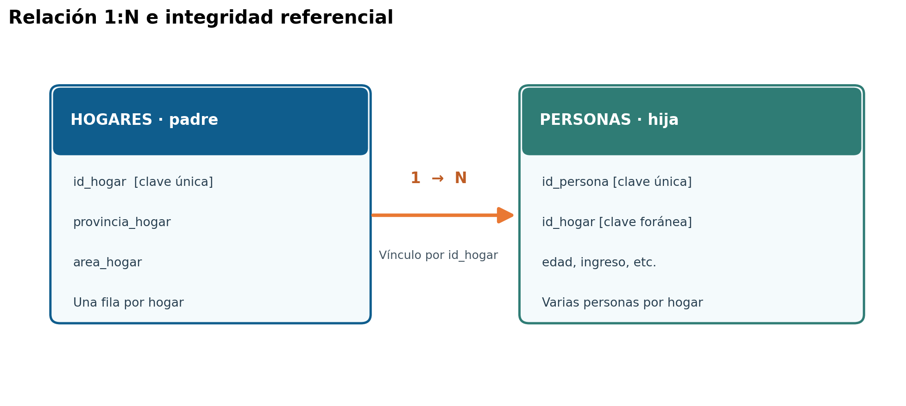
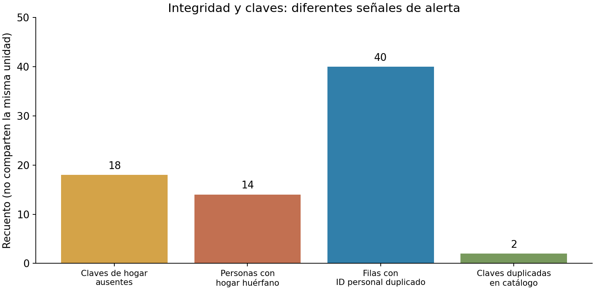
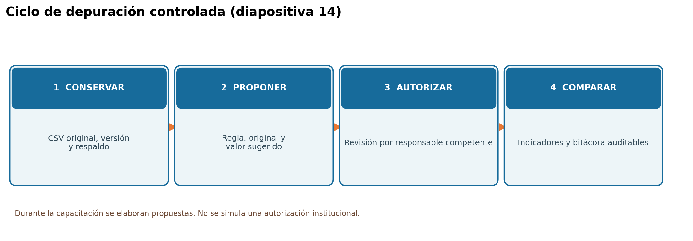
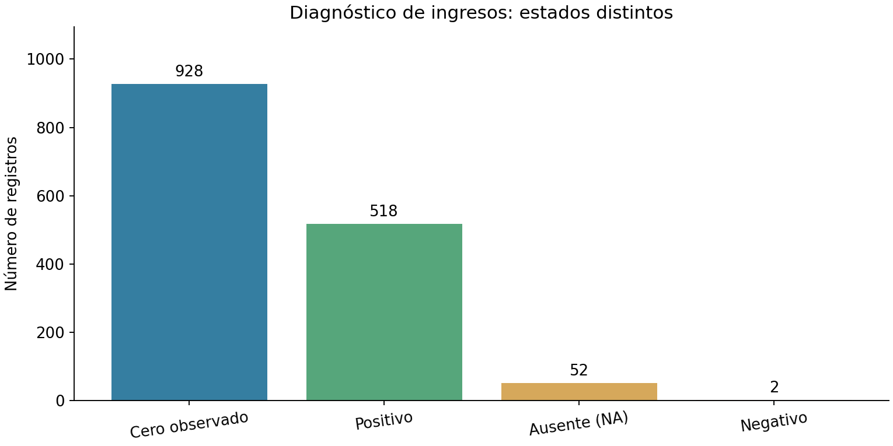
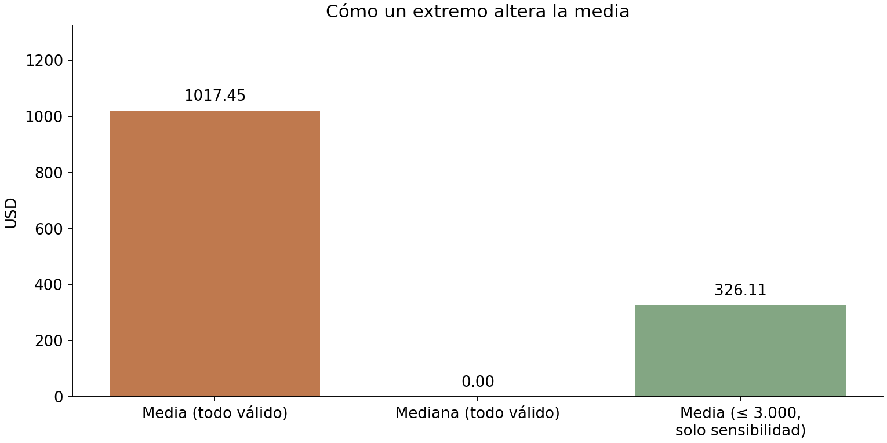
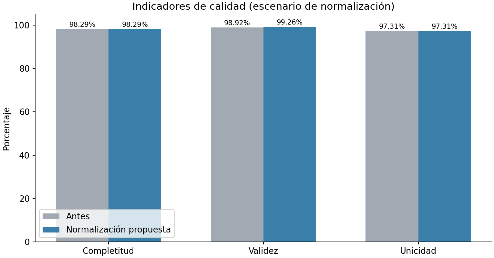

# GUÍA DOCENTE: EXPLICACIÓN PASO A PASO DE TODOS LOS SCRIPTS R

## Módulos 5 y 6 — Consistencia lógica, integridad, depuración controlada e indicadores

**Curso:** Evaluación de archivos de datos y automatización de reportes de calidad en R  
**Público:** personal técnico y analistas participantes del taller del INEC  
**Base de práctica:** `data_raw/personas_encuesta_sintetica_2026_10.csv`  
**Enfoque:** leer, comprender y construir los scripts de manera incremental en RStudio. **No consiste en ejecutar todo el proyecto de forma automática.**

> El conjunto de personas, el catálogo auxiliar de hogares, las equivalencias de normalización, las reglas y los umbrales son **sintéticos y didácticos**. No se atribuyen como normas oficiales del INEC. Los archivos fuente deben conservarse sin modificaciones; las propuestas requieren revisión metodológica y autorización antes de ser tratadas como correcciones reales.

## 1. Cómo leer esta guía

La explicación sigue **exactamente el orden de los siete archivos** contenidos en `R/`. Se conserva una copia de los scripts originales y se añade una versión con comentarios extensos en `R_EXPLICADOS/`. Esta guía complementa, no sustituye, `GUIA_ESTUDIO_MODULOS_5_Y_6.md`.

Para cada script se indican **objetivo → conceptos → entradas → código → explicación de las funciones y argumentos → salida esperada → interpretación → errores frecuentes → actividad de construcción**. La palabra *esperada* no implica que se haya ejecutado el script en R dentro de este material. El código proviene del proyecto entregado; los ejemplos pequeños adicionales están identificados como didácticos.

### 1.1. Correspondencia con las diapositivas

| Diapositiva | Concepto de la presentación | Script relacionado |
|---|---|---|
| 12 | Consistencia: relaciones lógicas temporales, de dependencia y semánticas | `05_01_consistencia_logica_guiado.R` |
| 13 | Integridad referencial entre personas y hogares; `anti_join()` | `05_02_claves_integridad_guiado.R` |
| 14 | Conservar, proponer, autorizar y comparar; bitácora | `06_01_normalizacion_bitacora_guiado.R` |
| 15 | Completitud, unicidad, validez y consistencia: tasas con denominador | `06_03_indicadores_calidad_guiado.R` |
| 16 (continuidad) | Visualización de indicadores antes y después | `06_03_indicadores_calidad_guiado.R` |

La media, mediana y los escenarios de imputación, desarrollados en `06_02_imputacion_escenarios_guiado.R`, amplían el componente estadístico del módulo 6; no sustituyen la necesidad de justificar metodológicamente cualquier imputación.



### 1.2. Cinco ideas que deben entenderse antes de programar

1. **Fila/observación:** representa un registro. En el archivo de personas existen 1.500 filas. Una fila de archivo no es automáticamente una persona única si hay duplicación de identificadores.
2. **Variable/columna:** característica registrada. El CSV tiene 27 columnas de origen, entre ellas `id_persona`, `id_hogar`, `condicion_actividad`, `horas_trabajo_semana` e `ingreso_mensual_usd`.
3. **`NA`:** ausencia o valor desconocido en R. `0.00` es un número **presente**. Los textos `N/D`, `SIN DATO` o `""` requieren reglas para tratarlos como faltantes.
4. **Alerta:** una condición que exige verificación, no un error confirmado ni una autorización para eliminar o imputar valores.
5. **Base de origen frente a copia derivada:** `personas_raw` contiene la lectura conservadora; `personas` añade columnas auxiliares; `personas_propuesta` incorpora equivalencias candidatas. Ninguna de estas operaciones escribe automáticamente el CSV.

**Regla transversal:** un conteo no puede interpretarse sin aclarar su **unidad de análisis**: número de filas, personas con clave única, claves diferentes, celdas, pruebas aplicables o alertas.

### 1.3. Árbol del proyecto

```text
calidad_inec_modulos_5_6/
├── calidad_inec_modulos_5_6.Rproj
├── data_raw/
│   ├── personas_encuesta_sintetica_2026_10.csv
│   └── hogares_catalogo_sintetico_2026_10.csv
├── diccionario/
│   ├── diccionario_variables.csv
│   ├── catalogo_provincias_didactico.csv
│   └── ESTANDAR_INGRESOS.md
├── R/                         <- scripts originales de referencia
│   ├── 00_preparacion.R
│   ├── 05_01_consistencia_logica_guiado.R
│   ├── 05_02_claves_integridad_guiado.R
│   ├── 06_01_normalizacion_bitacora_guiado.R
│   ├── 06_02_imputacion_escenarios_guiado.R
│   ├── 06_03_indicadores_calidad_guiado.R
│   └── TALLER_PARA_CONSTRUIR_EN_CLASE.R
├── R_EXPLICADOS/              <- mismos scripts con comentarios adicionales
├── resultados/                <- salidas OPCIONALES; no sobrescribir fuente
├── bitacoras/
└── figuras/
```

El archivo `.Rproj` identifica un proyecto en RStudio. **No es un archivo que contenga instrucciones R**; su función es abrir el contexto de trabajo y facilitar las rutas relativas. Los archivos `.R` contienen las instrucciones que se construyen y ejecutan por partes.

### 1.4. Procedimiento de aula por bloque

1. Abrir el proyecto `.Rproj` y crear un script nuevo: **File → New File → R Script**.
2. Copiar **solo el paso** que se está estudiando y leer los comentarios antes de ejecutarlo.
3. Seleccionar una línea o bloque pequeño y usar **Ctrl+Enter** (Windows/Linux) para enviarlo a la consola.
4. Examinar los objetos en *Environment* y las salidas en *Console*, *Plots* o `View()`.
5. Registrar qué se esperaba, qué se observó, qué limitación tiene la regla y qué sería necesario autorizar.

---

# 2. Script `00_preparacion.R`: preparar datos y herramientas

**Objetivo:** abrir correctamente el CSV de personas y el catálogo de hogares, preservar los identificadores como texto, identificar marcadores de ausencia y construir columnas derivadas listas para análisis.

**Entradas:** dos CSV de `data_raw/`.  
**Salidas en memoria:** `ruta_personas`, `ruta_hogares`, `personas_raw`, `hogares_raw`, `limpiar_ausencias`, `personas`, `hogares`.  
**No genera archivos de salida.**

## 2.1. Instalación y carga de paquetes

```r
# Una sola vez en el equipo, si faltan paquetes:
# install.packages(c("here", "readr", "dplyr", "tidyr", "ggplot2", "tibble"))

# En cada nueva sesión de trabajo:
library(here)
library(readr)
library(dplyr)
library(tidyr)
library(ggplot2)
```

**¿Qué hace `install.packages()`?** Descarga e instala bibliotecas en la instalación de R. Recibe `c(...)`, un vector de nombres; **no debe ejecutarse en cada sesión ni dentro de una rutina de producción**. **¿Qué hace `library()`?** Carga el paquete para que sus funciones estén disponibles en la sesión. `dplyr` aporta `filter()`, `mutate()`, `count()`, `left_join()` y el operador `%>%`; `readr`, importación; `ggplot2`, visualizaciones; `here`, rutas relativas. `tidyr` se reserva para transformaciones tabulares posteriores.

**Comprobación docente:** preguntar por qué `library(dplyr)` es necesario antes de escribir `%>%`. Si el error es `no se pudo encontrar la función "%>%"`, revisar primero que `dplyr` esté cargado. Otra opción es emplear la tubería nativa `|>` en versiones compatibles de R, aunque el proyecto entregado utiliza `%>%`.

## 2.2. Construcción de rutas y validación de existencia

```r
ruta_personas <- here::here(
  "data_raw", "personas_encuesta_sintetica_2026_10.csv"
)
ruta_hogares <- here::here(
  "data_raw", "hogares_catalogo_sintetico_2026_10.csv"
)
stopifnot(file.exists(ruta_personas), file.exists(ruta_hogares))
```

- `here::here("data_raw", "archivo.csv")`: junta los componentes de una ruta **desde la raíz del proyecto**. Los dos argumentos son nombres de carpeta y archivo; el resultado es una cadena con la ruta local correspondiente. `::` significa “utilizar la función de este paquete”.
- `<-`: operador de asignación; guarda el resultado en un objeto, sin imprimirlo necesariamente.
- `file.exists(ruta)`: devuelve `TRUE` si el archivo indicado existe o `FALSE` si no.
- `stopifnot(condición1, condición2)`: exige que ambas condiciones sean verdaderas; de lo contrario **detiene** el script. Evita avanzar con un archivo equivocado o inexistente.

**Ejemplo de interpretación:** si `file.exists(ruta_personas)` es `FALSE`, no cambie el código a una ruta personal del docente; compruebe que se abrió el `.Rproj`, que el nombre coincide y que el CSV está en `data_raw/`.

## 2.3. Importación conservadora

```r
personas_raw <- readr::read_csv(
  file = ruta_personas,
  col_types = readr::cols(.default = readr::col_character()),
  na = "NA",
  trim_ws = FALSE,
  locale = readr::locale(encoding = "UTF-8"),
  show_col_types = FALSE
)
```

**Función principal:** `readr::read_csv()` lee datos separados por comas y devuelve un **tibble**, una tabla similar a `data.frame` con una impresión más compacta.

| Argumento | Significado y motivo |
|---|---|
| `file = ruta_personas` | Archivo físico que se leerá. |
| `col_types = cols(.default = col_character())` | Todas las variables se leen como caracteres. Protege `P00001` y `H00001`, y permite detectar formatos antes de convertirlos. |
| `na = "NA"` | Traduce el texto literal `NA` a ausencia en la importación. Otros marcadores se tratan después mediante una regla explícita. |
| `trim_ws = FALSE` | Preserva espacios al principio y al final para detectar anomalías de registro. |
| `locale(encoding = "UTF-8")` | Indica la codificación de caracteres y protege tildes y la letra ñ. |
| `show_col_types = FALSE` | Oculta el aviso informativo sobre los tipos inferidos/declarados. |

**¿Por qué no importar automáticamente edad e ingreso como número?** Una conversión anticipada podría ocultar qué cadena produjo un problema. La estrategia segura consiste en conservar primero el texto y crear **columnas derivadas** numéricas. `read_csv()` no corrige por sí mismo los dominios ni verifica integridad referencial.

El catálogo auxiliar `hogares_raw` se importa con la misma lógica, porque `id_hogar` es una clave textual y debe coincidir exactamente entre archivos.

## 2.4. Construcción de la función `limpiar_ausencias()`

```r
limpiar_ausencias <- function(x) {
  # Convertir a texto y retirar únicamente espacios exteriores.
  y <- trimws(as.character(x))

  # Reconocer varias representaciones de ausencia.
  y[is.na(y) | toupper(y) %in% c("", "NA", "N/D", "SIN DATO")] <- NA_character_

  # En R la última expresión se devuelve como resultado.
  y
}
```

**`function(x)`** define una función propia de R. `x` es un **parámetro**: el vector que se desea examinar; la función devuelve un vector de igual longitud. Esto permite escribir `limpiar_ausencias(datos$edad)` o `limpiar_ausencias(datos$provincia)` sin repetir reglas.

**Análisis instrucción por instrucción:**

- `as.character(x)` obliga a trabajar con cadenas. Un identificador es código, no cantidad.
- `trimws(...)` elimina espacios externos. Por ejemplo, `"  N/D "` se transforma en `"N/D"`; **no sustituye espacios interiores**.
- `toupper(y)` convierte a mayúsculas para reconocer `"sin dato"` y `"SIN DATO"` del mismo modo.
- `c("", "NA", "N/D", "SIN DATO")` crea un vector con los marcadores establecidos para el ejercicio.
- `%in%` devuelve `TRUE` cuando un valor pertenece al vector de marcadores.
- `is.na(y)` identifica ausencias ya reconocidas por R. `|` es el operador lógico **O**.
- `y[condición] <- NA_character_` asigna la ausencia de tipo carácter **solo a los elementos identificados dentro de la copia**. No modifica los bytes del CSV.

**Ejemplo inventado para comprender la función:**

```r
entrada <- c("12", " N/D ", "", "0", "SIN DATO")
limpiar_ausencias(entrada)
# Resultado conceptual: "12", NA, NA, "0", NA
```

**Precaución:** en una operación real, no se debe convertir a `NA` cualquier texto que “parezca” desconocido. El catálogo de códigos de no respuesta lo determina el diccionario aprobado.

## 2.5. Creación de la tabla `personas` y columnas numéricas auxiliares

```r
personas <- personas_raw %>%
  mutate(
    fila_csv = row_number() + 1L,
    id_persona = limpiar_ausencias(id_persona),
    id_hogar = limpiar_ausencias(id_hogar),
    provincia = limpiar_ausencias(provincia),
    area = limpiar_ausencias(area),
    sexo = limpiar_ausencias(sexo),
    condicion_actividad = limpiar_ausencias(condicion_actividad),
    edad_n = suppressWarnings(as.numeric(limpiar_ausencias(edad))),
    horas_n = suppressWarnings(as.numeric(limpiar_ausencias(horas_trabajo_semana))),
    ingreso_n = suppressWarnings(as.numeric(limpiar_ausencias(ingreso_mensual_usd)))
  )
```

**¿Qué significa `%>%`?** Es una tubería: envía el resultado de `personas_raw` a la primera entrada de `mutate()`. La expresión equivale, conceptualmente, a `mutate(personas_raw, ...)`. Esto ayuda a leer un flujo de izquierda a derecha.

**¿Qué hace `mutate()`?** Añade o cambia columnas en la tabla devuelta. El resultado se asigna a `personas`; el objeto `personas_raw` permanece disponible como lectura de origen.

**¿Qué hace `row_number()`?** Entrega 1, 2, 3... para las filas actuales. Se suma `1L` (literal entero) porque la línea 1 del CSV contiene los encabezados; así, la primera observación está en `fila_csv = 2`. Este cálculo presupone el CSV original de una sola línea de cabecera y sin saltos de línea incrustados en los campos.

**¿Qué hacen `as.numeric()` y `suppressWarnings()`?** `as.numeric()` intenta interpretar un texto como número. Si encuentra `"25"`, obtiene 25; con `"veinte"` puede devolver `NA` y una advertencia. `suppressWarnings()` suprime el mensaje, **no corrige el dato**. Por eso se mantiene la columna textual `edad` junto a `edad_n`.

**Ejercicio indispensable:** después de la conversión, localizar fallas introducidas por el análisis:

```r
# Filas donde edad tenía contenido, pero NO pudo convertirse a número.
fallas_edad <- personas %>%
  filter(!is.na(limpiar_ausencias(edad)) & is.na(edad_n)) %>%
  select(fila_csv, id_persona, edad, edad_n)
print(fallas_edad)
```

Aquí, `filter()` conserva filas según condiciones y `select()` elige columnas para inspección. No trate automáticamente estas fallas como “valores que el informante no respondió”: pueden ser **errores de formato**.

## 2.6. Comprobación del tamaño e interpretación

```r
cat("Personas:", nrow(personas), "registros\n")
cat("Variables originales:", ncol(personas_raw), "\n")
```

- `nrow()` cuenta filas; `ncol()` cuenta columnas.
- `cat()` imprime varios elementos sin las marcas de índices que usa `print()`.
- `"\n"` produce salto de línea en la consola.

**Interpretación esperada:** 1.500 filas y 27 variables de origen. `personas` tendrá columnas adicionales como `fila_csv`, `edad_n`, `horas_n` e `ingreso_n`; por lo tanto su número de columnas será mayor que 27. **Más columnas no significa que se hayan creado nuevas observaciones.**

**Pausa:** explicar la diferencia entre *leer*, *convertir*, *detectar* y *corregir*. Este script solo realiza las tres primeras operaciones en objetos de memoria.

---

# 3. Script `05_01_consistencia_logica_guiado.R`: reglas entre campos

**Objetivo:** identificar registros cuya combinación de variables parece incoherente bajo tres reglas didácticas y convertir cada hallazgo en una alerta auditada.

**Entrada:** objeto `personas` del script 00.  
**Salida:** `alerta_ocupado_cero`, `alerta_no_ocupado_horas`, `alerta_periodo`, `alertas_logicas`, `resumen_l5`, gráfico de alertas.

## 3.1. `source()` y exploración inicial

```r
source(here::here("R", "00_preparacion.R"))
personas %>% count(condicion_actividad)
```

`source()` **ejecuta las instrucciones del archivo indicado**. Por ello, al construir el taller, es útil ejecutar primero el script 00 y después estudiar las siguientes reglas. Si se llama de nuevo `source()`, se recrean objetos como `personas` con los datos fuente.

`count(condicion_actividad)` agrupa observaciones por categoría y devuelve su frecuencia. Su objetivo no es validar todavía, sino **conocer qué categorías realmente aparecen** antes de escribir condiciones.

```r
personas %>% summarise(
  ingresos_na = sum(is.na(ingreso_n)),
  ingresos_cero = sum(ingreso_n == 0, na.rm = TRUE),
  ingresos_negativos = sum(ingreso_n < 0, na.rm = TRUE)
)
```

- `summarise()` crea una fila de indicadores a partir de múltiples registros.
- `sum(is.na(ingreso_n))` cuenta faltantes, porque en R `TRUE` suma 1 y `FALSE` suma 0.
- `sum(ingreso_n == 0, na.rm = TRUE)` cuenta ceros conocidos; sin `na.rm = TRUE` un `NA` podría contaminar el total.
- `sum(ingreso_n < 0, na.rm = TRUE)` cuenta negativos; el conjunto actualizado fue diseñado para no tener ingresos negativos, pero la regla sigue siendo un control útil ante futuros archivos.

## 3.2. Regla L5-01: persona ocupada con cero horas

```r
alerta_ocupado_cero <-
  !is.na(personas$condicion_actividad) &
  personas$condicion_actividad == "Ocupado" &
  !is.na(personas$horas_n) &
  personas$horas_n == 0
```

**Concepto:** una regla condicional vincula dos o más variables de la misma observación. La primera condición exige actividad presente; la segunda, categoría `Ocupado`; la tercera, horas conocidas; la cuarta, exactamente cero horas. `&` exige las cuatro condiciones simultáneamente. La salida es un **vector lógico** de la misma longitud que la tabla.

**¿Es automáticamente un error?** No. Una persona ocupada podría declarar cero horas en una semana particular por razones metodológicas. Por eso el script registra severidad `REVISAR`, no una corrección.

## 3.3. Regla L5-02: no ocupado con horas positivas

```r
alerta_no_ocupado_horas <-
  !is.na(personas$condicion_actividad) &
  personas$condicion_actividad %in% c("Desocupado", "Inactivo") &
  !is.na(personas$horas_n) &
  personas$horas_n > 0
```

`%in%` significa “pertenece al conjunto”. `c()` construye las dos categorías de comparación. `>` evalúa una desigualdad numérica; `&` combina todas las partes. Una observación puede activar una regla y no la otra. Las reglas deben interpretarse de acuerdo con el período de referencia y las definiciones de empleo del ejercicio.

## 3.4. Regla L5-03: correspondencia entre fecha y período

```r
fecha_d <- suppressWarnings(as.Date(
  personas$fecha_levantamiento,
  format = "%Y-%m-%d"
))

alerta_periodo <-
  !is.na(fecha_d) &
  !is.na(personas$periodo_referencia) &
  format(fecha_d, "%Y-%m") != personas$periodo_referencia
```

**Conceptos clave:** una fecha es una clase especial (`Date`), no solo un texto; un período como `2026-10` representa un mes. `as.Date(..., format = "%Y-%m-%d")` intenta interpretar año-mes-día. `format(fecha_d, "%Y-%m")` obtiene año-mes. `!=` significa “distinto de”.

**Distinción necesaria:** una fecha imposible o mal escrita que no pueda convertirse quedará como `NA` en `fecha_d`; esa falla no aparecerá como discordancia de período. Se necesita **otro control de formato** para detectarla. No confunda “no evaluable” con “válido”.

## 3.5. Función propia `crear_alerta()`

```r
crear_alerta <- function(tabla, condicion, codigo, variable,
                        descripcion, severidad = "REVISAR") {
  idx <- which(!is.na(condicion) & condicion)
  tibble::tibble(
    fila_csv = tabla$fila_csv[idx],
    id_persona = tabla$id_persona[idx],
    id_hogar = tabla$id_hogar[idx],
    regla_id = rep(codigo, length(idx)),
    variable = rep(variable, length(idx)),
    valor = as.character(tabla[[variable]][idx]),
    severidad = rep(severidad, length(idx)),
    descripcion = rep(descripcion, length(idx))
  )
}
```

**Objetivo de cada parámetro:** `tabla` contiene los registros y columnas; `condicion` es un vector lógico con una posición por fila; `codigo` es un identificador estable de regla; `variable` es el **nombre textual** del campo que se documenta; `descripcion` explica la incidencia; `severidad` permite asignar una prioridad orientativa.

- `which()` obtiene **posiciones** en las que la condición es `TRUE`. El filtro adicional `!is.na(condicion)` deja fuera los casos indeterminados.
- `idx` es un vector de índices, no un conjunto de IDs personales.
- `tabla$fila_csv[idx]` extrae las líneas de archivo afectadas. `$` accede a una columna con nombre fijo.
- `tabla[[variable]][idx]` accede por nombre **contenido en una variable**, por ejemplo si `variable = "horas_trabajo_semana"`. Los dobles corchetes son importantes aquí.
- `rep(codigo, length(idx))` repite la identificación de regla tantas veces como alertas hay.
- `tibble::tibble()` crea una tabla de evidencias. Si no hay alertas, devuelve cero filas, sin necesidad de inventar registros.

**Comparación didáctica:** `$edad` sirve para un nombre fijo; `[[nombre_columna]]` sirve cuando el nombre se recibe como texto dentro de una función.

## 3.6. Unificación de reglas y representación

```r
alertas_logicas <- dplyr::bind_rows(
  crear_alerta(personas, alerta_ocupado_cero, "L5-01", "horas_trabajo_semana",
              "Ocupado con cero horas declaradas"),
  crear_alerta(personas, alerta_no_ocupado_horas, "L5-02", "horas_trabajo_semana",
              "No ocupado con horas positivas"),
  crear_alerta(personas, alerta_periodo, "L5-03", "fecha_levantamiento",
              "Mes de levantamiento diferente del período")
)

resumen_l5 <- alertas_logicas %>% count(regla_id, name = "total")
```

`bind_rows()` apila varias tablas **con las mismas columnas**. `count(regla_id, name = "total")` calcula alertas por regla. Si una persona activa dos reglas, puede aparecer dos veces en el total de **incidencias**, lo cual no significa dos personas diferentes.

```r
ggplot(resumen_l5, aes(x = regla_id, y = total)) +
  geom_col(fill = "#2476A3") +
  geom_text(aes(label = total), vjust = -0.35) +
  labs(title = "Consistencia: alertas por regla",
       x = "Regla didáctica", y = "N.º de alertas") +
  theme_minimal()
```

`ggplot()` define qué tabla graficar; `aes()` vincula columnas a los ejes; `geom_col()` dibuja una barra cuya altura es el `total` **ya calculado**; `geom_text()` imprime cifras sobre las barras; `vjust` ajusta su posición vertical; `labs()` define títulos; `theme_minimal()` mejora la legibilidad. El gráfico facilita priorizar revisión, **no confirma por sí solo errores**.

**Actividad:** cambiar una condición a propósito y explicar cómo el conteo de alertas varía. No exportar antes de verificar la regla.

---

# 4. Script `05_02_claves_integridad_guiado.R`: unicidad y relaciones entre archivos

**Objetivo:** distinguir repetición de identificadores, filas idénticas, claves ausentes y claves de hogar sin correspondencia; después crear una tabla auditable de alertas.

**Entradas:** `personas`, `personas_raw` y `hogares`.  
**Salidas:** `repeticiones_adicionales`, `filas_con_clave_repetida`, `filas_identicas_adicionales`, `claves_catalogo_repetidas`, `filas_hogar_huerfano`, `claves_huerfanas`, `filas_hogar_ausente`, `hogares_sin_personas`, `alertas_integridad` y gráfico.

## 4.1. Clave primaria, foránea y cardinalidad 1:N

**Clave primaria conceptual (PK):** identificador que debería distinguir cada entidad de un archivo. En la tabla de personas del ejemplo, `id_persona` es la clave esperada. **Clave foránea (FK):** campo que apunta a una entidad en otro archivo; `personas$id_hogar` apunta al `hogares$id_hogar` del catálogo auxiliar. **Cardinalidad 1:N:** un hogar puede relacionarse con muchas personas.

```text
HOGARES                        PERSONAS
H00001  ---------------------> P00001, H00001
                               P00002, H00001
H00002  ---------------------> P00003, H00002
```

**Interpretación:** que dos personas compartan `id_hogar = H00001` es normal; que compartan indebidamente el mismo `id_persona` requiere investigación. No debe declararse `id_hogar` clave única dentro de la tabla de personas.

## 4.2. Repeticiones adicionales con `duplicated()`

```r
ids <- personas %>% filter(!is.na(id_persona))
repeticiones_adicionales <- ids %>% filter(duplicated(id_persona))
```

`filter(!is.na(id_persona))` separa los casos donde no existe una clave conocida. `duplicated(id_persona)` devuelve `FALSE` en la **primera aparición** de cada ID y `TRUE` en las siguientes. La cantidad obtenida mide repeticiones **adicionales**.

**Mini-ejemplo:** para `P01, P02, P01, P01`, el resultado de `duplicated()` es `FALSE, FALSE, TRUE, TRUE`. Hay 2 repeticiones adicionales, pero 3 filas con la clave P01.

```r
filas_con_clave_repetida <- ids %>%
  filter(duplicated(id_persona) |
         duplicated(id_persona, fromLast = TRUE)) %>%
  arrange(id_persona, fila_csv)
```

`fromLast = TRUE` invierte el sentido de exploración. Combinar ambos lados con `|` detecta todas las filas involucradas, **incluida la primera aparición**. `arrange()` organiza por ID y línea del archivo. En el caso trabajado anteriormente se identificaron 20 repeticiones adicionales que involucran 40 filas; la distinción es conceptual y conviene verificar los conteos al ejecutar el CSV que efectivamente se tenga abierto.

## 4.3. Duplicación exacta frente a repetición de clave

```r
filas_identicas_adicionales <- sum(duplicated(personas_raw))
```

Aquí se aplica `duplicated()` a **filas completas** del tibble original. Esto busca registros idénticos en todas las columnas, no solo IDs iguales. Es importante usar `personas_raw`: si se incluye `fila_csv`, todas las filas tendrán índices distintos y el control de filas idénticas podría quedar inutilizado.

**Preguntas:** ¿Dos filas con ID repetido pero edad distinta son idénticas? No. ¿Una fila exacta repetida es necesariamente un evento indebido? Depende de la unidad de análisis y de las reglas de captura, aunque debe revisarse.

## 4.4. Verificar la tabla padre antes de relacionar

```r
claves_catalogo_repetidas <- hogares %>%
  filter(!is.na(id_hogar)) %>%
  count(id_hogar, name = "apariciones") %>%
  filter(apariciones > 1)
```

`count()` produce cuántas filas hay por clave de hogar; el segundo `filter()` retiene las claves con más de una aparición. Si un catálogo padre tiene duplicaciones y se hace `left_join()` contra él, **podrían multiplicarse las filas de personas**, generando una falsa expansión del universo.

```r
ids_hogares_referencia <- hogares %>%
  filter(!is.na(id_hogar)) %>%
  distinct(id_hogar)
```

`distinct(id_hogar)` crea **una tabla de claves únicas para comparación**, sin borrar registros originales. El objetivo es comprobar pertenencia, no depurar el catálogo.

## 4.5. Integridad referencial con `anti_join()`

```r
personas_con_hogar <- personas %>% filter(!is.na(id_hogar))
filas_hogar_huerfano <- personas_con_hogar %>%
  anti_join(ids_hogares_referencia, by = "id_hogar")
claves_huerfanas <- filas_hogar_huerfano %>%
  distinct(id_hogar) %>% arrange(id_hogar)
```

**`anti_join(x, y, by = "id_hogar")`:** retorna las filas de `x` cuyas claves no tienen coincidencia en `y`. `x` es aquí la tabla **hija**; `y`, las claves válidas conocidas de la tabla **padre**; `by` es la variable compartida. No une todas las columnas de ambas tablas: **filtra por ausencia de correspondencia**.

**Diferencia entre métricas:** `nrow(filas_hogar_huerfano)` cuenta **personas afectadas**; `nrow(claves_huerfanas)` cuenta **identificadores de hogar distintos** sin correspondencia. Una clave ausente en el catálogo puede afectar a varias personas.

El catálogo sintético omitió deliberadamente cinco hogares para enseñar esta operación. Por tanto, **no concluye que los hogares sean inexistentes en la realidad**; concluye que **no aparecen en ese catálogo auxiliar**.

## 4.6. Ausencia de clave y hogares sin personas

```r
filas_hogar_ausente <- personas %>% filter(is.na(id_hogar))

hogares_sin_personas <- ids_hogares_referencia %>%
  anti_join(personas_con_hogar %>% distinct(id_hogar), by = "id_hogar")
```

Una clave `id_hogar` ausente en personas es un problema de **completitud**, no de referencialidad. En la segunda operación, el sentido del cruce se invierte: se localizan **hogares del catálogo** que no aparecen en la tabla de personas. No son automáticamente errores: podría existir distinta cobertura temporal o universo estadístico.

## 4.7. Tabla de alertas con `transmute()`

```r
alertas_integridad <- bind_rows(
  filas_hogar_huerfano %>% transmute(
    fila_csv, id_persona, id_hogar,
    regla_id = "I5-01", severidad = "REVISAR",
    observacion = "Hogar ausente en catálogo auxiliar"),
  filas_hogar_ausente %>% transmute(
    fila_csv, id_persona, id_hogar,
    regla_id = "I5-02", severidad = "REVISAR",
    observacion = "ID de hogar no declarado"),
  filas_con_clave_repetida %>% transmute(
    fila_csv, id_persona, id_hogar,
    regla_id = "I5-03", severidad = "REVISAR",
    observacion = "Clave personal presente más de una vez")
)
```

`transmute()` conserva **solo** las columnas que se mencionan o se crean en la salida. A diferencia de `mutate()`, no arrastra automáticamente el resto de variables del registro. `bind_rows()` unifica todas las clases de incidencia en una estructura común.

**¿Por qué no borrar directamente estas filas?** Una clave repetida puede indicar captura duplicada, una actualización no identificada o una discrepancia documental. Un `anti_join()` puede señalar un catálogo incompleto. Son hallazgos que se deben documentar antes de decidir.

## 4.8. Gráfico de integridad

El último bloque usa `count(regla_id, name = "total")`, `ggplot()`, `geom_col()`, `geom_text()`, `labs()` y `theme_minimal()`, con el mismo objetivo descrito en el apartado 3.6: **representar los conteos observados** por tipo de alerta. No confunda sumar todas las barras con contar personas únicas afectadas; las reglas pueden solaparse.



**Actividad:** construir, sin `left_join()` todavía, una lista con tres variables: fila del CSV, ID de persona y ID de hogar, e indicar para cada fila si la incidencia es I5-01, I5-02 o I5-03.

---

# 5. Script `06_01_normalizacion_bitacora_guiado.R`: depuración como propuesta trazable

**Objetivo:** observar categorías, construir una propuesta limitada de normalización textual, registrar cada celda cambiada, comprobar que no se alteraron filas ni identificadores y comparar gráficamente ambas representaciones.

**Entradas:** `personas_raw`.  
**Salidas:** `personas_propuesta`, función `registrar_cambios()`, `bitacora_propuesta`, `comp_area` y gráfico.  
**Advertencia:** la palabra “propuesta” significa que **no existe aprobación de los cambios**.



## 5.1. Normalización no es imputación

**Normalización:** establecer una representación uniforme de un mismo significado, como pasar de `"urban"` a `"Urbana"`, **solo si existe una equivalencia confirmada**. **Corrección semántica:** sustituir un valor supuestamente incorrecto por otro, lo que requiere evidencia y autorización. **Imputación:** estimar un valor que no se observó, por ejemplo a partir de una mediana; la estimación no equivale a medición.

Estas operaciones tienen objetivos, riesgos y documentación diferentes. Nunca se debe llamar “dato verdadero” al valor imputado, ni “aprobado” al resultado de una transformación simplemente porque el código se ejecutó sin errores.

## 5.2. Diagnóstico previo con `count(sort = TRUE)`

```r
personas_raw %>% count(area, sort = TRUE)
personas_raw %>% count(sexo, sort = TRUE)
personas_raw %>% count(provincia, sort = TRUE)
```

`count(area)` agrupa y suma frecuencias. `sort = TRUE` ordena de mayor a menor. La pregunta del análisis es: “¿Qué categorías se observan, con qué frecuencia y cuáles parecen equivalentes?”. No se debe diseñar un mapeo ciego antes de observar los valores reales.

## 5.3. Propuesta de equivalencias con `case_when()`

```r
personas_propuesta <- personas_raw %>%
  mutate(
    area = case_when(
      trimws(area) == "urban" ~ "Urbana",
      TRUE ~ area
    ),
    sexo = case_when(
      trimws(sexo) == "F" ~ "Mujer",
      TRUE ~ sexo
    ),
    provincia = case_when(
      trimws(provincia) == "PICHINCHA" ~ "Pichincha",
      trimws(provincia) == "Guayas" ~ "Guayas",
      TRUE ~ provincia
    )
  )
```

**`case_when()`** aplica condiciones en orden. Cada entrada `condición ~ resultado` especifica qué devolver si se cumple. `TRUE ~ area` es la **opción de respaldo**: si ninguna condición previa se cumple, conservar el texto original. Esto evita reemplazar arbitrariamente categorías como `"99"` o `"Desconocida"`.

`trimws()` aparece solo para comparar formas con espacios periféricos. Observe que no necesariamente limpia **todas** las columnas ni normaliza **todos** los valores: el script transforma únicamente las coincidencias indicadas.

**Diferencia clave:** `personas_propuesta <- ...` guarda la tabla transformada en memoria; no se ejecuta `write_csv()` sobre la ruta original.

## 5.4. ¿Por qué se necesita una bitácora?

Una tabla final no permite saber qué celda se modificó, por qué, quién lo propuso ni si estaba autorizado. Una **bitácora** registra la decisión y permite reproducirla o revertirla. La función docente `registrar_cambios()` prepara esos metadatos.

```r
registrar_cambios <- function(original, propuesto, columna, codigo_regla) {
  a <- as.character(original[[columna]])
  b <- as.character(propuesto[[columna]])
  iguales <- (is.na(a) & is.na(b)) |
    (!is.na(a) & !is.na(b) & a == b)
  indices <- which(!iguales)

  tibble::tibble(
    archivo_origen = rep("personas_encuesta_sintetica_2026_10.csv", length(indices)),
    fila_csv = indices + 1L,
    id_persona = original$id_persona[indices],
    variable = rep(columna, length(indices)),
    valor_original = a[indices],
    valor_propuesto = b[indices],
    regla_id = rep(codigo_regla, length(indices)),
    version_regla = rep("1.0", length(indices)),
    justificacion = rep("Equivalencia definida en diccionario didáctico", length(indices)),
    tipo_accion = rep("NORMALIZACION_PROPUESTA", length(indices)),
    responsable = rep("Participante (simulación)", length(indices)),
    fecha_propuesta = rep(as.character(Sys.Date()), length(indices)),
    estado = rep("PENDIENTE_DE_APROBACION", length(indices))
  )
}
```

**Parámetros:** `original` y `propuesto` son tablas con las mismas filas; `columna` es el nombre del campo; `codigo_regla` permite rastrear la regla. `[[columna]]` extrae la columna a partir de su nombre textual.

**Lógica de comparación:** `(is.na(a) & is.na(b))` trata como iguales dos ausencias; `(!is.na(a) & !is.na(b) & a == b)` trata como iguales dos valores presentes idénticos. El operador `|` une ambos casos. `which(!iguales)` identifica solo las posiciones **que cambiaron**.

**`length(indices)`** es el número de cambios a registrar. `rep()` repite el nombre del archivo, el código de regla y otros metadatos en cada fila. `Sys.Date()` obtiene la fecha del equipo al ejecutar la función; por sí sola **no demuestra aprobación**.

**Limitaciones para auditoría real:** el script no calcula un hash criptográfico del archivo ni identifica a un revisor real; la bitácora es pedagógica. Para trazabilidad institucional se requerirían la versión del archivo fuente, regla aprobada y evidencia de validación.

## 5.5. Consolidar cambios y comprobar invariantes

```r
bitacora_propuesta <- bind_rows(
  registrar_cambios(personas_raw, personas_propuesta, "area", "N6-01"),
  registrar_cambios(personas_raw, personas_propuesta, "sexo", "N6-02"),
  registrar_cambios(personas_raw, personas_propuesta, "provincia", "N6-03")
)

stopifnot(nrow(personas_raw) == nrow(personas_propuesta))
stopifnot(identical(personas_raw$id_persona, personas_propuesta$id_persona))
```

`bind_rows()` unifica los cambios de tres columnas. `stopifnot()` verifica **invariantes**, condiciones que deben permanecer ciertas durante la transformación. `identical()` comprueba igualdad exacta de valores y atributos de ambos vectores de ID; no basta con que tengan similar longitud.

**¿Por qué son importantes estos controles?** Una transformación de etiquetas no debe añadir, borrar, ordenar incorrectamente ni reasignar personas. Si se modifica la cantidad de filas o sus claves, la propuesta es más que una simple normalización y requiere diagnóstico.

## 5.6. Comparación de categorías antes y propuesta

```r
comp_area <- bind_rows(
  personas_raw %>% count(area, name = "total") %>% mutate(etapa = "Antes"),
  personas_propuesta %>% count(area, name = "total") %>% mutate(etapa = "Propuesta")
)

ggplot(comp_area, aes(x = area, y = total, fill = etapa)) +
  geom_col(position = "dodge") +
  labs(title = "Normalización de etiquetas de área",
       x = "Área registrada", y = "Registros") +
  theme_minimal()
```

`mutate(etapa = "Antes")` etiqueta el origen de los conteos. `fill = etapa` pide distinguir escenarios por relleno. `geom_col(position = "dodge")` coloca barras adyacentes, permitiendo observar cómo una etiqueta deja de aparecer y aumenta la frecuencia de otra. **No significa que el número de personas cambie**.

**Actividad:** elegir una equivalencia distinta, justificarla por escrito y elaborar una propuesta de bitácora. No ejecutar la escritura opcional a CSV hasta comprobar las invariantes.

---

# 6. Script `06_02_imputacion_escenarios_guiado.R`: estadísticas e imputación simulada

**Objetivo:** comparar media y mediana, explorar el efecto de ingresos extremos y construir **tres escenarios analíticos** que sustituyen solo ausencias, sin declarar que dichos valores fueron observados.

**Entradas:** `personas$ingreso_n`, `condicion_actividad`.  
**Salidas:** `ingresos_validos`, `media_global`, `mediana_global`, `media_sensibilidad`, `medianas_grupo`, `escenarios`, `resumen_estimadores` y gráfico.

## 6.1. ¿Qué es una ausencia y qué es un cero?

Un registro `ingreso_mensual_usd = "0.00"` indica **un cero registrado** y debe incluirse en los cálculos donde esa variable es aplicable. `NA` significa que no se dispone de ingreso. Un ingreso negativo, si aparece en un futuro archivo, merece una revisión separada. **Un valor extremo puede ser real**; no es correcto eliminarlo sin criterios estadísticos y conocimiento del dominio.

```r
personas %>% summarise(
  ausencias = sum(is.na(ingreso_n)),
  ceros = sum(ingreso_n == 0, na.rm = TRUE),
  negativos = sum(ingreso_n < 0, na.rm = TRUE),
  maximo = max(ingreso_n, na.rm = TRUE)
)
```

`max(..., na.rm = TRUE)` obtiene el máximo ignorando `NA`; no permite concluir si ese máximo es válido. **El denominador** para la cantidad de ingresos observados no es necesariamente el número de personas si existen casos de no respuesta o no aplicabilidad.



## 6.2. Crear un vector analítico válido para estadísticas descriptivas

```r
ingresos_validos <- personas$ingreso_n[
  !is.na(personas$ingreso_n) & personas$ingreso_n >= 0
]
```

Los corchetes `[condición]` seleccionan elementos del vector. El filtro conserva cero y positivos, excluye `NA` y cualquier negativo del **vector analítico**, pero no del CSV. Si faltantes tienen un mecanismo sistemático, los promedios calculados sobre los observados pueden estar sesgados.

## 6.3. Media y mediana: fórmulas, diferencias y funciones

**Media aritmética:** suma de las observaciones válidas dividida por su número. Es sensible a valores muy altos. **Mediana:** valor central al ordenar de menor a mayor; para un número par de casos se promedia el par central. Es más robusta ante valores extremos.

**Ejemplo inventado:** para ingresos `0, 100, 200, 300, 5000`, la media es `1120`, mientras que la mediana es `200`. No representan el mismo aspecto de la distribución.

```r
media_global <- mean(ingresos_validos)
mediana_global <- median(ingresos_validos)
media_sensibilidad <- mean(ingresos_validos[ingresos_validos <= 3000])
```

`mean()` recibe un vector numérico y calcula su media; `median()` recibe el vector y calcula su mediana. La expresión `ingresos_validos <= 3000` es una **restricción de sensibilidad ilustrativa** y no un criterio oficial para declarar inválidos valores superiores a USD 3000. La media de sensibilidad permite mostrar cómo cambia el resultado si se analiza un subconjunto, sin editar observaciones.

## 6.4. Agrupar por condición de actividad

```r
medianas_grupo <- personas %>%
  filter(!is.na(condicion_actividad)) %>%
  group_by(condicion_actividad) %>%
  summarise(
    mediana_grupo = median(
      ingreso_n[!is.na(ingreso_n) & ingreso_n >= 0],
      na.rm = TRUE
    ),
    observados_validos = sum(!is.na(ingreso_n) & ingreso_n >= 0),
    .groups = "drop"
  )
```

- `group_by(condicion_actividad)` divide internamente el conjunto por actividad.
- `summarise()` produce una fila por grupo, con su mediana y tamaño analítico.
- `na.rm = TRUE` indica ignorar ausencias dentro del estimador, aunque el vector ya se ha filtrado.
- `.groups = "drop"` desactiva el agrupamiento en el resultado.

**Precaución:** si un grupo carece de observaciones válidas, la mediana puede ser `NA` y R puede emitir una advertencia; esto indica que **no es posible estimarla con la información de ese grupo**.

## 6.5. Comparar tres escenarios sin modificar el observado

```r
escenarios <- personas %>%
  left_join(medianas_grupo, by = "condicion_actividad") %>%
  mutate(
    imputacion_aplicada = is.na(ingreso_n),
    ingreso_media_sim = if_else(is.na(ingreso_n), media_global, ingreso_n),
    ingreso_mediana_sim = if_else(is.na(ingreso_n), mediana_global, ingreso_n),
    ingreso_grupo_sim = if_else(
      is.na(ingreso_n),
      coalesce(mediana_grupo, mediana_global),
      ingreso_n
    )
  )
```

**`left_join()`** mantiene las filas de `personas` y agrega la mediana correspondiente a cada categoría de actividad. El argumento `by` establece la columna de relación. **`if_else(prueba, valor_si_TRUE, valor_si_FALSE)`** conserva el ingreso observado y reemplaza **solo los NA** por el estadístico elegido. **`coalesce(x, y)`** toma el primer valor no ausente: si no hay mediana del grupo, usa la mediana global como respaldo.

La columna `imputacion_aplicada` deja registro de qué casos serían sustituidos bajo cada escenario. La base sigue teniendo el campo original `ingreso_mensual_usd` y la columna observada `ingreso_n`.

**Punto metodológico:** una mediana cero puede ser estadísticamente correcta en un grupo con alta concentración de ceros, pero no significa que todo ingreso faltante sea realmente cero. Imputar requiere justificar **mecanismos de ausencia**, la población, la variable y el efecto en los análisis posteriores.

## 6.6. Comparar resultados e interpretar el gráfico

```r
resumen_estimadores <- tibble::tibble(
  estimador = c("Media global", "Mediana global", "Media (<= 3000)"),
  usd = c(media_global, mediana_global, media_sensibilidad)
)

ggplot(resumen_estimadores, aes(x = estimador, y = usd)) +
  geom_col(fill = "#397E9C") +
  geom_text(aes(label = round(usd, 2)), vjust = -0.3) +
  labs(title = "Media y mediana: sensibilidad a extremos",
       x = "Estimador", y = "USD") +
  theme_minimal()
```

`tibble()` crea una tabla desde vectores de igual longitud. `round(x, 2)` redondea la **presentación** a dos decimales. Las tres columnas comparan estimadores, **no tres grupos de personas**. El gráfico permite plantear por qué un promedio puede describir mal el valor típico si la distribución es asimétrica.



**Actividades de interpretación:** ¿Se puede imputar ingresos en una encuesta oficial sin analizar el mecanismo de ausencia? No. ¿Una media es siempre mejor que una mediana? No: sirven a objetivos diferentes. ¿Debe borrarse un ingreso alto solo porque aparece más allá de un umbral exploratorio? No.

---

# 7. Script `06_03_indicadores_calidad_guiado.R`: indicadores con numeradores y denominadores

**Objetivo:** construir una función reproducible que calcule **completitud, validez y unicidad**, aplicarla a la base original y a una propuesta de normalización y comparar los resultados en una tabla y gráfico.

**Entrada:** `personas_raw`, `personas_propuesta`, catálogo de provincias, `limpiar_ausencias()`.  
**Salidas:** `calcular_indicadores()`, `indicadores_antes`, `indicadores_propuestos` y `comparativa`.

> La presentación también incluye **consistencia** como dimensión de calidad. Este archivo docente calcula tres indicadores; el desarrollo de la cuarta dimensión está explicado en la guía ampliada y puede incorporarse como actividad posterior.

## 7.1. ¿Por qué documentar el denominador?

Una tasa representa la relación de **casos que cumplen** una propiedad con **casos a los que corresponde evaluarla**. Si se omite el denominador, dos porcentajes pueden parecer comparables cuando provienen de universos distintos.

| Indicador | Numerador | Denominador en este ejercicio | Advertencia |
|---|---|---|---|
| Completitud | Celdas requeridas con valor presente | 6 campos requeridos × filas | Supone que todos los campos son obligatorios para todas las filas. |
| Validez | Pruebas satisfactorias de provincia, edad e ingreso | Pruebas aplicables a valores presentes | Las ausencias se reflejan en completitud, no se cuentan como “válidas”. |
| Unicidad | Filas cuya `id_persona` aparece una sola vez | Filas con `id_persona` presente | Las claves vacías se analizan por completitud. |

**Precisión metodológica:** el porcentaje de unicidad aquí se define como proporción de **filas con clave presente que no está repetida en ninguna otra fila**. Existen otras definiciones posibles; debe indicarse siempre cuál se utiliza.

## 7.2. Seleccionar campos requeridos

```r
requeridas <- c("id_persona", "id_hogar", "provincia",
                "edad", "fecha_levantamiento", "personas_hogar")
```

`c()` crea el vector de seis nombres. Esta decisión procede del **ejercicio**, no de un catálogo institucional. Si se cambia la lista, cambiarán los resultados de completitud, aun usando el mismo CSV.

## 7.3. Construir una función con parámetro `datos`

```r
calcular_indicadores <- function(datos) {
  n_requeridas <- length(requeridas) * nrow(datos)

  n_presentes <- sum(vapply(requeridas, function(nombre) {
    sum(!is.na(limpiar_ausencias(datos[[nombre]])))
  }, integer(1)))

  # Las restantes pruebas de la función se explican a continuación.
}
```

`function(datos)` recibe una tabla. `length(requeridas)` cuenta las seis columnas y `nrow(datos)` las filas. `vapply()` recorre cada nombre; `function(nombre)` es una función **interna** que cuenta presentes en esa columna. `integer(1)` declara que cada iteración debe devolver **un solo entero**. Esta exigencia hace el cálculo más estricto que usar una lista sin estructura.

`datos[[nombre]]` extrae columnas dinámicamente. `!is.na(limpiar_ausencias(...))` marca presencia. `sum()` agrega los verdaderos y calcula cuántas celdas están presentes. Si son 1.500 filas y 6 variables, existen 9.000 celdas en el denominador **bajo el supuesto de obligatoriedad universal**.

## 7.4. Validez de provincia: pertenencia a un catálogo

```r
catalogo <- readr::read_csv(
  here::here("diccionario", "catalogo_provincias_didactico.csv"),
  show_col_types = FALSE
)$provincia

prov <- limpiar_ausencias(datos$provincia)
den_prov <- sum(!is.na(prov))
num_prov <- sum(!is.na(prov) & prov %in% catalogo)
```

`$provincia` extrae una sola columna de la tabla leída. `%in% catalogo` pregunta si el nombre registrado está incluido en el dominio aprobado **para este ejercicio**. Si la categoría aparece con otra grafía y no está en catálogo, será marcada como no válida respecto a esa lista, aunque su significado pudiera ser equivalente; por eso se estudia la normalización en una copia.

**Denominador de validez de provincia:** valores presentes; **numerador:** presentes que además están en catálogo.

## 7.5. Validez de edad: rango y formato

```r
edad <- limpiar_ausencias(datos$edad)
edad_num <- suppressWarnings(as.numeric(edad))
den_edad <- sum(!is.na(edad))
num_edad <- sum(
  !is.na(edad) &
  grepl("^[0-9]{1,3}$", edad) &
  !is.na(edad_num) & edad_num >= 0 & edad_num <= 110
)
```

**`grepl(patrón, texto)`** devuelve `TRUE` para un texto que cumple una expresión regular. El patrón `^[0-9]{1,3}$` quiere decir: `^` inicio; `[0-9]` dígito; `{1,3}` entre uno y tres dígitos; `$` final. Por ello, `"25"` cumple y `"25 años"`, `"25.0"` o `"abc"` no cumplen.

`edad_num >= 0 & edad_num <= 110` aplica un **rango didáctico**, declarado explícitamente como ilustrativo en las diapositivas. Los registros ausentes no se suman al denominador de validez, pero se informan por completitud.

## 7.6. Validez de ingreso: formato decimal y no negatividad

```r
ingreso <- limpiar_ausencias(datos$ingreso_mensual_usd)
ingreso_num <- suppressWarnings(as.numeric(ingreso))
den_ing <- sum(!is.na(ingreso))
num_ing <- sum(
  !is.na(ingreso) &
  grepl("^[0-9]+\\.[0-9]{2}$", ingreso) &
  !is.na(ingreso_num) & ingreso_num >= 0
)
```

El patrón `^[0-9]+\\.[0-9]{2}$` significa: uno o más dígitos enteros, **un punto decimal literal** y exactamente dos decimales. En la cadena de R se escribe `\\.` para que la expresión regular reciba `\.`. Así `"650.25"` y `"0.00"` cumplen; `"650,25"`, `"650"`, `"$650.25"` o `"-20.00"` no cumplen. Este control se diseñó a partir del **estándar educativo del CSV actualizado**.

El cero **cumple** `ingreso_num >= 0`; ausencia no equivale a cero. Un ingreso alto de formato correcto puede cumplir esta regla, aunque una revisión de valores extremos pueda generar una alerta separada.

## 7.7. Unicidad de identificadores

```r
ids <- limpiar_ausencias(datos$id_persona)
ids <- ids[!is.na(ids)]
n_ids <- length(ids)
n_ids_sin_repeticion <- sum(
  !duplicated(ids) & !duplicated(ids, fromLast = TRUE)
)
```

Primero se excluyen claves sin dato. `length(ids)` cuenta filas **con ID**. `duplicated(ids)` y `duplicated(ids, fromLast = TRUE)` identifican repetición desde ambos sentidos; negarlas con `!` y unirlas con `&` selecciona **solo los valores que aparecen exactamente una vez**. `sum()` cuenta las filas con clave única en el sentido definido.

**Ejemplo:** `P1, P2, P1, P3` produce 2 filas con ID no repetido (`P2` y `P3`), frente a 4 filas con ID presente: unicidad del 50 %. Esto no equivale a “3 claves diferentes de 4 filas”, que sería otro indicador.

## 7.8. Construcción de una sola tabla de indicadores

```r
numeradores <- c(n_presentes,
                 num_prov + num_edad + num_ing,
                 n_ids_sin_repeticion)
denominadores <- c(n_requeridas,
                   den_prov + den_edad + den_ing,
                   n_ids)

tibble::tibble(
  indicador = c("Completitud", "Validez", "Unicidad"),
  numerador = numeradores,
  denominador = denominadores,
  porcentaje = round(
    100 * ifelse(denominadores > 0,
                 numeradores / denominadores,
                 NA_real_),
    2
  )
)
```

`ifelse(prueba, sí, no)` protege el caso de denominador cero: si no existen pruebas aplicables, el porcentaje es `NA_real_` (ausencia de tipo numérico), **no 0 % ni 100 %**. `round(...,2)` presenta dos decimales. `tibble()` entrega un formato auditable con los conteos completos.

**Precaución:** validez mezcla **tres reglas** sumando pruebas satisfechas y aplicables; su interpretación es una tasa de cumplimiento de pruebas, no el porcentaje de personas “enteramente válidas”. No promedie los tres porcentajes de calidad sin diseñar antes un índice formal.

## 7.9. Comparación de original y propuesta

```r
indicadores_antes <- calcular_indicadores(personas_raw)
source(here::here("R", "06_01_normalizacion_bitacora_guiado.R"))
indicadores_propuestos <- calcular_indicadores(personas_propuesta)

comparativa <- bind_rows(
  indicadores_antes %>% mutate(escenario = "Antes"),
  indicadores_propuestos %>% mutate(escenario = "Propuesta")
)
```

`calcular_indicadores()` se reutiliza con distintas entradas, manteniendo la **misma definición de métricas**. `source()` ejecuta el script 06_01, el cual prepara `personas_propuesta` con etiquetas normalizadas en memoria. La comparación no representa una aprobación institucional ni demuestra un efecto causal.

```r
ggplot(comparativa,
       aes(x = indicador, y = porcentaje, fill = escenario)) +
  geom_col(position = "dodge") +
  geom_text(aes(label = paste0(porcentaje, "%")),
            position = position_dodge(width = 0.9),
            vjust = -0.25, size = 3) +
  coord_cartesian(ylim = c(0, 110)) +
  labs(title = "Métricas de calidad por escenario (didáctico)",
       x = "Indicador", y = "Porcentaje") +
  theme_minimal()
```

`paste0(x, "%")` concatena sin separadores. `position_dodge(width=0.9)` alinea barras y etiquetas de cada escenario; `coord_cartesian(ylim=c(0,110))` cambia el área visible sin descartar datos, y reserva espacio sobre el 100 % para las etiquetas. Las barras de dos escenarios deben compararse usando **exactamente la misma fórmula**.



**Actividad de extensión:** desarrollar una tasa de **consistencia** con numerador de verificaciones satisfechas y denominador de verificaciones aplicables, distinguiendo claramente una condición `FALSE` de una condición `NA` (no evaluable).

---

# 8. Script `TALLER_PARA_CONSTRUIR_EN_CLASE.R`: plan de trabajo, no programa resuelto

**Objetivo:** plantear **12 actividades TODO** para que el participante implemente los controles sin copiar el script completo. Casi todas sus líneas son comentarios iniciados con `#`: **R no ejecuta comentarios**.

| Actividad | Concepto | Evidencia que debe construir el participante |
|---|---|---|
| 1 | Claves y relaciones 1:N | Esquema escrito y carga de CSV. |
| 2 | Consistencia actividad/horas | Vector lógico y conteo de alertas. |
| 3 | `id_persona` repetido | Repeticiones adicionales y filas involucradas. |
| 4 | Integridad entre archivos | `anti_join()` y claves huérfanas. |
| 5 | Alerta trazable | Fila, ID, regla, variable, valor y severidad. |
| 6 | Normalización propuesta | Copia y bitácora, sin modificar origen. |
| 7 | Ausencia, cero y negativo | Tabla de condiciones de ingreso. |
| 8 | Estadística descriptiva | Media, mediana, rango y discusión de extremos. |
| 9 | Completitud | Numerador, denominador y tasa. |
| 10 | Validez | Dominio, formato y rango. |
| 11 | Unicidad | Conteo de filas con ID único conocido. |
| 12 | Comparación y trazabilidad | Antes/propuesta y comentario de limitaciones. |

**Cómo utilizarlo:** crear una copia `R/MI_TALLER_5_6.R` y sustituir cada `# TODO:` por código escrito personalmente. Después de cada bloque, comparar contra el script explicado correspondiente. El objetivo pedagógico es demostrar comprensión de las funciones y su interpretación, no copiar archivos sin examinarlos.

---

# 9. Glosario de todas las funciones y operadores usados

La tabla siguiente agrupa las funciones importantes de los siete scripts y los argumentos que el estudiante debe saber explicar oralmente.

| Función u operador | Objetivo | Entrada/argumentos clave | Resultado / advertencia |
|---|---|---|---|
| `install.packages()` | Instalar paquetes | `c("paquete1", "paquete2")` | Se hace una vez si faltan paquetes; requiere acceso/repositorio. |
| `library()` | Cargar un paquete | nombre del paquete | Deja sus funciones disponibles en sesión. |
| `::` | Llamar función de paquete explícito | `paquete::función()` | No obliga a cargar todo el paquete. |
| `here::here()` | Construir ruta del proyecto | nombres de carpetas/archivo | Cadena de ruta independiente del computador. |
| `<-` | Asignar un valor | objeto y expresión | Guarda resultado en memoria. |
| `%>%` | Encadenar operaciones | izquierda alimenta primera entrada de derecha | Requiere `dplyr`/`magrittr` cargado en este taller. |
| `source()` | Ejecutar script externo | ruta a archivo `.R` | Crea o sustituye objetos en el entorno. |
| `file.exists()` | Comprobar archivo | ruta | `TRUE`/`FALSE`. |
| `stopifnot()` | Validar invariantes | una o más condiciones | Interrumpe si alguna es falsa. |
| `readr::read_csv()` | Leer CSV | `file`, `col_types`, `na`, `locale` | Tibble; no valida semántica ni calidad. |
| `readr::cols()` | Declarar tipos | `.default` y campos concretos | Especificación para importar. |
| `readr::col_character()` | Mantener texto | sin argumentos relevantes | Preserva identificadores y formatos observables. |
| `readr::locale()` | Definir interpretación regional | `encoding`, entre otros | Evita errores de codificación de caracteres. |
| `readr::write_csv()` | Exportar datos | objeto, ruta, `na` | **Usar ruta de resultados, nunca origen.** |
| `function()` | Definir rutina propia | parámetros | Reutiliza lógica; devuelve resultado. |
| `as.character()` | Convertir a texto | vector | Preserva representación textual del objeto dado. |
| `as.numeric()` | Convertir a número | vector | Texto inválido puede producir `NA` y aviso. |
| `suppressWarnings()` | Suprimir avisos | expresión | No soluciona errores; puede ocultar fallas si no se auditan. |
| `trimws()` | Eliminar espacios exteriores | vector de texto | No cambia espacios interiores. |
| `toupper()` | Pasar a mayúsculas | texto | Útil al comparar códigos. |
| `c()` | Crear vector | varios valores | Vector de tipos compatibles. |
| `%in%` | Comprobar pertenencia | valor y conjunto | Vector lógico. |
| `is.na()` | Detectar ausencia | vector | `TRUE` donde existe `NA`. |
| `NA_character_`, `NA_real_` | Ausencia tipada | constante | NA de carácter o numérico. |
| `!`, `&`, `|` | NO, Y, O lógicos | expresiones booleanas | En presencia de NA puede haber resultado indeterminado. |
| `==`, `!=`, `<`, `<=`, `>`, `>=` | Comparar | valores compatibles | Condiciones lógicas; `== NA` no es una prueba válida de ausencia. |
| `mutate()` | Crear/transformar columnas | tabla, expresiones | Devuelve tabla, no escribe archivo. |
| `row_number()` | Numerar filas | sin argumentos en el uso mostrado | Secuencia dentro del contexto de datos. |
| `nrow()`, `ncol()` | Contar filas/columnas | tabla | Enteros; no miden unicidad. |
| `length()` | Contar elementos | vector | No necesariamente equivale a filas únicas. |
| `cat()` | Imprimir texto y valores | varias expresiones | Salida en consola. |
| `print()` | Mostrar objeto | objeto, opciones | Salida en consola. |
| `head()` | Ver primeras filas | objeto, `n` | No modifica el conjunto. |
| `filter()` | Conservar filas | condiciones | Cuidado: en `dplyr`, las condiciones NA no se conservan. |
| `select()` | Conservar columnas | nombres de campos | Devuelve vista reducida para analizar. |
| `count()` | Contar combinaciones | variables, `sort`, `name` | Tabla de frecuencias. |
| `summarise()` | Resumir grupos | expresiones | Una fila por grupo (o una global). |
| `group_by()` | Agrupar registros | columnas clave | Condiciona resúmenes posteriores. |
| `arrange()` | Ordenar registros | nombres de columnas | Facilita revisión; conserva observaciones. |
| `distinct()` | Conservar valores combinados distintos | columnas | En tabla auxiliar puede crear catálogo de claves. |
| `duplicated()` | Detectar repeticiones | vector/tabla, `fromLast` | Primera aparición no se marca salvo búsqueda inversa. |
| `sum()` | Sumar números o TRUE/FALSE | vector, `na.rm` | Cuenta TRUE; revisar ausencias. |
| `which()` | Obtener índices verdaderos | vector lógico | Posiciones enteras, no IDs estadísticos. |
| `rep()` | Repetir elementos | valor, `times` | Construye metadatos de tamaño esperado. |
| `tibble::tibble()` | Construir tabla | columnas/vector | Tibble estructurado. |
| `bind_rows()` | Concatenar tablas | una o varias tablas | Une filas, ajustando nombres. |
| `transmute()` | Crear y seleccionar solo columnas indicadas | tabla, expresiones | Útil para alertas. |
| `anti_join()` | Detectar claves sin pareja en segunda tabla | `x`, `y`, `by` | Mantiene filas sin coincidencia en `x`. |
| `left_join()` | Añadir datos de segunda tabla a la primera | `x`, `y`, `by` | Puede multiplicar filas si la derecha tiene claves repetidas. |
| `as.Date()` | Interpretar fechas | texto y `format` | Clase Date o NA para conversiones fallidas. |
| `format()` | Formatear una fecha | objeto, formato | Texto (p. ej. año-mes). |
| `[[ ]]`, `$`, `[ ]` | Acceder a columnas/elementos | nombre literal/dinámico/índice | `[[nombre]]` es apropiado para un nombre guardado como texto. |
| `case_when()` | Aplicar reglas condicionales ordenadas | `condición ~ valor` | Conservar un respaldo (`TRUE ~ original`). |
| `identical()` | Comprobar igualdad exacta | dos objetos | Útil para invariantes de claves. |
| `Sys.Date()` | Obtener fecha actual del sistema | ninguno | Fecha técnica, no fecha de autorización. |
| `mean()` | Media aritmética | vector, `na.rm` | Sensible a extremos. |
| `median()` | Mediana | vector, `na.rm` | Robusta ante extremos; considerar grupos sin datos. |
| `max()` | Máximo | vector, `na.rm` | Un máximo alto no significa error. |
| `if_else()` | Decidir entre dos valores de tipos compatibles | condición, valor verdadero/falso | Útil para escenarios de imputación. |
| `coalesce()` | Tomar primer no ausente | uno o varios vectores | Permite valor de respaldo documentado. |
| `ifelse()` | Condición vectorizada base R | prueba, sí, no | En este ejercicio evita dividir entre denominadores nulos. |
| `vapply()` | Iterar con salida tipada | vector, función, plantilla de salida | Si no coincide el tipo/tamaño esperado, advierte con error. |
| `grepl()` | Verificar patrones de texto | expresión regular, texto | Útil para formato, no para semántica. |
| `round()` | Redondear | número, dígitos | Cambia la presentación/cálculo devuelto, no el valor del CSV. |
| `ggplot()` | Iniciar gráfico | tabla, estéticas | Declara datos; necesita geometrias para verse. |
| `aes()` | Vincular columnas a ejes/estilos | `x`, `y`, `fill`, `label` | Mapeos de datos. |
| `geom_col()` | Dibujar barras con alturas suministradas | `fill`, `position` | No cuenta de nuevo registros. |
| `geom_text()` | Etiquetar gráfico | `label`, `vjust`, `size` | Mejora lectura de conteos. |
| `labs()` | Titular gráfico/ejes | `title`, `x`, `y` | Proporciona contexto. |
| `theme_minimal()` | Estilo del gráfico | opciones | Facilita comparación visual. |
| `position_dodge()` | Colocar elementos por grupos lado a lado | `width` | Alinea etiquetas y barras por escenario. |
| `coord_cartesian()` | Ajustar ventana de visualización | `ylim` | No descarta filas como algunas transformaciones de límites. |
| `paste0()` | Concatenar texto sin separador | varios argumentos | Formatea etiquetas con `%`. |

---

# 10. Errores habituales que conviene explicar en clase

| Situación | Qué significa | Cómo investigarla |
|---|---|---|
| `no se pudo encontrar la función "%>%"` | No está cargado el paquete que proporciona la tubería. | Ejecutar `library(dplyr)` y verificar instalación. |
| `Archivo no existe` o falla `stopifnot()` | El CSV no está donde lo espera el proyecto. | Abrir `.Rproj`, ejecutar `here::here()`, revisar carpeta `data_raw`. |
| `NAs introducidos por coerción` | Un texto no pudo convertirse a número. | Comparar `edad` con `edad_n`; no suprimir el problema sin registrarlo. |
| `NA` al contar condiciones | Se usó `sum(condición)` con casos desconocidos. | Añadir `na.rm = TRUE` cuando corresponda y documentar no evaluables. |
| `object 'personas' not found` | No se creó el objeto en esta sesión. | Construir el script 00 o ejecutar sus pasos previos. |
| `object 'personas_propuesta' not found` | No se ha creado la propuesta. | Desarrollar 06_01 antes de comparar 06_03. |
| Join que aumenta inesperadamente el número de filas | La tabla derecha tiene claves no únicas. | Revisar `count(id_hogar)` y las cardinalidades antes de un `left_join()`. |
| Mediana por grupo `NA` | No hay observaciones numéricas válidas en ese grupo. | Revisar `observados_validos`; no inventar una estimación. |
| Unicidad demasiado alta o baja | Se mezclaron claves ausentes, valores distintos y filas involucradas. | Indicar si se mide repeticiones adicionales, filas involucradas o claves únicas. |
| Mejoría de validez tras normalizar | La coincidencia con el catálogo aumenta. | Confirmar las equivalencias; no interpretarla como autorización. |

---

# 11. Evaluación formativa y cierre

## Preguntas para comprobar comprensión

1. ¿Qué diferencia existe entre `personas_raw`, `personas` y `personas_propuesta`?
2. ¿Por qué se recomienda `col_character()` para identificadores como `P00001`?
3. ¿Cómo detectar una conversión a `NA` que no provenía de una ausencia?
4. ¿Por qué `Ocupado` con cero horas es una alerta y no una eliminación automática?
5. ¿En qué se diferencian las **repeticiones adicionales** y las **filas involucradas** en duplicaciones?
6. ¿Por qué un hogar puede aparecer muchas veces en personas, pero no en el catálogo padre de hogares?
7. ¿Qué devuelve `anti_join(personas, hogares, by="id_hogar")` y qué no demuestra?
8. ¿Qué distingue la normalización `"urban" → "Urbana"` de imputar una ausencia?
9. ¿Qué campos mínimos necesita la bitácora para que otra persona reproduzca una propuesta?
10. ¿Por qué se puede necesitar un `median()` por grupo y qué se hace si ese grupo no tiene datos?
11. ¿Qué representa exactamente el denominador de completitud del script 06_03?
12. ¿Por qué no es correcto equiparar “90 % de unicidad” con “90 % de personas distintas”? Depende de la definición de medición.

## Entregables de laboratorio

El participante deberá producir un `.R` de construcción personal con comentarios en sus propias palabras; una tabla de alertas lógicas; una tabla de integridad; una bitácora de propuestas; tres indicadores con numeradores y denominadores; una comparación estadística de media/mediana; y un breve comentario sobre las limitaciones. **Los scripts explicados son una referencia para razonar, no un reemplazo del trabajo del estudiante.**

**Cierre conceptual:** primero se **preserva** la fuente; luego se **perfila y valida**; después se **documentan** incidencias; solo entonces se **proponen** tratamientos, se revisan y —fuera del alcance de este ejercicio— se autorizan. La calidad no se mide únicamente por cuántas celdas se logran rellenar, sino por su significado, coherencia, oportunidad, trazabilidad y aptitud para el uso estadístico.
