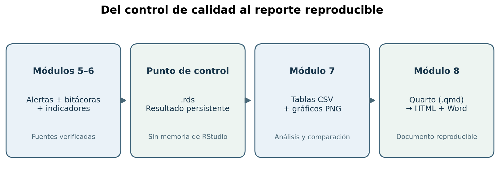

# Guía de estudio y taller guiado: módulos 7 y 8

**Curso:** Evaluación de archivos de datos y automatización de reportes de calidad en R  
**Institución beneficiaria:** Instituto Nacional de Estadística y Censos (INEC)  
**Caso:** encuesta sintética de personas, octubre de 2026  
**Insumo principal:** `data_raw/personas_encuesta_sintetica_2026_10.csv`  
**Modalidad:** explicación conceptual + construcción manual de código en RStudio + verificación y discusión.  
**Duración sugerida:** 2 horas por módulo (4 horas en total).

> **Advertencia metodológica.** El CSV y todos los catálogos son sintéticos. Los controles, reglas y umbrales de los ejercicios no representan políticas oficiales del INEC. No hay autorización institucional de las propuestas de depuración. Nunca modificar el CSV fuente.



## 0. Alineación con las diapositivas

| Diapositivas | Núcleo conceptual | Aplicación en el proyecto |
|---|---|---|
| 16 | Seguimiento antes/después con barras, sin interpretación causal. | Diferencia entre Original y Propuesta. |
| 17 | `dplyr`, `ggplot2` y tablas de incidencias. | Frecuencias, ausencias, indicadores y resúmenes estadísticos. |
| 18 | Documento Quarto `.qmd`. | Narrativa + bloques R + salidas. |
| 19 | Reporte HTML/Word y parámetros. | `quarto render`, `--to` y `-P`. |

Las cifras y colores de las diapositivas son ilustrativos: **las tablas finales se calcularán desde los resultados propios del CSV**, no se copiarán valores de las diapositivas.

## 0. Punto de partida: qué se construyó en los módulos anteriores

En los módulos 5 y 6 se utilizaron los siguientes objetos, cuyo contenido debe **reutilizarse**, no suponerse:

| Objeto en R | ¿Qué contiene? | ¿Para qué servirá? |
|---|---|---|
| `personas_raw` | Archivo original importado como caracteres. | Referencia intacta de los registros. |
| `personas_propuesta` | Copia con normalizaciones didácticas. | Comparación **original/propuesta**, no aprobación. |
| `alertas_logicas` | Eventos L5-01, L5-02 y L5-03, con identificador y regla. | Gráfico de inconsistencias entre variables. |
| `alertas_integridad` | Eventos por claves y vínculos entre hogares y personas. | Tabla y gráfico de integridad. |
| `bitacora_propuesta` | Antes y después, variable, regla, fecha, estado. | Evidencia de trazabilidad de las propuestas. |
| `indicadores_antes` | Tres tasas calculadas en el módulo 6. | Línea base. |
| `indicadores_propuestos` | Tasas del escenario de normalización. | Comparación descriptiva en puntos porcentuales. |

**Condición importante:** los scripts anteriores cargaban datos en memoria y sus exportaciones CSV estaban comentadas como opcionales. Cerrar RStudio sin guardar una salida estructurada puede hacer que esos resultados desaparezcan. Para evitarlo, el nuevo script `06_99_guardar_hitos_para_reporte.R` escribe un archivo `RDS` con todos esos objetos después de que el participante los haya construido.

### 0.1. La estructura esperada del proyecto

```text
INEC_Modulos_7_y_8_Continuacion/
├── calidad_inec_modulos_7_8.Rproj
├── data_raw/
│   ├── personas_encuesta_sintetica_2026_10.csv
│   └── hogares_catalogo_sintetico_2026_10.csv
├── diccionario/
│   ├── diccionario_variables.csv
│   └── catalogo_provincias_didactico.csv
├── R/
│   ├── 00_preparacion.R                         # Módulo anterior
│   ├── 05_01_consistencia_logica_guiado.R      # Módulo anterior (con corrección)
│   ├── 05_02_claves_integridad_guiado.R        # Módulo anterior
│   ├── 06_01_normalizacion_bitacora_guiado.R  # Módulo anterior
│   ├── 06_02_imputacion_escenarios_guiado.R    # Módulo anterior
│   ├── 06_03_indicadores_calidad_guiado.R     # Módulo anterior
│   ├── 06_99_guardar_hitos_para_reporte.R      # Puente de continuidad
│   ├── 07_00_funciones_analisis.R
│   ├── 07_01_tablas_calidad.R
│   ├── 07_02_graficos_calidad.R
│   ├── 07_03_comparacion_entre_archivos_periodos.R
│   ├── 08_01_verificar_precondiciones.R
│   └── 08_02_generar_reportes_opcional.R
├── reportes/
│   └── reporte_calidad.qmd
├── resultados/
│   ├── 01_hitos_modulos_5_6.rds              # Se construye en clase
│   ├── 02_analisis_modulo_7.rds              # Se construye en clase
│   ├── tablas/                              # CSV de resultados
│   └── figuras/                             # Gráficos PNG
├── figuras/                                # Material visual didáctico
└── actividades/                            # Ejercicios y soluciones
```

La carpeta `data_raw/` representa el **origen**, mientras que `resultados/` contiene las **salidas derivadas**. `.Rproj` es el contenedor lógico del proyecto, `.R` contiene instrucciones R, `.rds` guarda objetos de R y `.qmd` define el informe Quarto. Las carpetas de salida empiezan vacías intencionalmente.

### 0.2. Requisitos para completar el taller

1. Tener R, RStudio, Quarto CLI y acceso de escritura a la carpeta del proyecto.
2. Abrir `calidad_inec_modulos_7_8.Rproj`, no únicamente un script aislado desde otra carpeta.
3. Instalar los paquetes de R si aún no están disponibles: `here`, `readr`, `dplyr`, `tidyr`, `ggplot2`, `tibble`, `knitr`; para renderizado desde R, también `quarto`.
4. Completar y comprobar los objetos de los módulos 5 y 6 antes de construir las nuevas tablas.
5. Verificar que `indicadores_antes` y `indicadores_propuestos` tienen las columnas `indicador`, `numerador`, `denominador`, `porcentaje`.
6. Confirmar que las incidencias conservan `fila_csv`, `regla_id` y `severidad` para no perder trazabilidad.
7. No cambiar la definición de una tasa entre escenarios. Toda comparación debe usar la misma regla y unidad de análisis.
8. No publicar el reporte sin comprobar tablas, figuras y estado de cada propuesta.

**Instalación inicial:** escribir una vez en la consola de R, con conexión a internet:

```r
install.packages(c("here", "readr", "dplyr", "tidyr", "ggplot2",
                   "tibble", "knitr", "quarto"))
```

El paquete `quarto` proporciona una interfaz desde R; **no sustituye** a la aplicación independiente Quarto CLI. En la terminal de RStudio, `quarto --version` debe mostrar una versión instalada. Para guardar resultados en HTML no se necesitan cuentas en línea. Word utiliza la salida `docx` de Quarto.

---

# MÓDULO 7. Indicadores, tablas y gráficos de calidad

**Objetivo:** transformar resultados auditables en resúmenes comprensibles, tablas comparativas y visualizaciones que permitan identificar tendencias y prioridades de revisión.

**Resultado de aprendizaje:** el participante podrá distinguir indicadores de calidad, eventos y filas afectadas; construir tablas y gráficos; interpretar cambios entre escenario original y propuesta y reconocer cuándo una comparación temporal no es legítima.

## 7.1. Conceptos fundamentales

### ¿Qué es un indicador de calidad de datos?

Un indicador es una medida calculada a partir de observaciones y reglas definidas previamente. Para que sea verificable debe registrar su **nombre, universo, numerador, denominador, fórmula, unidad y período o versión**.

**Completitud (didáctica):** casillas obligatorias con valor presente divididas para todas las casillas obligatorias evaluadas. Por ejemplo, seis variables obligatorias por 1.500 registros crean 9.000 evaluaciones posibles; el valor definitivo debe calcularse a partir del archivo, nunca suponerse.

**Validez (didáctica):** pruebas que cumplen sus reglas divididas para pruebas aplicables. En el módulo 6 se comprobó dominio de provincia, edad declarada y formato/valor no negativo del ingreso. Los faltantes se excluyen de este denominador de validez y se reflejan en completitud.

**Unicidad (didáctica):** filas con `id_persona` declarado que aparece exactamente una vez divididas para filas con `id_persona` declarado. Una clave ausente no es una clave duplicada: se evalúa en completitud.

**Variación en puntos porcentuales:** porcentaje de la propuesta menos porcentaje original. Ejemplo didáctico: de 91 % a 94 % hay **+3 puntos porcentuales**, no necesariamente un crecimiento relativo de 3 %.

**Incidencia:** evento de una regla que se activa. Una persona puede activar dos reglas, por lo que **10 eventos no significan 10 personas distintas**. Para contar registros afectados se toma la unión de `fila_csv` en ambas tablas de alertas.

**Dimensión y medida:** una dimensión es un concepto (validez, integridad); una medida expresa la operación calculada (número de alertas, tasa de completitud). Los eventos de alerta no constituyen por sí mismos una tasa oficial de consistencia.

### ¿Qué es un gráfico de seguimiento?

Es una visualización que permite interpretar cambios en una medida entre fechas, archivos o escenarios. Antes de compararlos, hay que comprobar que los conjuntos de datos tienen igual significado estadístico, reglas compatibles, unidades comparables y denominadores documentados.

**En este caso hay dos escenarios:** `Original` y `Propuesta`. No son dos períodos. El campo `periodo_referencia` incluye `2026-10` y algunas grafías `2026/10`; la segunda no es un mes adicional. El script 7.3 deja preparada una comparación temporal real, pero **no fabrica un segundo archivo ni datos históricos**.

## 7.2. Paso 0: guardar lo ya logrado — `06_99_guardar_hitos_para_reporte.R`

**Objetivo del script:** convertir los objetos que el estudiante generó manualmente en el módulo 5 y 6 en un punto de control persistente `01_hitos_modulos_5_6.rds`.

**Antes de comenzar:** en la pestaña *Environment* deben observarse `personas_raw`, `personas_propuesta`, `alertas_logicas`, `alertas_integridad`, `bitacora_propuesta`, `indicadores_antes` e `indicadores_propuestos`. Si faltan, reconstruirlos mediante los ejercicios previos; no sustituirlos por números inventados.

**Bloque A — verificar los objetos**:

```r
objetos_necesarios <- c("personas_raw", "personas_propuesta",
  "alertas_logicas", "alertas_integridad", "bitacora_propuesta",
  "indicadores_antes", "indicadores_propuestos")
objetos_faltantes <- objetos_necesarios[
  !vapply(objetos_necesarios, exists, logical(1),
          envir = .GlobalEnv, inherits = FALSE)
]
```

- `c()` crea un vector de nombres de objetos.
- `vapply()` aplica `exists()` a cada nombre y exige como salida un valor lógico; evita resultados de longitud inesperada.
- `exists()` pregunta si el objeto está definido en el entorno señalado.
- `.GlobalEnv` es el espacio de trabajo actual de la sesión de RStudio.
- `!` invierte `TRUE`/`FALSE`, de forma que se seleccionan los objetos que faltan.
- `if` y `stop()` impiden continuar si falta una tabla indispensable.

**Bloque B — proteger integridad entre versiones:** `nrow()` verifica el número de filas; `identical()` comprueba que los identificadores en ambas versiones mantengan el mismo contenido y orden. Es una prueba de seguridad, no un procedimiento de depuración.

**Bloque C — crear una lista y guardar:**

```r
ruta_salida <- here::here("resultados", "01_hitos_modulos_5_6.rds")
dir.create(dirname(ruta_salida), recursive = TRUE, showWarnings = FALSE)
saveRDS(hitos, ruta_salida)
comprobacion <- readRDS(ruta_salida)
```

- `here::here()` construye una ruta relativa desde la raíz del proyecto, evitando `setwd()`.
- `dirname()` devuelve la carpeta padre de un archivo.
- `dir.create()` crea carpetas faltantes; `showWarnings = FALSE` evita avisos innecesarios si ya existen.
- `saveRDS()` serializa el objeto completo (incluidos nombres, tipos y ausencias).
- `readRDS()` lo recupera en una sesión distinta; no requiere tener el objeto abierto desde ayer.

**Actividad de comprobación:** cerrar y volver a abrir RStudio, ejecutar `readRDS(here::here("resultados", "01_hitos_modulos_5_6.rds"))` y verificar `names()` y `nrow()` sin volver a cargar todo el proyecto. No sobrescribir el CSV.

## 7.3. Paso 1: definir funciones de análisis — `07_00_funciones_analisis.R`

Este script **no genera salidas**. Define funciones que utilizarán otros scripts y el informe.

### A. `normalizar_ausencia(x)`

Objetivo: tratar los marcadores vacíos, `NA`, `N/D`, `SIN DATO` como ausencias en memoria. `trimws()` quita espacios de los extremos; `toupper()` convierte a mayúsculas para evaluar variantes; `as.character()` conserva una comparación textual uniforme. **No convierte el cero numérico en ausente.**

### B. `validar_hitos(hitos)`

Objetivo: revisar la estructura antes del análisis. `names()` recupera nombres de objetos y columnas, `setdiff()` encuentra los esperados que faltan, `all()` comprueba si todas las condiciones son verdaderas, `stop()` detiene un análisis incompleto. Valida que el número de filas original y propuesta coincidan y que las tablas de alertas e indicadores tengan las columnas requeridas.

### C. `calcular_indicadores_compatibles(datos, catalogo_provincias)`

Objetivo: ofrecer una definición coherente con el módulo 6 cuando se disponga de otro archivo. **No sustituye los indicadores existentes de los módulos anteriores.**

- `length(requeridas) * nrow(datos)` calcula el denominador de completitud.
- `vapply()` recorre los campos obligatorios y suma casillas presentes con `sum(!is.na(...))`.
- `grepl()` comprueba patrones de edad o ingreso utilizando expresiones regulares.
- `as.numeric()` transforma cadenas numéricas; `suppressWarnings()` no soluciona el error de lectura, solo permite identificarlo como `NA` sin inundar la consola.
- `duplicated()` y `duplicated(..., fromLast=TRUE)` comprueban si una clave aparece más de una vez en cualquier posición del archivo.
- `round(100 * numerador / denominador, 2)` expresa el resultado como porcentaje con dos decimales; no redondear antes de calcular la tasa.

**Precaución sobre comparabilidad:** si el diccionario, los límites o el universo cambian, una diferencia temporal podría responder a esos cambios metodológicos, no a una mejora real de los datos.

### D. `construir_analisis(hitos)`

Es el centro del módulo 7. Recibe todas las salidas anteriores y devuelve una **lista de tablas**, con nombres:

| Resultado | Uso |
|---|---|
| `indicadores_long` | Una fila por indicador y escenario; ideal para `ggplot2`. |
| `indicadores_ancho` | Una fila por indicador y varias columnas: porcentajes antes/propuesta y diferencia en pp. |
| `incidencias` | Alertas agrupadas por origen, regla y severidad. |
| `cobertura_alertas` | Eventos totales, filas únicas afectadas y tamaño del archivo. |
| `faltantes` | Ausencias absolutas y relativas de seis campos obligatorios. |
| `resumen_numericos` | Media, mediana, cuartiles y registros no evaluables de edad e ingreso. |
| `bitacora_resumen` | Cantidad de cambios propuestos por campo y estado. |
| `periodos` | Frecuencia de textos de período y clasificación de formato. |

**Funciones empleadas:**

```r
indicadores_long <- dplyr::bind_rows(
  dplyr::mutate(hitos$indicadores_antes, escenario = "Original"),
  dplyr::mutate(hitos$indicadores_propuestos, escenario = "Propuesta")
)
```

- `mutate()` añade una columna para saber de qué escenario proviene cada valor.
- `bind_rows()` une verticalmente tablas con columnas equivalentes.
- La estructura *larga* permite que `ggplot()` utilice la columna `escenario` como categoría visual.

```r
indicadores_ancho <- indicadores_long |>
  tidyr::pivot_wider(id_cols = "indicador", names_from = "escenario",
                     values_from = c("numerador", "denominador", "porcentaje"),
                     names_glue = "{.value}_{escenario}") |>
  dplyr::mutate(variacion_pp = porcentaje_Propuesta - porcentaje_Original)
```

- `|>` pasa un resultado a la siguiente función; cumple una función similar a `%>%`, pero pertenece a R base moderno.
- `pivot_wider()` convierte categorías de una columna en columnas nuevas, útil para comparación lado a lado.
- `names_glue` da nombres como `porcentaje_Original` y `porcentaje_Propuesta`.
- `variacion_pp` **resta** porcentajes; no se debe interpretar como un aumento relativo porcentual.

La cobertura de alertas usa `union()` para fusionar los índices de filas de ambos módulos y `unique()` para evitar contar dos veces la misma fila. Cada incidencia conserva el nombre de su regla: si una fila incumple varias reglas, se mantiene cada evento en el informe.

La tabla de períodos utiliza `grepl("^[0-9]{4}-(0[1-9]|1[0-2])$", periodo_referencia)`: la expresión exige cuatro dígitos, un guion y un mes de 01 a 12. `2026/10` queda marcado para revisión, **no** se convierte silenciosamente en `2026-10`.

## 7.4. Paso 2: tablas comparativas — `07_01_tablas_calidad.R`

**Objetivo:** construir tablas con valores calculados, revisar hallazgos y exportarlas sin modificar fuentes.

**Orden de construcción manual:**

1. `library(here)`, `library(dplyr)`, `library(tidyr)` y `library(readr)` cargan funciones de rutas, manipulación y exportación.
2. `source(here::here("R", "07_00_funciones_analisis.R"))` lee y define las funciones auxiliares del paso anterior.
3. `file.exists(ruta_hitos)` confirma que el punto de control está presente; si falta, se detiene el script con un mensaje útil.
4. `hitos <- readRDS(ruta_hitos)` restaura todas las salidas de módulos 5 y 6 desde un único archivo.
5. `analisis <- construir_analisis(hitos)` calcula las tablas del módulo 7 de forma consistente.
6. `print(analisis$indicadores_ancho)` permite revisar numeradores, denominadores y variación; es un paso **obligatorio de interpretación**, no solo una impresión de consola.
7. `write_csv()` guarda cada tabla en un CSV derivado bajo `resultados/tablas/`.
8. `saveRDS()` conserva además la lista completa `analisis` en `resultados/02_analisis_modulo_7.rds`, para que Quarto la use en otra sesión.

**Diferencia entre `write_csv()` y `saveRDS()`:** `write_csv()` crea un archivo tabular legible por otras aplicaciones, pero no conserva todas las clases y atributos de R. `saveRDS()` conserva las estructuras de R para reutilizarlas sin cambios innecesarios. Ambos son salidas derivadas; ninguno sobrescribe `data_raw/`.

**Estadísticos descriptivos adicionales:** el mismo script exporta `07_estadisticos_descriptivos.csv` con `media()`, `median()` y `quantile()` sobre edad e ingreso. En R los nombres reales de las funciones son `mean()`, `median()` y `quantile()`. `mean()` es sensible a extremos, `median()` expresa el centro de los datos ordenados y `quantile(x, 0.25)` / `quantile(x, 0.75)` calculan el primer y tercer cuartil. Los registros ausentes, no convertibles o fuera del dominio didáctico se cuentan por separado; **un ingreso alto no se elimina por ser raro**. Los ceros se conservan como observaciones, no como valores faltantes.

**Interpretación docente de la tabla:** exigir que el participante explique por qué un indicador puede mantener el mismo denominador y cambiar el numerador después de normalizar etiquetas; qué implica que la unicidad permanezca constante; y por qué una alerta de integridad no confirma automáticamente un dato incorrecto.

## 7.5. Paso 3: gráficos descriptivos — `07_02_graficos_calidad.R`

Este archivo recibe los resultados de `07_01` y genera tres imágenes PNG en `resultados/figuras`.

### A. Gráfico de barras agrupadas: indicadores

```r
g_indicadores <- ggplot(a$indicadores_long,
                        aes(x = indicador, y = porcentaje, fill = escenario)) +
  geom_col(position = position_dodge(width = 0.75), width = 0.65) +
  coord_cartesian(ylim = c(0, 105)) +
  labs(title = "Indicadores de calidad: original y propuesta",
       x = NULL, y = "Porcentaje", fill = "Escenario") +
  theme_minimal()
```

- `ggplot(datos, aes(...))` crea la estructura de un gráfico. `aes` asigna columnas a posiciones, colores o tamaños.
- `geom_col()` dibuja barras con la altura que ya existe en `porcentaje`. A diferencia de `geom_bar()` predeterminado, no vuelve a contar registros.
- `fill = escenario` muestra con categorías visuales distintas la versión original y la propuesta.
- `position_dodge()` separa barras de un mismo indicador, evitando superposición.
- `coord_cartesian(ylim=...)` ajusta la ventana de visualización sin cambiar los porcentajes originales.
- `geom_text()` agrega etiquetas, mediante otra capa en el script completo.
- `labs()` define título, subtítulo, ejes y leyenda; `theme_minimal()` mejora legibilidad.

### B. Gráfico horizontal: alertas por regla

El segundo gráfico representa `a$incidencias`. Usa `reorder(regla_id, incidencias)` para ordenar categorías y `coord_flip()` para disponer las reglas en el eje vertical. El objetivo es identificar cuáles reglas generan más eventos de revisión, no clasificar automáticamente la gravedad de los datos.

### C. Gráfico horizontal: ausencias por variable

El tercer gráfico toma `a$faltantes`: muestra cuántas celdas están ausentes en cada campo requerido. La altura de cada barra se basa en `ausencias`, no en porcentajes. No debe confundirse con una tabla de valores numéricos fuera de rango.

### D. Guardar una figura para Quarto

```r
ggsave(file.path(carpeta_figuras, "07_indicadores_escenarios.png"),
       plot = g_indicadores, width = 9, height = 5.5, dpi = 170)
```

`file.path()` une los componentes de una ruta de forma compatible con el sistema operativo. `ggsave()` guarda el objeto gráfico. `width` y `height` corresponden al tamaño físico en pulgadas (salvo que se especifique otra unidad); `dpi` es la resolución en píxeles por pulgada. Word y HTML utilizarán la misma figura generada a partir de las tablas validadas.

**Pregunta de aula:** si una regla tiene 20 eventos y otra 15, ¿hay 35 personas diferentes? No necesariamente: una misma fila podría ser contabilizada por ambas reglas. Explique cómo comprobarlo mediante la unión de `fila_csv`.

## 7.6. Paso 4: comparación entre archivos y períodos — `07_03_comparacion_entre_archivos_periodos.R`

La comparación temporal solo puede realizarse si existe **un segundo CSV real** con esquema y método compatibles. En el script, `segundo_csv <- ""` significa **no comparar**. El participante debe reemplazar esa cadena por una ruta válida y verificar su procedencia.

```r
segundo_csv <- ""
if (!nzchar(segundo_csv)) {
  message("No hay segundo archivo. Se conserva la comparación Original/Propuesta.")
}
```

- `nzchar()` responde si una cadena tiene al menos un carácter.
- `if` activa la comparación únicamente cuando se proporcionó una ruta.
- `message()` informa un estado, sin tratar la ausencia del segundo archivo como error.

Si hay segundo archivo, se importa como texto con `read_csv()` y se evalúa con **las mismas definiciones** mediante `calcular_indicadores_compatibles()`. Se verifica que contenga un período válido diferente a `2026-10` y que no haya múltiples períodos sin desagregar. `stop()` evita reportar comparaciones mal etiquetadas.

### Reglas para comparar responsablemente

- Misma unidad de observación y población objetivo o advertencia de diferencias.
- Mismos diccionarios de variables, dominios y controles, o documentación de cambios.
- Igual tratamiento de ausencias y denominadores.
- No confundir *comparación entre versiones* con *evolución en el tiempo*.
- No inferir causalidad de dos porcentajes observados.

**Actividad:** el docente puede entregar un segundo archivo sintético válido creado para otra fecha; los participantes deberán documentar compatibilidad y solo entonces ejecutar el script. En el paquete actual no se añade un período ficticio extra.

---

# MÓDULO 8. Generación automática de reportes con Quarto

**Objetivo:** construir un informe reproducible que combine texto metodológico, cálculos existentes, tablas, figuras y conclusiones interpretadas, produciendo salidas HTML y Word.

**Producto esperado:** `reportes/reporte_calidad.qmd` como fuente y, al renderizar en el equipo del participante, `reportes/reporte_calidad.html` y `reportes/reporte_calidad.docx`.

## 8.1. Conceptos esenciales

### ¿Qué es Quarto?

Quarto es un sistema de publicación de documentos computacionales: combina Markdown, código ejecutable y una configuración de salida. Un archivo `.qmd` es texto editable; el motor de R (`knitr`) evalúa bloques de código y la herramienta de publicación crea el documento HTML o Word. Quarto no sustituye la necesidad de tener R, paquetes y archivos de datos correctamente instalados.

### ¿Qué significa que un informe sea reproducible?

Que otra persona pueda generar las mismas tablas y figuras con las mismas entradas, reglas, versiones de software y parámetros. Para lograrlo, el informe debe cargar resultados guardados desde disco mediante rutas estables, no depender de variables existentes por casualidad en el panel *Environment*.

### Distinción entre formatos

- **`.R`:** script con instrucciones; prepara datos y crea gráficos.
- **`.Rproj`:** archivo del proyecto RStudio que organiza trabajo y rutas.
- **`.rds`:** guarda objetos de R con sus tipos y atributos.
- **`.qmd`:** documento fuente Quarto que combina narrativa, tablas y gráficos.
- **`.html`:** informe para navegador web.
- **`.docx`:** informe editable en Word.

## 8.2. Paso 1: validar dependencias — `08_01_verificar_precondiciones.R`

**Antes de renderizar:** ejecutar en RStudio este script de verificación.

- `requireNamespace(paquete, quietly = TRUE)` comprueba si un paquete está disponible sin adjuntarlo a la búsqueda de funciones.
- `vapply()` revisa cada nombre del vector de dependencias, devolviendo TRUE/FALSE.
- `Sys.which("quarto")` busca en el sistema el ejecutable Quarto. Si no aparece, instalar el programa Quarto CLI y revisar el `PATH`.
- `file.exists()` verifica el punto de control anterior, el resumen del módulo 7 y el documento `.qmd`.
- `stop()` impide continuar con archivos incompletos o inconsistentes.

**Comprobación de terminal:**

```bash
quarto --version
quarto check
```

El primer comando muestra la versión; el segundo permite revisar componentes disponibles. Se ejecutan en la **Terminal** del sistema o de RStudio, no como instrucciones dentro de la consola R.

## 8.3. Paso 2: crear el archivo `.qmd`

En RStudio: **File > New File > Quarto Document**. También puede abrir y editar la plantilla incluida `reportes/reporte_calidad.qmd`.

### A. Encabezado YAML

```yaml
---
title: "Informe técnico de calidad de archivos estadísticos"
format:
  html:
    toc: true
    number-sections: true
    embed-resources: true
  docx:
    toc: true
    number-sections: true
params:
  periodo: "2026-10"
---
```

- `---` abre y cierra el encabezado YAML.
- `title` establece el título visible.
- `format` declara formatos de salida; `html` permite visualizar en navegador y `docx` en Word.
- `toc: true` genera un índice; `number-sections: true` numera las secciones.
- `embed-resources: true` incorpora recursos en el HTML, facilitando compartirlo.
- `params` define parámetros de entrada: el período que se presentará en el informe. **Cambiar el texto del período no crea registros nuevos.**

### B. Primer bloque de código y configuración

````text
```{r}
#| label: preparar-entrada
#| include: false
library(here)
library(dplyr)
library(knitr)
a <- readRDS(here::here("resultados", "02_analisis_modulo_7.rds"))
```
````

- Las marcas ` ```{r} ` y ` ``` ` delimitan un bloque ejecutable de código R dentro de Quarto.
- `#| label:` identifica el bloque, útil para ubicar fallos.
- `#| include: false` ejecuta el bloque sin mostrar su código ni sus resultados en el informe.
- `library()` carga paquetes; `readRDS()` recupera los resultados calculados en el módulo 7.

En la plantilla completa se comprueba que el archivo exista y que el parámetro de período coincida con el período válido del conjunto de trabajo. Es mejor que el renderizado falle de manera visible antes de publicar un informe incorrecto.

### C. Insertar un resultado numérico dentro de la narrativa

Es posible escribir en Markdown un texto como:

```text
El conjunto contiene **`r a$metadata$n_registros` registros**.
```

La expresión delimitada por `` `r ...` `` es código R *en línea*. Al renderizar, Quarto sustituye esa expresión por el valor real que se cargó desde el archivo RDS. Si cambia el dataset y se recalculan los resultados, el número se actualiza sin escribirlo manualmente.

## 8.4. Paso 3: crear una tabla dentro del informe

```r
indicadores_para_reporte <- a$indicadores_ancho |>
  dplyr::transmute(
    Indicador = indicador,
    `Original (%)` = porcentaje_Original,
    `Propuesta (%)` = porcentaje_Propuesta,
    `Variación (pp)` = round(variacion_pp, 2)
  )
knitr::kable(indicadores_para_reporte,
             caption = "Indicadores de calidad por escenario")
```

- `transmute()` crea una nueva tabla solo con las columnas seleccionadas o calculadas, dejando fuera los campos no requeridos para presentación.
- Los nombres entre acentos graves (backticks) permiten incluir espacios, tildes y símbolos en los títulos de columnas.
- `round()` redondea el valor presentado, no modifica la tasa base.
- `knitr::kable()` crea una tabla compatible con HTML y Word; `caption` añade su título.

Se puede utilizar `gt::gt()` en otros ejercicios para construir tablas visualmente más sofisticadas, pero aquí se usa `knitr::kable()` para facilitar la salida en ambos formatos.

## 8.5. Paso 4: insertar gráficos calculados previamente

```r
knitr::include_graphics(
  here::here("resultados", "figuras", "07_indicadores_escenarios.png")
)
```

`knitr::include_graphics()` incorpora una imagen existente como figura del informe, sin reconstruirla con datos diferentes. Si falta el PNG, la plantilla detiene la ejecución, indicando que primero hay que completar el paso 7.2.

Para añadir un título de figura, en la cabecera del bloque se utiliza:

```text
#| fig-cap: "Comparación de indicadores en dos escenarios"
#| out-width: "100%"
```

`fig-cap` define el pie de figura; `out-width` controla el tamaño relativo de salida. Para un informe de Word, conviene revisar la legibilidad de etiquetas, los saltos de página y el tamaño de las imágenes.

## 8.6. Paso 5: redactar conclusiones basadas en datos

Una conclusión debe diferenciar **observación, interpretación, limitación y decisión**. Ejemplo de estructura:

> Observación: la tabla muestra una variación de [valor calculado] puntos porcentuales en validez. Interpretación: la propuesta estandariza ciertas etiquetas registradas. Limitación: las reglas y diccionarios son didácticos. Decisión: la propuesta no se adopta sin revisión metodológica y bitácora de aprobación.

La plantilla genera automáticamente frases sobre aumento, disminución o ausencia de cambio. Pero el instructor debe enseñar que automatizar un párrafo **no sustituye el juicio estadístico**. No se deben prometer mejoras de calidad real solo por una cifra positiva.

## 8.7. Paso 6: ejecutar el renderizado

Desde la **Terminal de RStudio**, ubicada en la raíz del proyecto:

```bash
quarto render reportes/reporte_calidad.qmd --to html
quarto render reportes/reporte_calidad.qmd --to docx
quarto render reportes/reporte_calidad.qmd --to html -P periodo:2026-10
```

- `quarto render` solicita la creación del documento a partir del `.qmd`.
- `--to html` genera salida web; `--to docx` genera un documento Word.
- `-P periodo:2026-10` define un valor de parámetro para la ejecución.

También se incluye `R/08_02_generar_reportes_opcional.R`, que utiliza `quarto::quarto_render()` desde la consola de R después de instalar el paquete `quarto` y Quarto CLI.

**Secuencia de la práctica:** renderizar primero HTML, inspeccionar tablas y gráficos, ajustar la redacción y después renderizar Word. La instrucción genera los documentos al ejecutar los comandos en el ordenador del participante; no se han generado de antemano.

## 8.8. Paso 7: verificar resultados antes de distribuir

Use la siguiente lista de cotejo:

- [ ] Se utilizó exactamente el CSV acordado, sin sobrescribirlo.
- [ ] El punto de control RDS contiene los resultados de módulos 5 y 6.
- [ ] La tabla de indicadores mantiene numeradores y denominadores auditables.
- [ ] El gráfico de indicadores concuerda con las cifras de la tabla.
- [ ] Las alertas se distinguen de las filas únicas afectadas.
- [ ] La bitácora describe **propuestas**, no modificaciones aprobadas.
- [ ] El período mostrado coincide con los archivos; formatos atípicos están señalados.
- [ ] HTML y Word contienen los mismos indicadores, figuras y conclusiones.
- [ ] Se ha revisado el documento final antes de compartirlo.
- [ ] No aparecen datos personales reales ni salidas fuera de las políticas aplicables.

---

# Glosario de funciones: qué hacen, cuándo y por qué

| Función u operador | Qué hace | Propósito en el taller |
|---|---|---|
| `library()` | Adjunta un paquete instalado. | Habilitar dplyr, ggplot2, etc. |
| `requireNamespace()` | Comprueba disponibilidad sin adjuntar paquete. | Validación previa al informe. |
| `source()` | Lee y evalúa código de otro archivo `.R`. | Reutilizar funciones ya definidas. |
| `here::here()` | Construye rutas desde la raíz del proyecto. | Evitar rutas absolutas de Windows. |
| `file.exists()` | Comprueba existencia de un archivo. | No renderizar sin entradas. |
| `dir.create()` | Crea un directorio. | Preparar carpetas `resultados`. |
| `saveRDS()` | Guarda un objeto R en disco. | Persistir resultados de módulos 5–6. |
| `readRDS()` | Lee un archivo RDS. | Recuperar los mismos objetos. |
| `readr::write_csv()` | Exporta una tabla como CSV. | Compartir indicadores y alertas. |
| `readr::read_csv()` | Importa texto CSV en una tabla. | Leer un segundo período autorizado. |
| `function()` | Define operaciones reutilizables. | Centralizar las reglas de cálculo. |
| `vapply()` | Aplica función con tipo de resultado esperado. | Contar NA por variable de manera segura. |
| `exists()` | Comprueba si un objeto está definido. | Revisar continuidad entre módulos. |
| `names()` | Lista nombres de columnas u objetos. | Verificar estructura. |
| `nrow()` | Cuenta filas. | Conocer universo y controles. |
| `length()` | Cuenta elementos de vector. | Dimensionar denominadores e índices. |
| `is.na()` | Detecta valores ausentes. | Definir completitud. |
| `trimws()` | Elimina espacios extremos. | Normalizar marcadores de ausencia. |
| `toupper()` | Convierte texto a mayúsculas. | Homogeneizar comparaciones. |
| `grepl()` | Detecta si un texto cumple un patrón. | Comprobar formato `AAAA-MM`. |
| `duplicated()` | Identifica apariciones repetidas. | Definir unicidad. |
| `union()` | Une valores de dos vectores eliminando repetidos. | Contar filas con alguna alerta. |
| `unique()` | Extrae valores distintos. | No duplicar filas alertadas. |
| `setdiff()` | Obtiene elementos del primer conjunto ausentes en el segundo. | Detectar columnas faltantes. |
| `all()` | TRUE si todos los elementos son verdaderos. | Verificar requisitos. |
| `any()` | TRUE si al menos un elemento es verdadero. | Detectar inconsistencias graves. |
| `stop()` | Detiene la ejecución con un mensaje. | No producir informes inválidos. |
| `message()` | Emite información de estado. | Explicar que no existe segundo período. |
| `c()` | Combina elementos en un vector. | Listas de variables y paquetes. |
| `list()` | Agrupa distintos objetos. | Guardar tablas juntas en RDS. |
| `dplyr::mutate()` | Añade/modifica columnas. | Etiquetar escenarios. |
| `dplyr::transmute()` | Crea una tabla de columnas seleccionadas/calculadas. | Presentación limpia en reportes. |
| `dplyr::bind_rows()` | Une tablas por filas. | Consolidar escenarios y alertas. |
| `dplyr::count()` | Agrupa y cuenta combinaciones. | Total de eventos por regla. |
| `dplyr::arrange()` | Ordena filas. | Presentar incidencias. |
| `dplyr::select()` | Selecciona columnas. | Crear tablas finales. |
| `tidyr::pivot_wider()` | Pasa de formato largo a ancho. | Escenarios en columnas. |
| `|>` | Conduce un resultado a la siguiente operación. | Construir pipelines legibles. |
| `mean()` | Promedio aritmético. | Resumir ingreso y edad con cautela ante extremos. |
| `median()` | Valor central de la distribución. | Comparar con la media. |
| `quantile()` | Calcula cuantiles (p25 y p75). | Examinar dispersión central. |
| `floor()` | Trunca hacia el entero inferior. | Comprobar edad entera en regla didáctica. |
| `ggplot()` | Define gráfico y datos. | Diagramas estadísticos. |
| `aes()` | Asigna variables a ejes y estética. | Representar indicadores y categorías. |
| `geom_col()` | Dibuja barras con valores precomputados. | Visualizar porcentajes/conteos. |
| `geom_text()` | Coloca etiquetas sobre un gráfico. | Leer cifras sin estimaciones visuales. |
| `position_dodge()` | Separa barras por grupo. | Comparar dos escenarios. |
| `coord_flip()` | Invierte orientación de ejes. | Mostrar listas de reglas largas. |
| `coord_cartesian()` | Ajusta ventana de visualización. | Escala de tasas sin eliminar observaciones. |
| `labs()` | Asigna títulos y etiquetas. | Comunicabilidad del gráfico. |
| `theme_minimal()` | Usa estilo visual simple. | Presentación limpia. |
| `ggsave()` | Guarda imagen de un gráfico. | Reutilizarla en Quarto. |
| `knitr::kable()` | Formatea tablas en documentos. | HTML y Word. |
| `knitr::include_graphics()` | Inserta un archivo gráfico. | Reporte reproducible. |
| `quarto::quarto_render()` | Llama al motor de Quarto desde R. | Generar formatos de informe. |

---

# Taller de integración: cómo comprobar que el proyecto funciona

| Orden | Script | Dependencia principal | Salida esperada | Criterio de éxito |
|---:|---|---|---|---|
| 1 | Módulos 5 y 6 anteriores | CSV y diccionario | Objetos en memoria | Las tablas muestran casos reales del CSV. |
| 2 | `06_99_guardar_hitos_para_reporte.R` | Objetos de 5–6 | `01_hitos_modulos_5_6.rds` | `readRDS()` los restaura correctamente. |
| 3 | `07_00_funciones_analisis.R` | Paquetes R | Funciones en memoria | No cambia el dataset ni escribe archivos. |
| 4 | `07_01_tablas_calidad.R` | RDS de hitos | Tablas CSV y `02_analisis_modulo_7.rds` | Hay numerador, denominador y porcentaje consistentes. |
| 5 | `07_02_graficos_calidad.R` | RDS de módulo 7 | Tres archivos PNG | Cada barra corresponde a una tabla de origen. |
| 6 | `07_03_comparacion_entre_archivos_periodos.R` | Segundo CSV, solo si existe | Comparación temporal opcional | No inventa un segundo período. |
| 7 | `08_01_verificar_precondiciones.R` | R, paquetes, Quarto y resultados | Diagnóstico de requisitos | No faltan dependencias ni archivos. |
| 8 | `reporte_calidad.qmd` | RDS y figuras | Informe fuente reproducible | Abre desde RStudio y sus bloques se pueden revisar. |
| 9 | `08_02_generar_reportes_opcional.R` o Terminal | Quarto CLI | HTML y DOCX | Ambos abren y contienen cifras coincidentes. |

## Incidencias frecuentes y sus soluciones

**`could not find function "%>%"`**: no se cargó `dplyr`. Ejecute `library(dplyr)`; los scripts nuevos emplean preferentemente `|>`.

**`Faltan resultados de los módulos 5 y 6`**: aún no se han creado todos los objetos. Reconstruya el módulo anterior, valide sus resultados y ejecute el puente de guardado.

**`Can't extract column with variable`**: se produce en una versión anterior de `crear_alerta` al usar `variable` a la vez como argumento y nombre de columna dentro de `tibble()`. En el paquete se corrigió calculando `valores_detectados` **antes** de llamar a `tibble()`.

**`01_hitos_modulos_5_6.rds` no existe**: ejecutar `06_99_guardar_hitos_para_reporte.R` después de construir los objetos anteriores.

**`02_analisis_modulo_7.rds` no existe**: ejecutar `07_01_tablas_calidad.R` y revisar si aparece alguna advertencia o error.

**`could not find function 'quarto_render'`**: la interfaz pertenece al paquete `quarto`; instalarlo y llamarlo como `quarto::quarto_render()`. Además, se necesita Quarto CLI.

**`quarto: command not found`**: Quarto CLI no está instalado o su ejecutable no está en el PATH; instalarlo y abrir una nueva terminal.

**`file not found` durante Render**: revisar que las rutas se construyan con `here::here()` desde el `.Rproj`, y generar los archivos del módulo 7 antes de intentar publicar.

**Word presenta los gráficos muy pequeños**: revisar dimensiones al guardar con `ggsave()` y configuración `fig-cap`/`out-width` en el `.qmd`.

**Se ve 2026/10 como nuevo período**: no tratarlo como dato temporal independiente; es una forma no conforme del período del archivo y requiere revisión antes de cualquier comparación.

## Actividades prácticas recomendadas

1. Crear el punto de control `.rds` y restaurarlo después de reiniciar RStudio; registrar los nombres y dimensiones de sus objetos.
2. Explicar, con numerador y denominador, tres indicadores existentes y calcular su variación absoluta en puntos porcentuales.
3. Obtener el total de alertas y el total de filas distintas alertadas; justificar por qué los resultados difieren.
4. Construir una tabla que combine la variable, la cantidad y el porcentaje de ausencias sobre 1.500 filas.
5. Crear tres gráficos: indicadores, incidencias por regla y ausencias por campo; escribir una interpretación de cada uno.
6. Identificar y registrar el formato no conforme `2026/10` sin inventar un período adicional.
7. Crear un documento Quarto, insertar una tabla con `kable()` y un gráfico previamente guardado; generar HTML y Word.
8. Revisar si las conclusiones se apoyan en las cifras y si la propuesta se identifica claramente como pendiente de aprobación.

La sección `actividades/` contiene el cuaderno para participantes y la solución orientativa para docentes.

## Fuentes técnicas complementarias

- Quarto. *Tutorial: Hello, Quarto*: https://quarto.org/docs/get-started/hello/rstudio.html
- Quarto. *Parameters*: https://quarto.org/docs/computations/parameters.html
- Quarto. *Word Basics*: https://quarto.org/docs/output-formats/ms-word.html
- Quarto. *Using R*: https://quarto.org/docs/computations/r.html
- R for Data Science (2e): https://r4ds.hadley.nz/
- Documentación de `ggplot2`: https://ggplot2.tidyverse.org/

**Alcance de la entrega:** se proporcionan los archivos fuente del proyecto, la guía y el código de construcción. El informe final HTML/DOCX se obtiene al ejecutar Quarto en el entorno del participante después de validar las entradas; los archivos no se han renderizado previamente.
